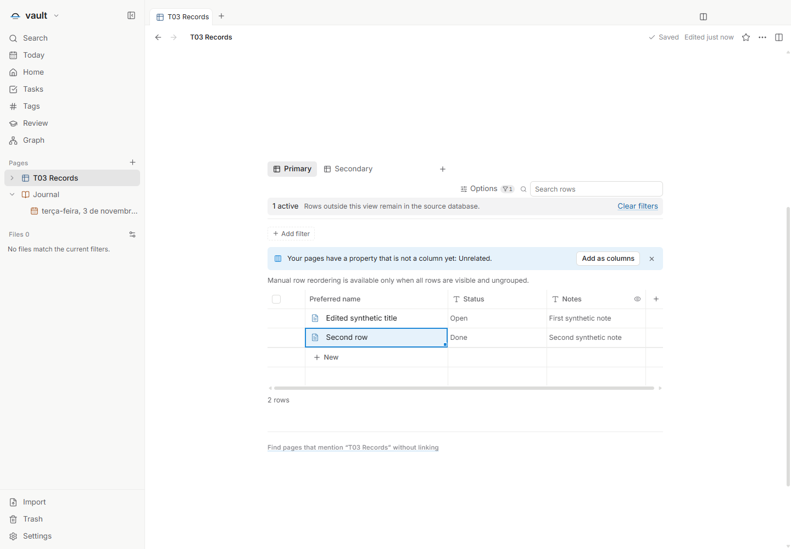
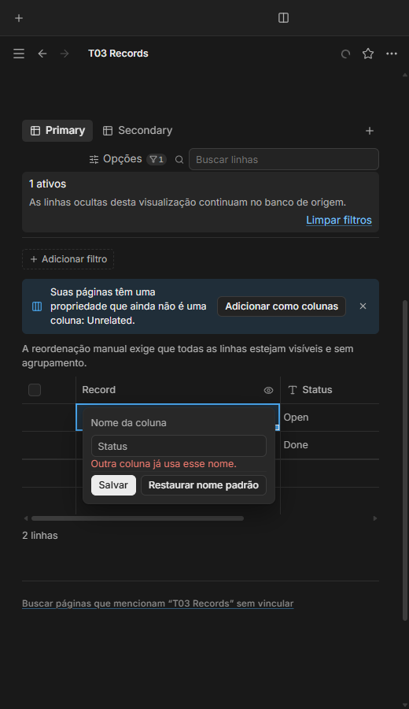
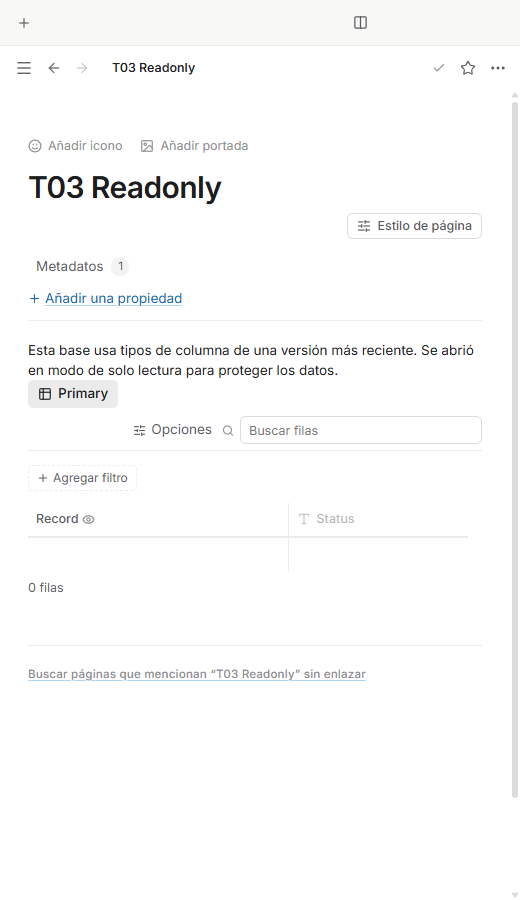

# Nome e propriedade de exibição — T03

Issue: [#54](https://github.com/hodeliun/Morrow/issues/54).
Base oficial: Morrow 1.3.0.

## Comportamento

O cabeçalho Nome pode receber um rótulo próprio sem duplicar os títulos das
páginas. Editar uma célula dessa coluna continua usando a operação normal de
renomear a página, preservando seu ID e o corpo do documento.

O banco pode escolher outra propriedade para exibição e voltar a Nome pelo menu,
com indicador acessível. O padrão do banco é distinto de um override explícito
de relação. Uma propriedade comum pode ser removida pelo menu de contexto, com
identificação do alvo; Nome permanece obrigatório e sua remoção fica indisponível
com explicação.

Para usar, abra o menu do cabeçalho por botão direito ou pelo teclado e escolha
a ação de renomear. O rótulo não pode colidir com uma propriedade existente.
No menu da coluna desejada, escolha seu uso como exibição; o olho identifica a
escolha. Use novamente Nome para restaurar a projeção do título. Nas relações,
a opção de herdar o padrão do banco é diferente de escolher uma coluna explícita.

## Compatibilidade dos dados

Esta entrega exige a primeira publicação do formato persistido 13, distinto da
versão oficial Morrow 1.3.0. A fundação inclui todos os contratos de leitura,
normalização, serialização, migração e operações de cópia/recuperação dos campos
definidos para esse formato. Isso evita publicar um leitor 13 intermediário que
descarte campos do mesmo formato. As interfaces de outros tickets continuam
separadas e não são declaradas entregues por essa fundação.

Notas antigas devem abrir sem regravação apenas para adicionar os novos campos.
A migração IndexedDB de 12 para 13 atualiza os metadados de versão preservando
os registros originais. Ausência, `null`, zero e `false` mantêm suas distinções;
versões futuras são rejeitadas com segurança. Um padrão de exibição legado
explicitamente `null` continua válido e editável, sem escrita ao apenas abrir;
valores inválidos continuam protegidos. Contratos: [formato 13](../SCHEMA-13.md).

## Verificação

O recorte isolado T03 passou `npm run check`: 965 testes em 119 arquivos, tipos,
lint e compilação. Os 3.597 artefatos do pacote conferem com o snapshot testado.
Os cenários principal e complementar passaram na aplicação isolada no Windows,
incluindo os seis critérios, português/inglês/espanhol, temas claro/escuro e
viewport de 520 px.

O rótulo alterou apenas o metadado do banco, sem criar uma segunda propriedade
de título. A renomeação normal manteve o ID da página, o corpo e a identidade
após reabrir. O olho de exibição e a restauração de Nome passaram; a remoção da
propriedade comum identificou o alvo e reteve os valores anteriores em YAML
extra, preservando títulos, IDs, visualizações, filtros e campos desconhecidos.
A remoção de Nome ficou indisponível com explicação traduzida.

As relações com padrão herdado acompanharam as mudanças do banco; as com
override explícito mantiveram sua escolha, inclusive após processo novo. O caso
somente leitura manteve bytes e horários de modificação, sem controles de edição
da coluna. Os quatro processos finais saíram normalmente; não houve erro de
página nem tela genérica de falha.

A fundação do formato 13 foi verificada nos caminhos de migração, normalização,
Markdown, backup, importação, clipboard estruturado, duplicação, planos de criação
e recuperação de salvamento parcial, incluindo `false` explícito. O caso legado
de exibição `null` passou por leitura e abertura/fechamento sem escrita no arquivo.
Valores inválidos continuam protegidos; a versão futura 14 é rejeitada.

Os resultados negativos anteriores foram preservados: adaptações de tipagem,
uma expectativa antiga de versão e três timeouts de I/O que não se repetiram
nas suítes focadas nem nas verificações completas seguintes, sem alterar prazos
ou configuração. A compilação anterior passou nos testes, mas foi rejeitada na
revisão de compatibilidade por tornar o padrão legado `null` somente leitura;
esse caso foi corrigido e verificado antes de executar a interface final.

Resultados, hashes e limites: [registro verificável](T03-validation.json).
Esta é uma entrega de código, sem instalador, release ou migração de um perfil
pessoal. As interfaces dos outros controles e da aparência por nota não são
declaradas entregues aqui.

## Demonstrações sintéticas

O rótulo Preferred name continua representando títulos de páginas; o olho indica
que Notes foi escolhido para exibição.

O painel mantém o diagnóstico e as ações dentro da janela estreita.

O rótulo e o indicador continuam visíveis sem oferecer edição da coluna.
