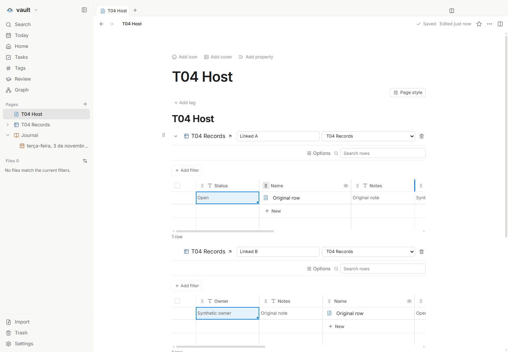
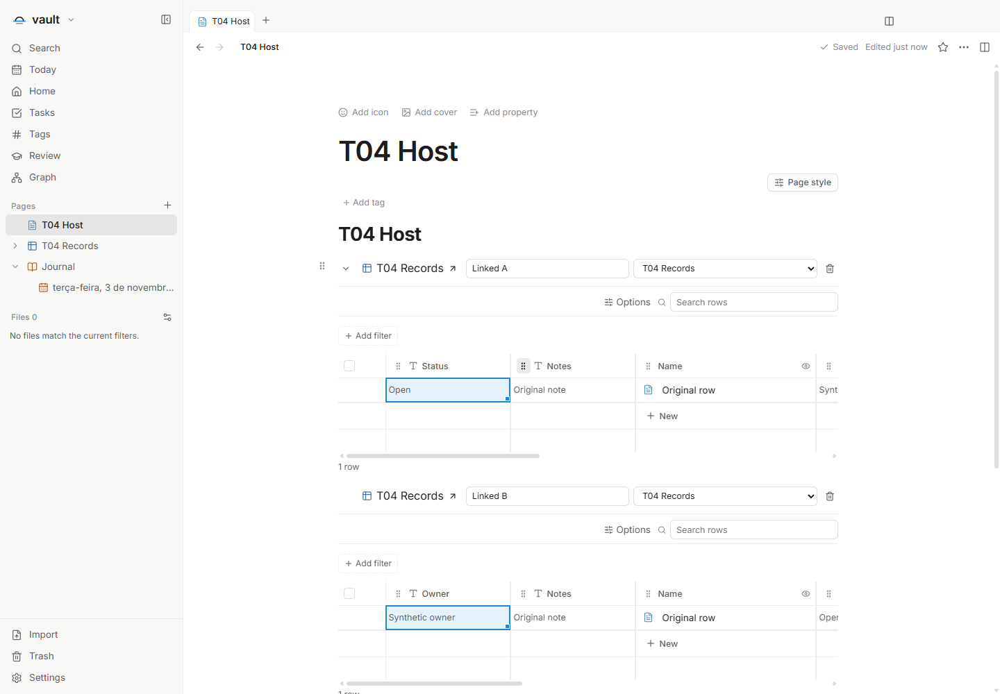
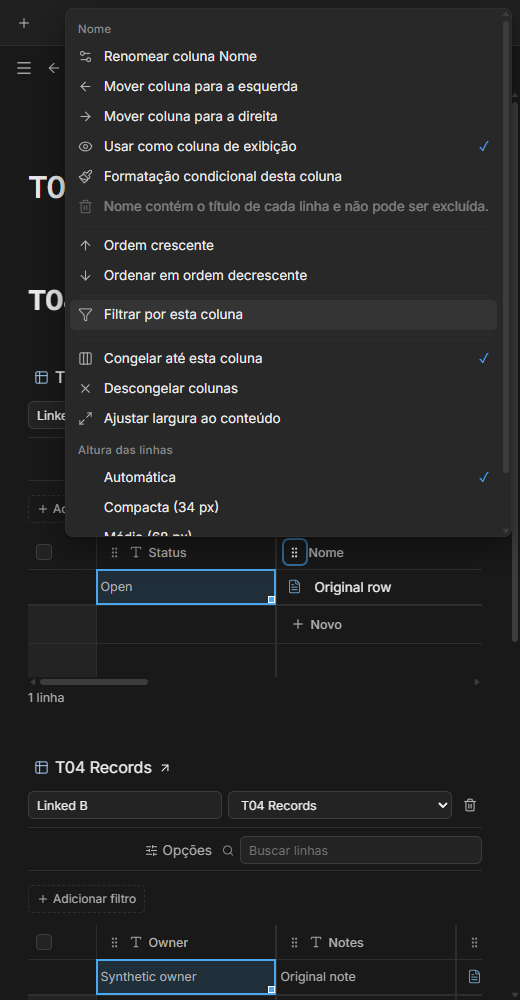

# Ordem de colunas por visualização — T04

Issue: [#55](https://github.com/hodeliun/Morrow/issues/55).
Base oficial: Morrow 1.3.0; formato persistido: 13, já publicado no T03.

## Comportamento

Use a alça no cabeçalho de uma coluna para arrastá-la antes ou depois de outra.
O indicador vertical mostra o destino; soltar aplica uma única mudança à ordem
da visualização. Escape cancela. Pelo teclado, abra o menu da alça e escolha
Mover coluna para a esquerda ou para a direita.

A coluna Nome também pode mudar de posição. Cabeçalho, células, ação Novo e
cálculos seguem a mesma ordem, inclusive com colunas congeladas e rolagem
horizontal. A ação Novo continua antes da linha de cálculos. Colunas ocultas e
IDs desconhecidos mantêm suas posições reservadas na configuração.

A mudança pertence à visualização: outra visualização do mesmo banco mantém
sua própria ordem, e o esquema e os valores das linhas continuam intactos.
Arrastar uma coluna entre visualizações não altera nenhuma delas. A abertura
de notas existentes não grava apenas para materializar uma ordem padrão.

## Verificação

O recorte passou `npm run check`: 974 testes em 119 arquivos, tipos, lint e
compilação. Os 3.597 artefatos do pacote conferem com o snapshot validado.
Os cenários principal e complementar passaram na aplicação isolada no Windows,
com dados sintéticos e janelas ocultas.

Foram verificados arraste com destino único, cancelamento sem escrita,
alternativa pelo teclado/menu, seleção e edição por IDs estáveis, título em
posição intermediária, colunas ocultas/congeladas e rolagem de 1.084 px.
Fechar e abrir novamente manteve os IDs e as ordens independentes de duas
visualizações. O esquema de origem e os arquivos das linhas permaneceram
intactos durante a reordenação; o arraste normal de blocos do documento
continuou com um único indicador horizontal.

As seis combinações de português, inglês e espanhol com temas claro/escuro
passaram a 520 px. Os menus couberam na janela e o banco em modo somente
leitura não ofereceu alças de movimentação nem alterou bytes ou horários dos
arquivos. Não houve erro de página nem tela genérica de falha nos cenários finais.

Os resultados negativos foram preservados. Um teste novo presumiu IDs de
células nos cabeçalhos; passou após verificar os nomes acessíveis do cabeçalho
separadamente dos IDs do corpo e rodapé. A primeira execução de interface
parou no teste de arraste de um bloco comum: o alvo estava fora da área visível.
Uma confirmação no mesmo pacote demonstrou o alvo correto, um único indicador
horizontal e cancelamento sem escrita. A execução completa seguinte passou,
sem modificar produto, prazo ou compilação para corrigir esse teste.

Resultados e hashes: [registro verificável](T04-validation.json).
Esta é uma entrega de código, sem release, instalador ou uso de perfil pessoal.

## Demonstrações sintéticas

O marcador aparece na borda de destino, sem um segundo indicador de bloco.

Nome e Novo acompanham a ordem própria de cada visualização.

O menu oferece movimento para esquerda/direita e mantém as ações de Nome.
