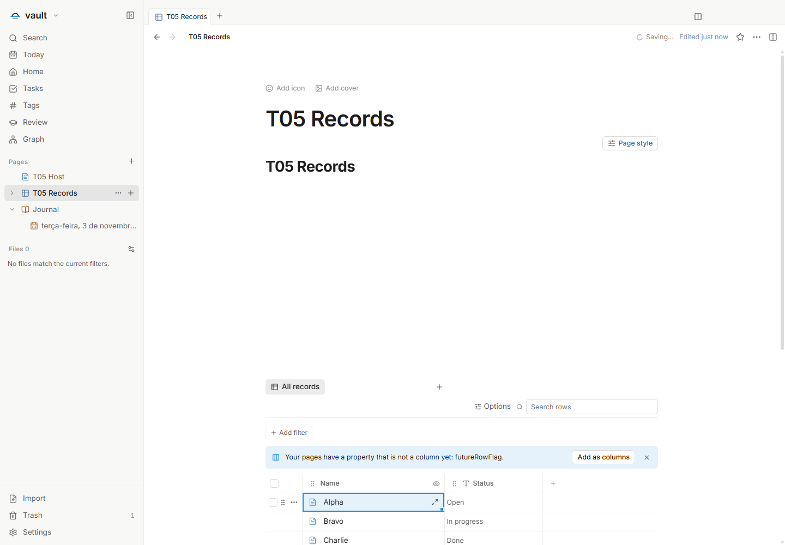
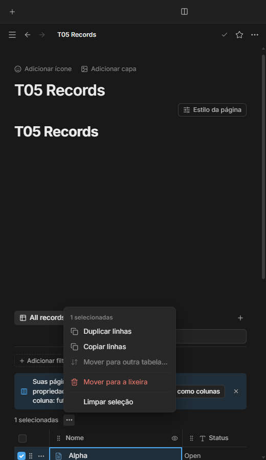
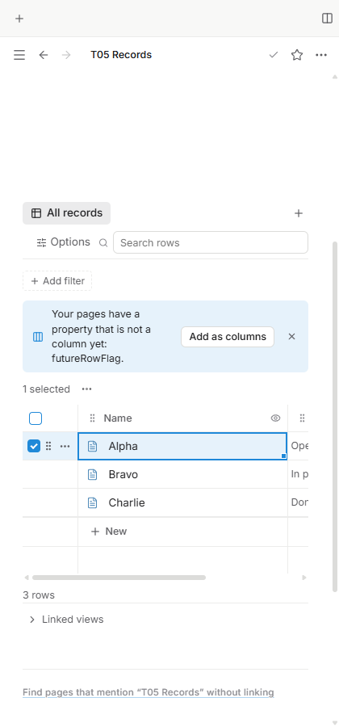

# Seleção aditiva e ações de linha — T05

Issue: [#56](https://github.com/hodeliun/Morrow/issues/56).
Base oficial: Morrow 1.3.0; formato persistido 13 mantido.

## Comportamento

Cada checkbox acrescenta ou retira somente a sua linha da seleção, sem exigir
Ctrl ou Shift. O checkbox do cabeçalho mantém a seleção geral. Espaço alterna
a linha focada sem trocar a célula ativa.

O contador de linhas selecionadas oferece um único botão de três pontos para
as ações em lote, substituindo a faixa permanente de comandos. O menu reúne
duplicação, cópia, movimento para outra tabela, lixeira e limpar seleção,
conforme a disponibilidade de cada ação.

Checkbox, alça de linha e alça de bloco têm funções distintas. A margem mantém
os estilos discretos já publicados: os controles aparecem por hover/foco e
continuam reconhecíveis quando selecionados, sem mudar a largura das colunas.
Os menus e confirmações revalidam a disponibilidade das linhas e a permissão
de edição; o banco somente leitura não oferece controles mutantes de linha.

## Verificação

`npm run check` passou com 978 testes em 120 arquivos, tipos, lint e compilação.
Os 3.597 artefatos do pacote conferem com o snapshot validado. O cenário completo
passou na aplicação isolada no Windows: seleção incremental com e sem
modificadores, seleção geral, Espaço, célula ativa, margem por hover/foco,
menu compacto e duplicação/lixeira de duas linhas, com persistência após
fechar e abrir novamente.

As seis combinações de português, inglês e espanhol com temas claro/escuro
foram verificadas a 520 px. O banco realmente registrado na lixeira permaneceu
somente leitura, sem controles mutantes de linha e sem alterar seus arquivos.
Abertura, IDs, campos desconhecidos, bytes e horários foram conferidos nos
cenários pertinentes. Não houve erro de página nem tela genérica de falha no
cenário final.

A revisão visual complementar de 420 px passou no mesmo pacote, com a barra
lateral realmente fora da tela, scrim oculto, centro do checkbox recebendo o
ponteiro e margem de 68 px estável em repouso, hover e foco. A captura inicial
foi rejeitada por mostrar a barra lateral ainda sobre a margem durante a
transição; a captura substituta e a seleção real confirmam esse caso separado.

Os resultados negativos dos roteiros foram preservados: navegação móvel para
uma página já selecionada deixava a barra lateral aberta; outra precondição
exigia a caixa inteira do checkbox dentro da tela, enquanto o contrato de
interação usa centro físico visível e hit test. Os ajustes ficaram no roteiro,
sem alterar produto, compilação, prazos ou as verificações geométricas.

A cópia foi verificada apenas como opção do menu; o clipboard do sistema não
foi usado. Ações em lote efetivamente executadas foram duplicação e lixeira
com dados sintéticos. Esta entrega é de fontes, sem release, instalação ou
uso de aplicativos, perfil ou arquivos pessoais.

Resultados e hashes: [registro verificável](T05-validation.json).

## Demonstrações sintéticas

O checkbox e as alças ocupam a margem reservada, sem deslocar os dados.

Um botão de três pontos concentra as ações para a seleção atual.

A navegação está fechada e a margem mantém sua largura e seus controles.
