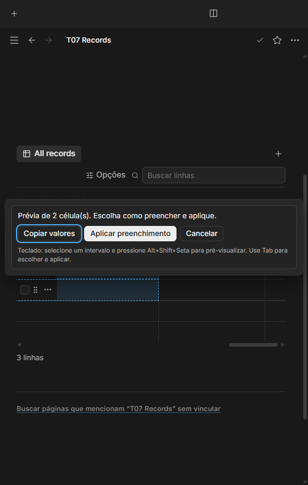
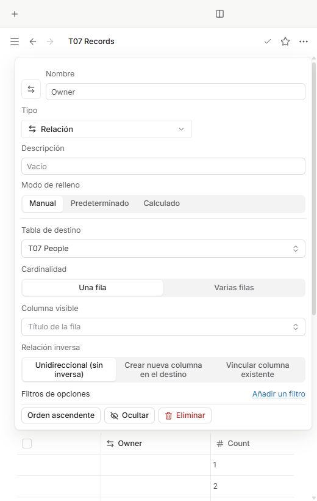
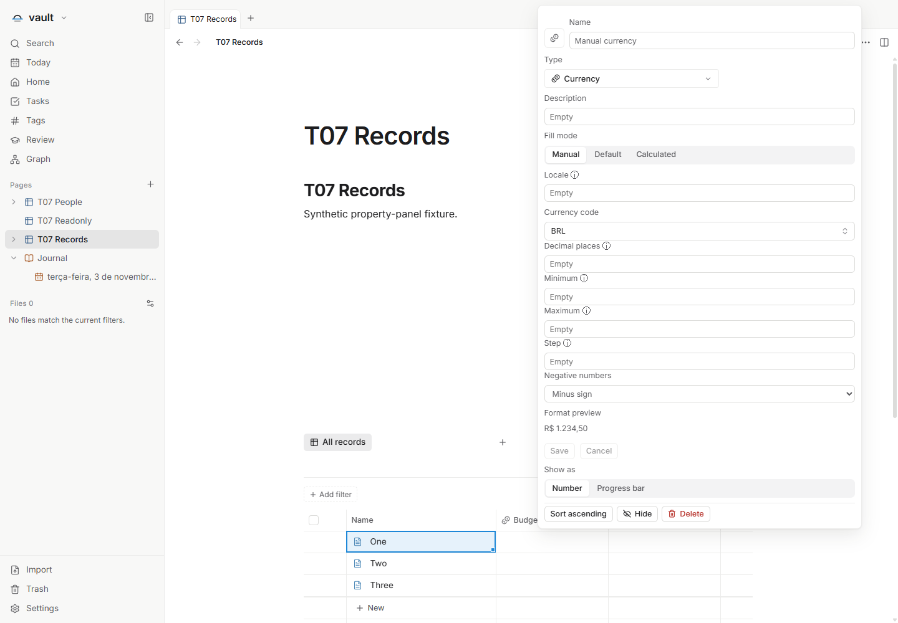

# Painéis de propriedades e seletores legíveis — T07

Issue: [#58](https://github.com/hodeliun/Morrow/issues/58).
Base oficial: Morrow 1.3.0.

## Comportamento

A criação de uma propriedade separa a escolha do tipo da ação de adicionar.
Após uma criação manual bem-sucedida, a configuração abre automaticamente;
cancelar essa configuração mantém a propriedade criada. Importar ou duplicar
não deve reabrir esse painel.

Catálogos de moeda e fuso oferecem busca por nome ou código, e o locale mantém
entrada livre. Valores válidos existentes que não aparecem no catálogo continuam
visíveis e preservados. Campos numéricos e textos livres mantêm suas entradas.

A prévia de preenchimento usa as camadas compartilhadas da aplicação para ficar
dentro da janela, inclusive no extremo direito da tabela. Aplicar, cancelar,
desfazer e Escape devem continuar acessíveis sem cortes ou perda de foco.

## Verificação

O recorte isolado T07 passou `npm run check`: 931 testes em 114 arquivos, tipos,
lint e compilação. Os 3.597 artefatos do pacote conferem com o snapshot testado.
Os cenários principal e de invalidação passaram na aplicação isolada no Windows.
Os seis critérios foram verificados, incluindo português, inglês e espanhol,
temas claro/escuro, viewport de 520 px e largura total.

Para usar, adicione uma propriedade manualmente e configure-a no painel aberto.
Os campos de catálogo oferecem busca por código ou nome; o locale aceita entrada
livre validada. Na prévia de preenchimento, escolha o modo e use Aplicar ou
Cancelar. Escape fecha a camada superior e devolve o foco; o teclado alcança as
ações. O preenchimento aplicado pode ser desfeito pela ação pública da notificação.

O ensaio principal verificou criação e cancelamento sem apagar a propriedade,
busca de moeda/fuso, opções de relação inversa contidas nos botões, prévia no
extremo direito, aplicar e desfazer por teclado e cancelamento sem escrita.
Importar um arquivo sintético e duplicar pelo menu não reabriram configuração.
Propriedades, IDs, valores, campos desconhecidos e arquivos sobreviveram à
reabertura; o caso somente leitura manteve bytes e horários de modificação.

Os casos de formato são distintos: CLP é uma moeda real reconhecida pelo catálogo
Intl deste runtime; `en-150` é um locale personalizado válido; `US/Eastern` é um
alias válido de fuso fora da lista corrente. O código `ZZZ` exercita sintaxe aceita
pelo Intl, sem afirmar que seja uma moeda real. A preservação de moeda válida
fora de um catálogo limitado também é coberta pelos testes dos helpers.

Uma alteração externa declarada de coluna oculta no banco sintético confirmou
que uma mudança real de alvos fecha a prévia, sem Aplicar tardio ou alteração das
linhas. O arquivo original foi restaurado com seus bytes, horário e IDs exatos.
Esse ensaio verifica o watcher, sem apresentá-lo como gesto público de ocultar.

O primeiro ensaio procurou um controle de histórico do T21/T22, ausente nesta
entrega. O roteiro privado foi corrigido para usar o Desfazer público da
notificação, por foco e Enter, mantendo a restauração literal de valores e bytes.
O negativo foi preservado; produto e pacote não mudaram por esse ajuste.

Resultados, hashes e limites: [registro verificável](T07-validation.json).
Os três processos dos cenários finais saíram normalmente e não houve erro de
página nem tela genérica de falha. Esta é uma entrega de código, sem instalador,
release ou alteração da instalação pessoal. O formato do banco continua sendo 12.

## Demonstrações sintéticas

As ações e a orientação por teclado permanecem dentro da janela no extremo direito.

Os três rótulos quebram linha dentro dos próprios botões.

O painel abre após a criação bem-sucedida, sem tratar Cancelar como remoção.
