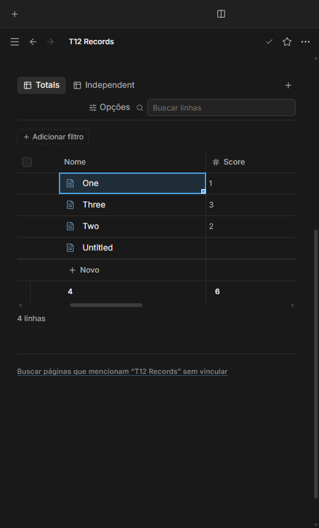
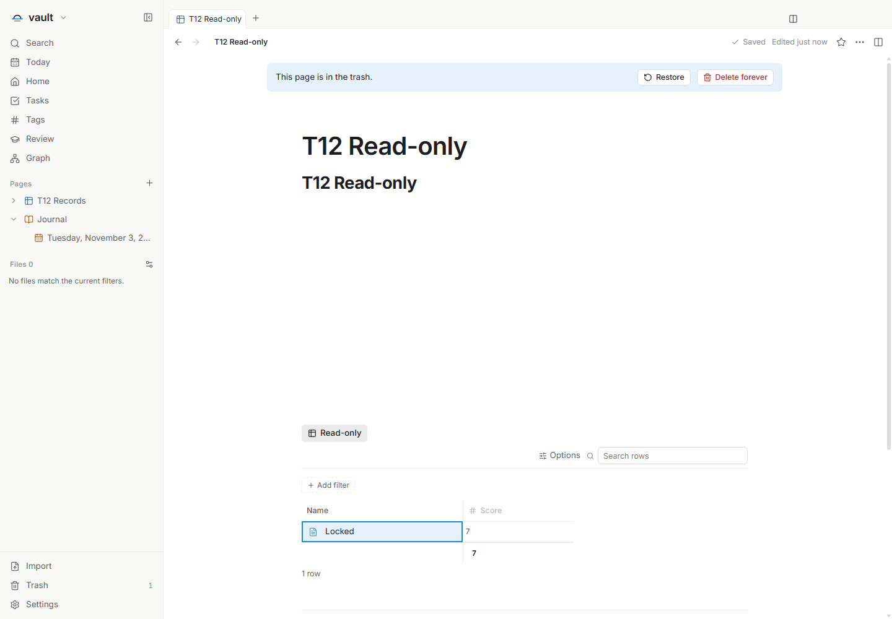

# Rodapé compacto das tabelas — T12

Issue: [#63](https://github.com/hodeliun/Morrow/issues/63).
Base oficial: Morrow 1.3.0.

## Comportamento

A tabela apresenta os registros, a ação **Novo** e, depois, o rodapé de cálculos.
A ação de criação permanece separada dos dados: não é um registro exportado nem
entra nos resultados calculados. Os resumos continuam configurados por propriedade
e visualização.

O rodapé acompanha o fundo da tabela. A ação de configurar o resumo é discreta
e aparece ao passar o mouse ou alcançar o controle por teclado; os resultados
já configurados permanecem legíveis.

## Verificação

O recorte isolado T12 passou `npm run check`: 925 testes em 113 arquivos, tipos,
lint e compilação. Os 3.597 artefatos do pacote conferem com o snapshot testado.
A interface empacotada passou os cinco critérios: posição de **Novo**, criação
de registro real, independência dos cálculos, alinhamento com rolagem,
redimensionamento e colunas congeladas, além de tabelas sem resultados e
visualização somente leitura. Português, inglês e espanhol, temas claro/escuro
e viewport de 520 px foram verificados.

Para usar, clique em **Novo** logo abaixo dos registros. Os cálculos ficam depois
dessa ação. Passe o mouse sobre uma célula de resumo vazia ou alcance o controle
por teclado para escolher o cálculo. Resultados configurados continuam visíveis
e independentes entre as propriedades e as visualizações.

A preservação necessária à criação e reabertura inclui campos desconhecidos do
banco e dos metadados locais por identidade, valores atuais prevalecendo sobre
os antigos, separação entre ordem de itens ativos e da lixeira e ausência de
regravações por mera ordem de chaves. Os 51 testes direcionados passaram; antes
das correções, 14 falhavam. O formato do banco continua sendo o 12.

A primeira verificação completa identificou um teste do renderizador que contava
a nova célula de **Novo** como dado. A correção exclui somente a linha dessa ação,
mantendo as duas células de registros e a do resumo, seus três alinhamentos e a
verificação de geometria na interface. Esse resultado negativo foi preservado.

A revisão visual do pacote seguinte identificou texto de colunas roláveis
atravessando a célula congelada selecionada. O fundo translúcido da seleção
substituía a base opaca da célula. A correção compõe a tinta da seleção sobre
uma base opaca com a cor já resolvida da célula, preservando o foco e os cálculos.
O pacote anterior e essa falha visual foram preservados; uma nova compilação e
verificação da mesma seleção após rolagem passaram antes da publicação. Sete
medições confirmam base opaca e tinta de seleção, incluindo os seis pares de
idioma e tema. As capturas corrigidas mantêm a seleção que revelou o problema.

Na reabertura, os registros, resumos e campos desconhecidos foram preservados.
A preparação usa a navegação pública para Hoje e espera a gravação terminar antes
de capturar o baseline. Na lixeira, os originais mantiveram bytes e horários de
modificação, com os controles de mutação ausentes. Os processos de teste saíram
normalmente e não houve erro de página nem tela genérica de falha.

Resultados, hashes e limites: [registro verificável](T12-validation.json).
Esta é uma entrega de código, sem instalador, release ou alteração da instalação
pessoal.

## Limites

A coluna Nome permanece fixa nesta entrega; reordená-la pertence ao T04 (#55), conforme seu critério de título e propriedades comuns. Campos
futuros preserváveis continuam opacos, sem ativar suas funcionalidades. Um
mapeamento de banco reconhecido que não pode ser preservado fica somente leitura.

Permanece a limitação anterior da varredura: um JSON de registro local que falhou
na leitura pode chegar ao repositório como `null`, assim como um arquivo ausente.
Esta entrega não introduz uma leitura bruta adicional nem afirma distinguir
esses casos. Os testes de preservação se aplicam aos metadados estruturados
efetivamente fornecidos pela varredura.

## Demonstrações sintéticas

Quatro registros aparecem antes de Novo; o rodapé conta quatro e soma seis.
A célula congelada selecionada mantém fundo opaco durante a rolagem horizontal.

Na lixeira, o resumo continua legível, com a ação de criar ausente.
