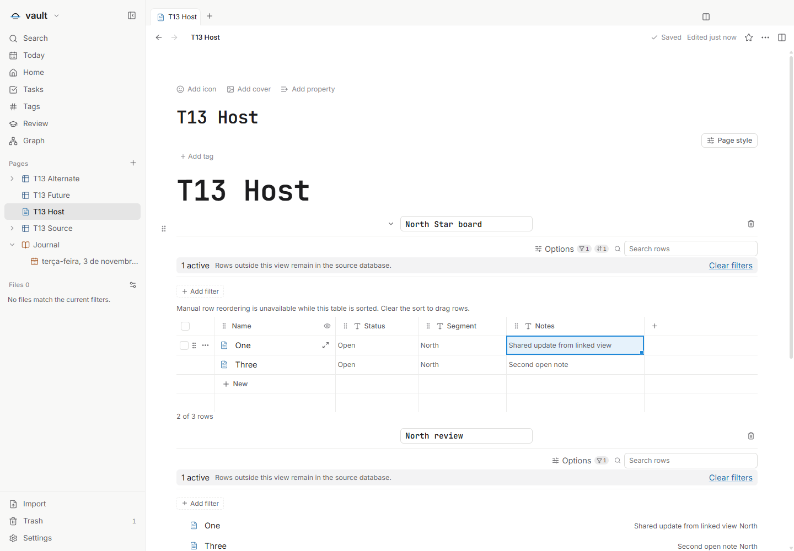
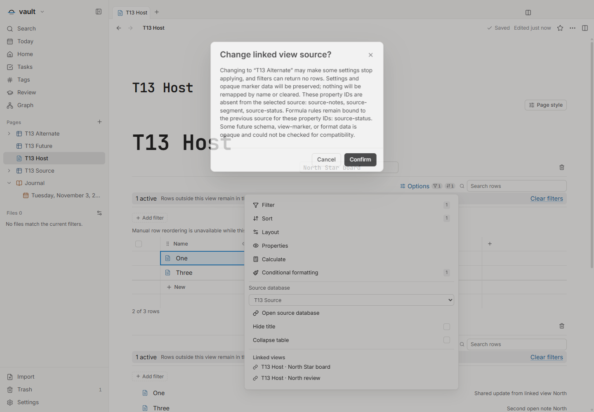
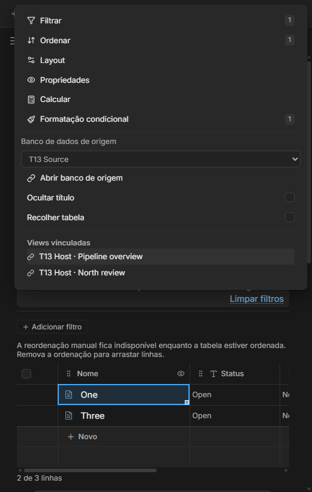

# Títulos próprios das visualizações — T13

Issue: [#64](https://github.com/hodeliun/Morrow/issues/64). Base oficial Morrow 1.3.0;
formato persistido 13 mantido, sem migração nesta entrega.

O título identifica a visualização vinculada e pode ser renomeado sem alterar
o banco de origem ou outra visualização. Ocultar título remove o campo; as
Opções permitem restaurá-lo pelo teclado. A origem e sua troca ficam nas
Opções. Os campos explicam a diferença entre nome do bloco e layout das linhas.

As visualizações reutilizam a tabela existente e compartilham os registros da
origem, mantendo títulos, filtros e layouts independentes. O tamanho e a cor
da tabela ficam isolados do título externo, preservando a formatação condicional.

Ao trocar a origem, o aviso identifica propriedades ausentes por ID, referências
que não podem ser verificadas em formatos futuros e fórmulas ainda ligadas à
origem anterior, inclusive campos nativos. Confirmar muda a origem solicitada,
preservando IDs do bloco/visualização, vínculos originais e dados opacos.
Não há remapeamento silencioso por nomes; Cancelar preserva bytes e horários.

## Verificação

`npm run check`: 987 testes em 120 arquivos, tipos, lint e compilação aprovados.
Os 3.597 artefatos do pacote conferem com o snapshot. A aplicação isolada no
Windows verificou os sete critérios: duas visualizações, edição compartilhada,
nomes/filtros/layouts independentes após reabrir, ocultação/restauração pelo
teclado, tipografia e troca de origem com confirmação/cancelamento.

As seis combinações de PT/EN/ES e temas claro/escuro passaram a 520 px, com
dimensões da janela oculta e do renderer conferidas. O host realmente registrado
na lixeira permaneceu somente leitura, com bytes e horários intactos.
Não houve erros de página nem tela genérica de falha. Processos próprios
encerraram com código zero; perfis e cofres eram sintéticos e ocultos.

A revisão encontrou que o aviso ignorava vínculos de fórmulas para Nome,
criação e atualização. Três regressões falharam antes da correção e passaram
depois; o avaliador não foi alterado. O primeiro check verde foi preservado
como anterior à correção. Um negativo do roteiro esperava árvore visível com
a barra lateral móvel fechada; foi corrigida apenas a prontidão da navegação,
preservando clique público, hit test e geometria real, sem mudar produto ou prazo.

A dependência T11 já estava publicada e foi reconciliada com sua prova original.
Esta entrega não é release, instalador ou teste de dados pessoais/clipboard.
Hashes e resultados: [validação](T13-validation.json).

## Demonstrações sintéticas

As duas superfícies mostram o mesmo registro editado, com filtros e layouts próprios.

O aviso distingue IDs ausentes, vínculos anteriores e dados opacos antes de confirmar.

A origem aparece nas Opções, com controles contidos na largura disponível.
