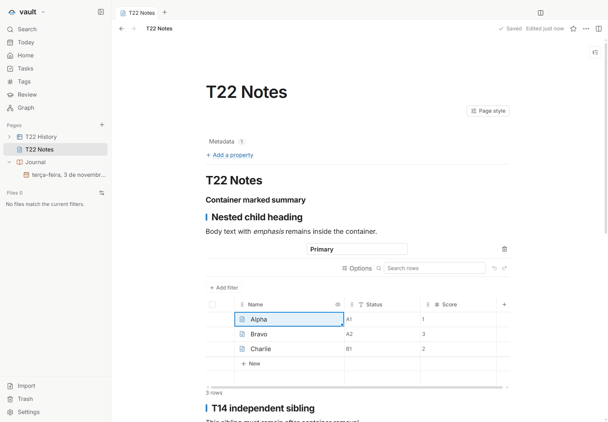
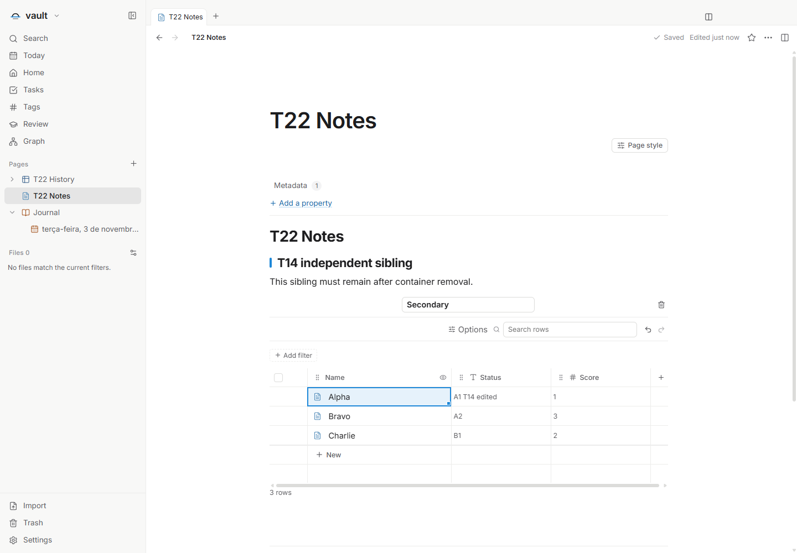

# T14 — Document structure and table integrity

Tracking issue: [#65](https://github.com/hodeliun/Morrow/issues/65).

This is a verification of previously published editor behavior. It does not add a new document format or claim that a missing table on screen necessarily means its source data was deleted.

The earlier build20 verification preserved future-format files, unknown metadata and page bytes, and checked SourceEditor identity through reopening. The published reversible-toggle tests also cover marked text, nested table and linked-view identities, conversion undo and Markdown reopening.

The historical build04 criteria attempt remains a failed result: its recorded `detailsRemovedFromHostDocument` boolean contradicts its document snapshot, which contains no details node after deletion. That result does not establish a product defect, and its later undo/reopen steps did not run. It is not counted as a passing scenario.

The additional verification passed 28 assertions on the unchanged T22 package: converting the details container to Heading 3 retained marked text, nested content and both linked-view identities. Ctrl+Enter committed only the intended row value. Explicitly deleting the selected container removed its host fragment while the independent view, source database and all row files remained intact. Undo and an actual application restart restored the document and identities and retained the edited value and unknown metadata.

Two preliminary runs stopped at an overly strict document comparison after Undo. The observed difference was exactly one trailing empty paragraph with null attributes, which the editor adds for caret access. The final comparison uses the editor's existing equivalence for that support paragraph; every meaningful node, attribute, mark and identity remains compared. No product fix or new causal reproduction of the original reported loss is claimed. The result is based on measured documents and files through the real actions, not visual absence alone.

The 417 product files match main `3e1b57ca984e2a3bdc0d4bd62c7f2be23b50fe2c` and its validated immutable package. The existing full gate passed 1,058 tests in 132 files, typecheck, lint and build; all 3,597 packaged artifacts matched. This documentation-only verification did not repeat that gate. Both owned child processes exited 0; no owned application process or runtime lease remained. Synthetic fixtures are retained privately; no personal data or clipboard was accessed.

This reconciles a historical prerequisite and does not add to the 24 resumed feature deliveries. See [the validation record](T14-validation.json).

