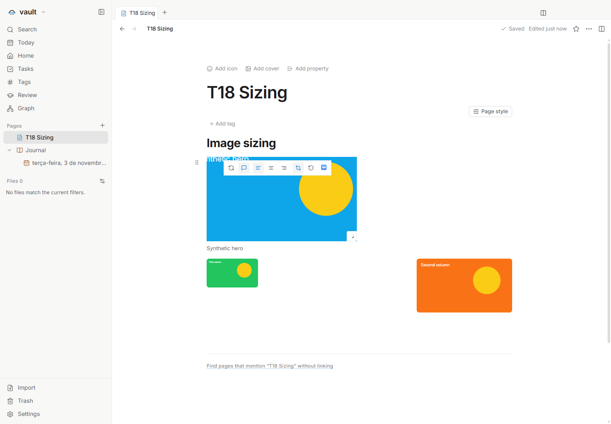
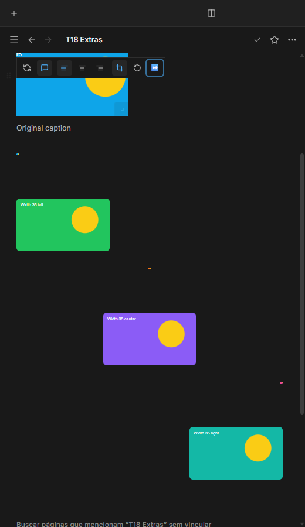

# Tamanho individual de imagens — T18

Issue: [#69](https://github.com/hodeliun/Morrow/issues/69).
Base oficial: Morrow 1.3.0; aprimoramento do fork sobre a entrega T20.

## Comportamento

Uma imagem pode ter uma largura de apresentação própria, dentro ou fora de um
grupo de colunas. A alça permite ajustar continuamente; o controle de largura
oferece alternativa por teclado e configuração. Duas imagens na mesma coluna
mantêm valores independentes, respeitando o espaço disponível.

O ajuste altera a apresentação no documento, sem regravar os pixels do arquivo.
Recorte, legenda, alinhamento e campos desconhecidos do marcador são preservados.
Cancelar restaura a largura anterior; confirmar produz uma única edição, com
desfazer e persistência após reabrir. A substituição por arquivo local deve
continuar preservando a origem fora do vault.

Para usar, passe o mouse sobre a imagem e arraste sua alça, ou abra o botão de
redimensionamento na barra da imagem e ajuste a largura pelo controle. O teclado
também alcança os controles; as setas ajustam a barra de largura. Escape cancela
uma prévia em andamento, e Desfazer restaura uma edição já confirmada.

## Limite da entrega

Inclui somente tamanho, controles e posicionamento das imagens existentes. Não
inclui visualizadores de arquivos, navegador, mudanças nos bancos de dados ou
no formato 12. Não altera o aplicativo pessoal nem publica um instalador.

## Verificação

O recorte isolado corrigido passou `npm run check`: 823 testes em 99 arquivos,
tipos, lint e compilação. Todos os 3.597 artefatos do pacote conferem com o snapshot.
Os cenários principal, complementar padrão e complementar com fonte de 32 px e
entrelinha 2,4 passaram na interface, incluindo os seis critérios da issue.

Foram verificados cancelamento, tamanhos independentes, legenda/recorte/alinhamento,
desfazer, reabertura, substituição local e originais intactos. Imagens de 1% e 35%
foram verificadas com alinhamentos diferentes, português/inglês/espanhol, temas
claro/escuro e viewport de 520 px. A mudança para somente leitura durante o arraste
cancela a prévia sem gravar e esconde os controles de edição.

Antes da publicação, o ensaio de tipografia ampliada identificou uma barra
reposicionada sem caminho utilizável de mouse até ela. A correção exige conexão
com a imagem visível e preserva a alternativa por teclado. O teste navega por
rolagem real após recarregar, respeitando a restauração de posição já publicada.

Resultados, hashes e limites: [registro verificável](T18-validation.json).

## Demonstrações sintéticas

A imagem principal e as duas imagens em colunas mantêm dimensões próprias.

A barra oferece edição do tamanho sem regravar a imagem. As amostras menores
demonstram a diferença entre 1% e 35% com alinhamentos independentes.
