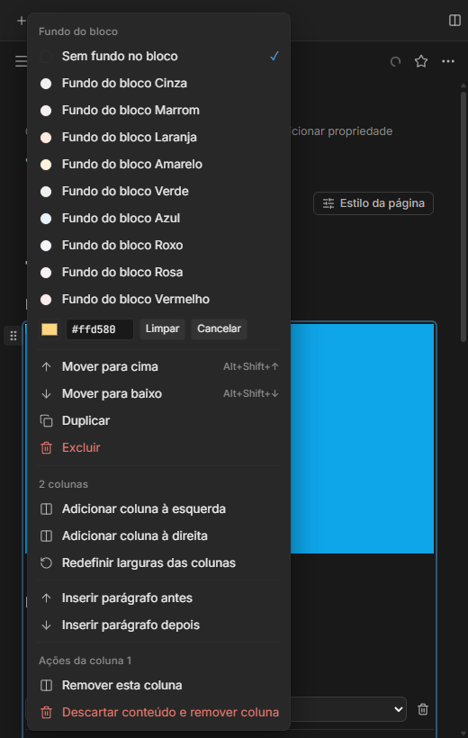
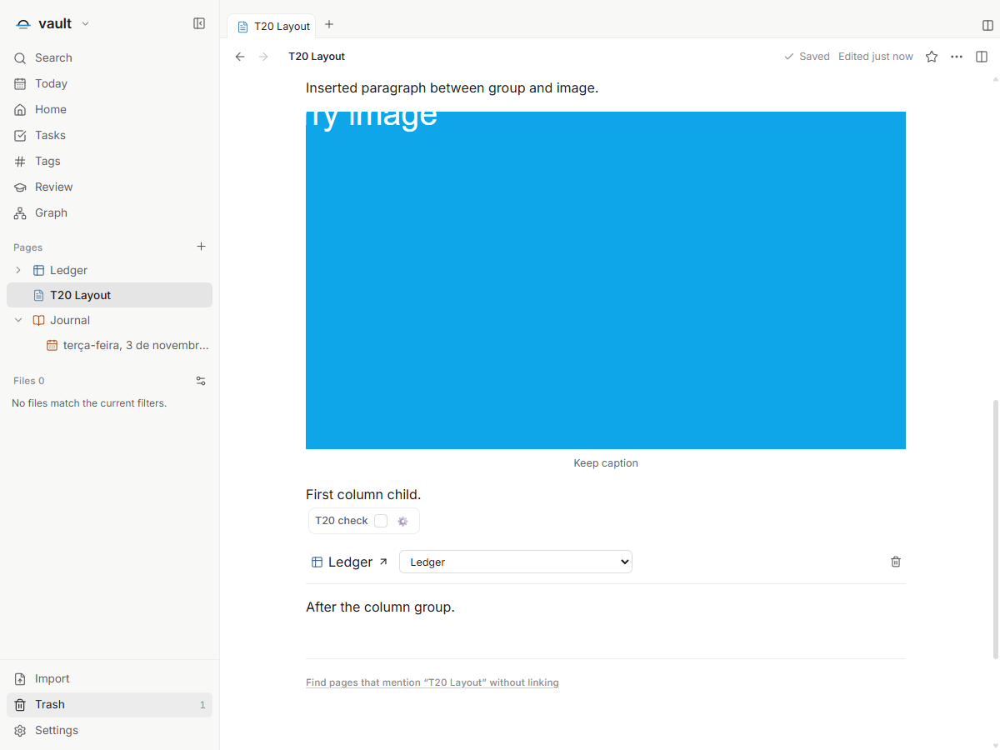

# Composição em colunas — T20

Issue: [#71](https://github.com/hodeliun/Morrow/issues/71).
Base oficial: Morrow 1.3.0; esta entrega altera somente o fork.

## Comportamento

O menu de uma coluna oferece sua remoção explicitamente. Uma coluna vazia também
pode ser removida com Backspace no início; a edição normal de texto continua
removendo caracteres. Para uma coluna com conteúdo, a confirmação distingue
preservar os blocos no fluxo após o grupo de descartá-los deliberadamente.
Cancelar mantém o documento intacto.

As colunas sobreviventes mantêm a ordem e as identidades dos blocos, com larguras
redistribuídas. Se restar uma coluna, seu conteúdo volta ao fluxo normal. Imagens,
controles e visualizações vinculadas devem sobreviver à remoção da estrutura,
ao desfazer e à reabertura.

O menu de blocos permite inserir um parágrafo antes ou depois de uma imagem ou
grupo de colunas. A seleção e o foco seguem para o novo parágrafo, permitindo
digitar imediatamente. Durante um arraste, um único indicador mostra o destino
acima, abaixo ou ao lado do bloco; cancelar remove o indicador sem gravar conteúdo.

Por exemplo, arrastar um parágrafo que está imediatamente antes do grupo para sua
lateral direita cria uma coluna para esse conteúdo. Desfazer restaura o documento.
A validação isolada identificou e corrigiu o cancelamento indevido desse caso.

## Limite desta entrega

Inclui somente as ações de composição e seus pré-requisitos de preservação de
conteúdo. Não inclui a nova interface de redimensionamento de imagens, o formato
13 de bancos de dados, navegadores, players ou os outros tickets em andamento.
Não altera a base oficial nem representa uma release instalável.

## Verificação

A implementação acumulada recebeu aceite local no pacote 38: os seis critérios
da issue foram verificados com dados sintéticos, incluindo preservação e descarte,
cancelamento, Backspace, foco, arraste nos quatro lados, desfazer, reabertura,
somente leitura e português/inglês/espanhol em temas claro/escuro.

Na entrega isolada corrigida, `npm run check` passou 787 testes em 99 arquivos,
tipos, lint e compilação. Os 3.597 artefatos do pacote conferiram com o snapshot.
A interface passou os seis critérios, os quatro indicadores de arraste, dois
arrastes efetivos (vertical e lateral), desfazer com restauração dos bytes,
reabertura, somente leitura e seis combinações de idioma/tema a 520 px.
Os dois processos de teste encerraram com código zero; nenhum processo próprio
permaneceu ativo. Não houve uso da área de transferência do sistema.

O ensaio inicial identificou o cancelamento indevido do arraste lateral adjacente;
a condição foi corrigida antes da publicação. O teste de Backspace aguarda a
seleção real do caret após o clique: a seleção visual e o estado do editor se
sincronizam de forma assíncrona, sem seleção programática no roteiro.

Hashes, resultados e limites: [registro de validação](T20-validation.json).

## Demonstrações sintéticas da entrega isolada

O menu distingue remover preservando os blocos de descartar o conteúdo.

O novo parágrafo recebe o texto; imagem, legenda, controle e view vinculada
continuam presentes após as transformações de composição.
