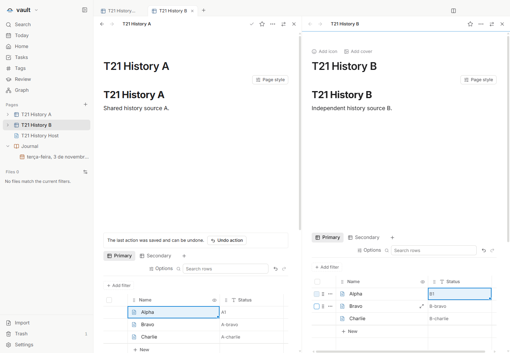
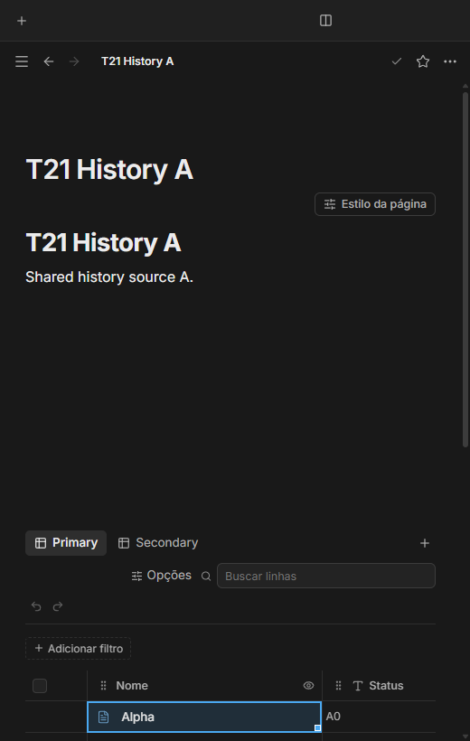

# Histórico limitado dos dados — T21

Issue: [#72](https://github.com/hodeliun/Morrow/issues/72).
Base oficial Morrow 1.3.0 e formato persistido 13 mantidos.

As visualizações do mesmo banco compartilham o histórico dos seus dados.
Desfazer e refazer indicam o próximo efeito e ficam indisponíveis quando a
operação não pode ser aplicada com segurança. Uma alteração entre dois bancos
é uma ação compartilhada, sem cópias independentes da recuperação.

O histórico mantém dez ações recentes por banco durante a sessão, com teto
global de 32 MiB para entradas concluídas. A remoção por limite considera as
ações concluídas mais antigas; recuperação pendente, conflito ou operação em
curso permanecem protegidos. Uma edição nova invalida o refazer do escopo afetado.

As inversas reutilizam comandos tipados e a recuperação existente. Antes de
escrever, conferem dados e permissões; um conflito não sobrescreve alterações
externas silenciosamente. A recuperação persistida da última ação continua
disponível, sem prometer dez ações persistentes depois de reiniciar.

O teclado respeita o foco: um campo com texto em edição usa seu desfazer nativo;
o foco na grade usa o histórico daquele banco. Os controles validam novamente
permissões e alvos no momento da ação.

## Verificação

O check integrado passou com 1.000 testes em 121 arquivos, tipos, lint e build.
Os testes dirigidos cobrem escopos independentes, ações atômicas entre bancos,
dez entradas, limite global, recuperação pendente, conflito, mudança de permissão
durante I/O e preservação de journal estrangeiro. São falhas controladas nos seams
de storage; não representam corte real de energia ou de processo.

Os 3.597 artefatos do pacote conferem com o snapshot. A UI isolada no Windows
passou: edição por duas views e dois blocos vinculados da mesma origem,
desfazer/refazer compartilhados, dois bancos em painéis reais, Ctrl+Z conforme
o foco e dez ações durante a sessão. Texto ainda em edição mantém seu histórico
nativo; o foco num item de menu fora da grade não consome o histórico do banco.

A última ação de tabela foi recuperada e desfeita após fechar e reabrir
cooperativamente. Os arquivos dos dados e os estados específicos de ambos os
bancos foram conferidos junto ao indicador único da fila na pane primária.
As seis combinações de PT/EN/ES e claro/escuro passaram a 520 px. Banco e linha
realmente registrados na lixeira mantiveram controles indisponíveis e bytes/
horários intactos. Não houve erro de página ou tela genérica de falha.

As janelas permaneceram ocultas e os processos próprios encerraram com código
zero. O item Copiar foi somente focado para testar o encaminhamento de Ctrl+Z;
não houve ação de clipboard do sistema. Dados, cofres e perfis eram sintéticos.
Sem release, instalação ou alteração de formato. [Hashes e resultados](T21-validation.json).

## Demonstrações sintéticas

A e B conservam dados e histórico próprios, enquanto as views de A compartilham suas ações.

Desfazer e refazer permanecem acessíveis e indicam indisponibilidade sem criar overflow do documento.
