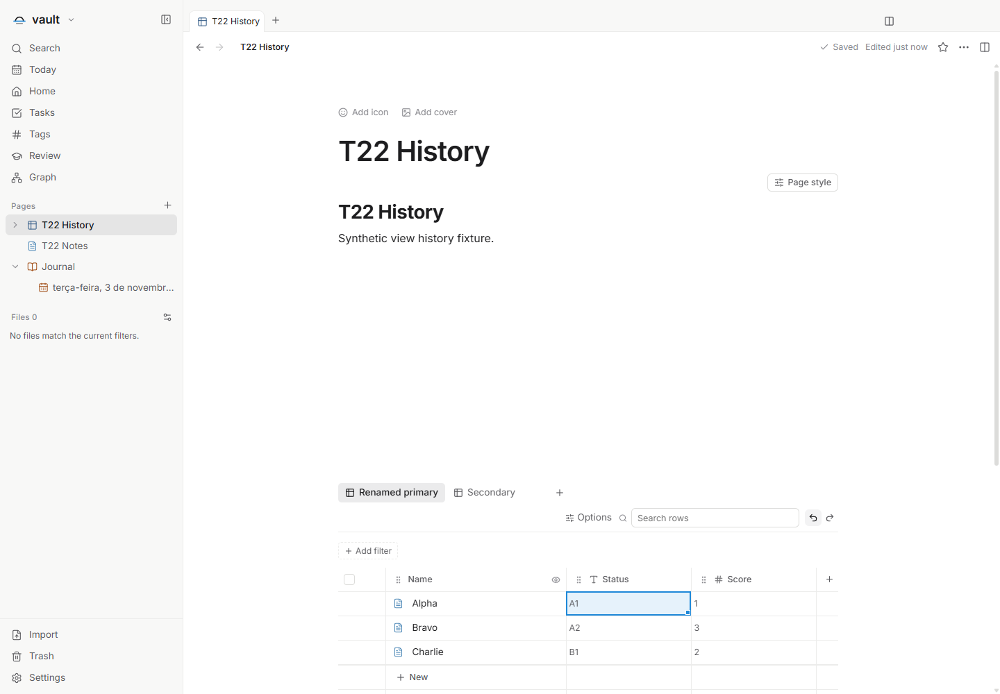
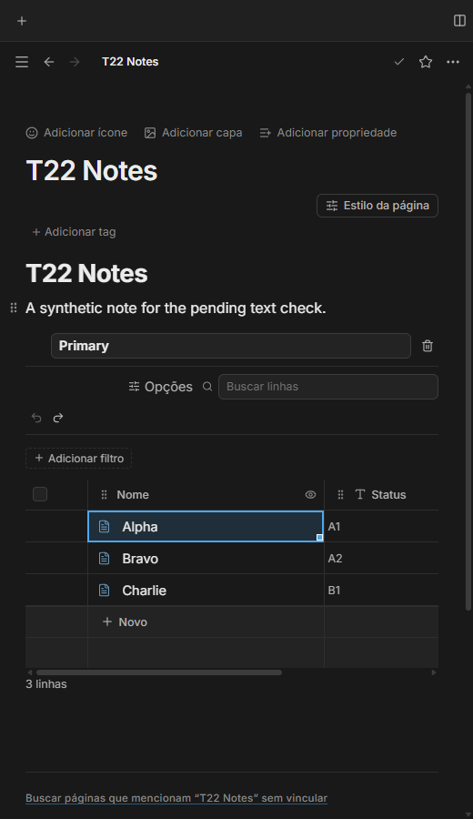

# Histórico contextual das visualizações — T22

Issue: [#73](https://github.com/hodeliun/Morrow/issues/73).
Base oficial Morrow 1.3.0 e formato persistido 13 mantidos.

Cada visualização mantém dez ações recentes de configuração durante a sessão,
separadas dos dados do banco. Título, filtros, ordenação, ordem e ocultação de
colunas podem ser desfeitos sem alterar a outra visualização. O desfazer
contextual escolhe a ação aplicável mais recente e identifica seu proprietário
nos rótulos acessíveis dos controles. O refazer respeita a ordem das ações desfeitas.

Dados e configurações compartilham o teto global de 32 MiB das entradas
concluídas. Uma ação que afeta várias views é contada uma vez; recuperação
pendente, conflitos e operações em curso permanecem protegidos. Uma nova edição
invalida o refazer no escopo correspondente, sem apagar o de outra view.

A busca filtra enquanto é digitada: Escape cancela sem gravar, e Enter confirma
uma ação lógica. Arrastar ou redimensionar uma coluna também representa uma
ação lógica. Texto ainda em edição conserva seu desfazer nativo. Ao configurar
uma view vinculada, o texto pendente é salvo primeiro; desfazer a configuração
mantém esse texto e o desfazer nativo seguinte não restaura a configuração.

As inversas revalidam identidade, configuração e editores afetados antes de
aplicar mudanças. Os campos não alterados pela ação permanecem atuais; conflitos
recusam a operação sem sobrescrever silenciosamente outra pane. O histórico
das views é de sessão e não é restaurado após reiniciar. A recuperação persistida
dos dados existente permanece separada.

## Verificação

`npm run check` passou com 1.058 testes em 132 arquivos, tipos, lint e build.
Os 99 testes dirigidos em 16 arquivos cobrem orçamento compartilhado, captura
única, inversas, ordenação contextual, snapshots estáveis, conflitos, múltiplos
hosts/editores e os caminhos de gravação pelo editor de fonte e assistente.

Os 3.597 artefatos do pacote conferem com o snapshot. A UI isolada no Windows
passou nos cinco critérios: duas views, dados intercalados com configurações,
desfazer/refazer contextual, dez ações, busca e reabertura sem persistir o
histórico de configuração. As seis combinações PT/EN/ES e claro/escuro passaram
a 520 px, alterando idioma pelas Configurações ao vivo, sem recarregar a página.
Texto pendente, configuração e os bytes originais da nota foram conferidos em
cada caso; campos desconhecidos e IDs permaneceram íntegros.

Um negativo do roteiro foi preservado: a prontidão do toggle após redimensionar
a janela amostrava posição e hit em momentos diferentes. O helper passou a ler
a geometria atual e aguardar o centro realmente atingível, sem force ou aumento
de prazo. A repetição somente dos extras passou no mesmo pacote; uma espera
observada resolveu a prontidão em duas tentativas/73 ms. A causa exata da falha
antiga não é atribuída ao produto. O cenário principal aprovado não foi repetido.

Não houve erro de página ou tela genérica de falha; processos próprios saíram
com código zero. Conflitos externos e permissão durante replay foram verificados
em seams controlados de código/storage, sem alegar interrupção real de energia
ou conflito externo determinístico na UI. Não houve clipboard do sistema,
aplicativo ou dado pessoal, instalação ou release. [Hashes e resultados](T22-validation.json).

## Demonstrações sintéticas

As duas views conservam suas configurações; os controles usam rótulos acessíveis
para indicar se a próxima ação pertence aos dados ou à visualização.

A view e o texto da nota permanecem independentes durante o desfazer contextual e nativo.
