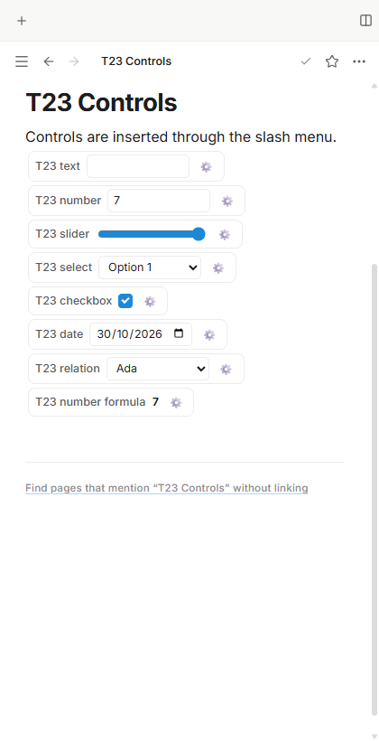
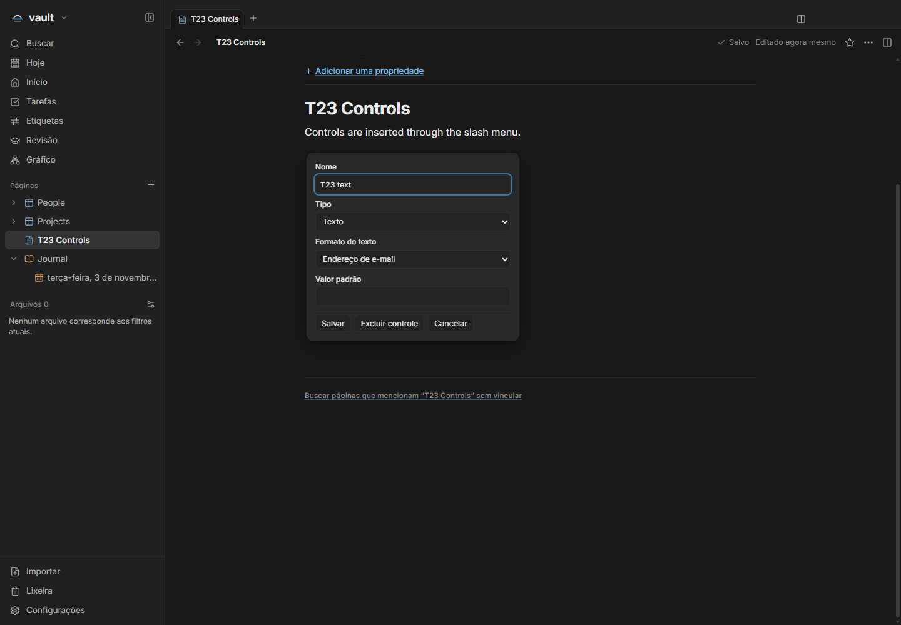
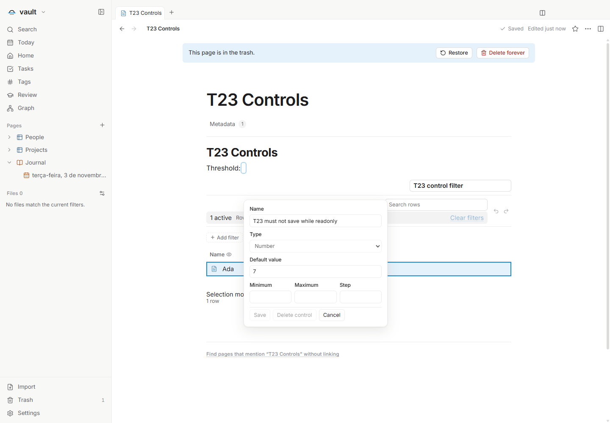

# T23 — Discover and configure existing controls

Tracking issue: [#74](https://github.com/hodeliun/Morrow/issues/74). Historical prerequisite [#65](https://github.com/hodeliun/Morrow/issues/65) was verified and reconciled before this delivery.

The slash catalog identifies the seven existing controls: text, number, slider, select, checkbox, date and relation. Manual insertion opens the control settings; the contextual menu also exposes configuration, reset and clear actions. Name, current value, default and format are separate. Saving settings preserves the live value; defaults apply on creation or explicit reset.

Plain-text, email and numeric constraints report translated diagnostics while retaining incomplete drafts. Save and Cancel preserve control identities, reject stale configuration and respect readonly pages. Values continue to feed the existing result and filter engines. No new control types, format version or parallel formula engine are introduced.

The filter verification exposed a compatibility defect in the recently published view history: a freshly loaded Markdown view omits its ephemeral host attribute, while the editor supplies that value from its owner. The capture guard now accepts only an omitted attribute or the exact already-known document owner. Explicit null, empty and foreign owners remain rejected. The correction changes neither stored documents nor opening writes. Configuration, Undo and Redo now work before any prose edit.

## Verification

The final gate passed **1,069 tests in 135 files**, typecheck, lint and build. The immutable snapshot contains 422 source files and all 3,597 packaged artifacts matched. Three targeted legacy-owner regressions failed before the correction; the final targeted suites passed 29 tests. The initial control suites passed 27 tests.

| Criterion | Evidence |
| --- | --- |
| Seven controls and translated discovery | Seven English UI insertions; unit catalog aliases for all seven in EN/PT/ES; Portuguese and Spanish relation insertion/cancellation and localized configuration in a 420px renderer viewport. EN/light, PT/dark and ES/light were exercised. |
| Value, name, default and format | Live number 7 survives a default of 6; explicit resets, zero, false, blank, slider/date/select and deliberate relation choices persist independently. |
| Validation and incomplete drafts | Invalid email/numeric drafts retain prior saved values; explicit clearing and cancel are checked. |
| Save, Cancel, identity and readonly | IDs survive settings and application restart. A synthetic external move to Trash while settings remain open disables editing/Save, permits Cancel, preserves exact bytes and mtime, and does not recreate the original file. |
| Existing formulas and preservation | A result consumes value 7. A bound control filter includes/excludes/restores its row at 7→3→7, with exact page/control bindings and unknown metadata preserved. |

The main UI passed on build01. Build02 changes only three linked-owner guard modules and their three tests; the other 416 source files and the main driver are identical. The main fixture contains no linked-view nodes, so its evidence is retained with its original build attribution. The affected linked-filter, configuration Undo/Redo and readonly scenario passed on build02 without diagnostic hooks. The [validation record](T23-validation.json) records both provenances.

Earlier failed runs remain classified: the old driver expected unpublished result auto-opening, corrected to the existing public configuration button; the linked-owner failure was a real product defect; a later helper expected `Filter` without its active-count badge. The package-proof filename was corrected without rebuilding or overwriting the earlier proof. No acceptance assertion or deadline was weakened.

All application runs used hidden windows, synthetic vaults and isolated profiles. The three successful child processes exited 0; no owned process or runtime lease remained. Fixtures and raw reports are retained privately. Native Windows IME and personal clipboard were not exercised. This is a source delivery, not a downloadable release or installation.

