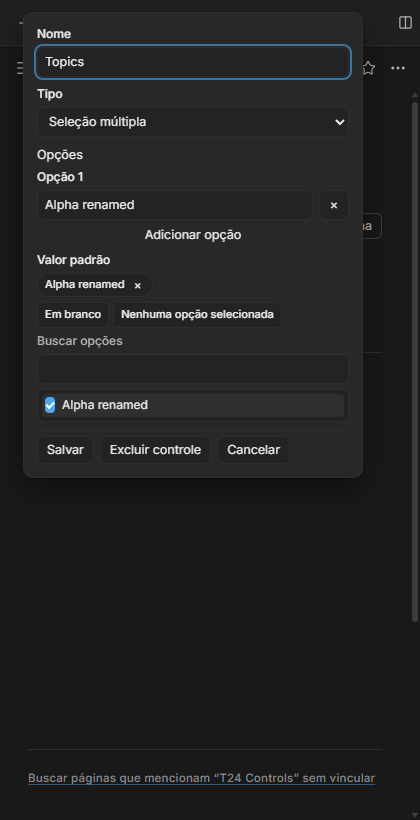
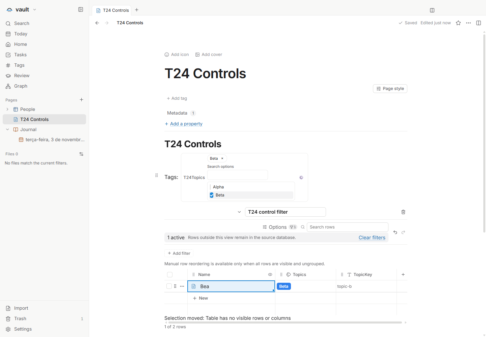
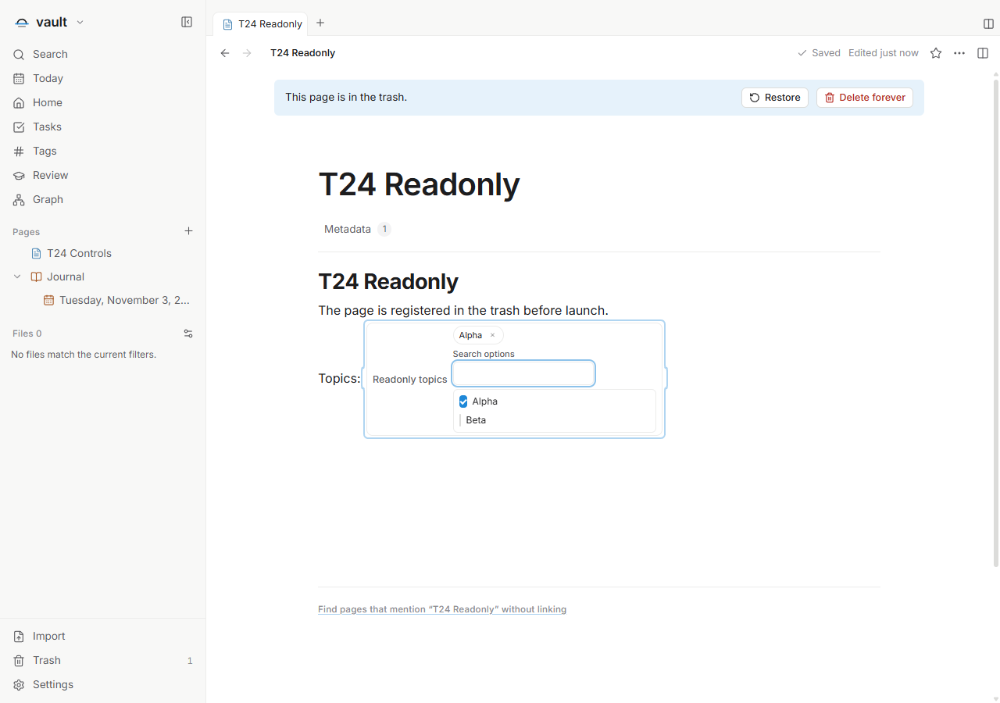

# T24 — Controle de seleção múltipla

Issue: [#75](https://github.com/hodeliun/Morrow/issues/75). Dependência: T23,
entregue no PR106. Esta entrega expõe o contrato de lista tipada já publicado no
formato 13, sem nova migração ou engine de fórmulas.

O controle permite buscar opções, selecionar por teclado e remover chips com
nomes acessíveis. Opções têm identidades próprias: renomear mantém a seleção;
remover uma opção exige resolver explicitamente seu uso no valor atual e no
padrão, confirmando com Save. Cancel preserva o arquivo. Valor vazio `[]` e
valor em branco `null` permanecem distintos.

O padrão é separado da seleção atual e aplicado pelo reset. Fórmulas e filtros
consomem a lista de IDs, sem depender dos nomes apresentados. O modo somente
leitura mantém busca de apresentação, mas desabilita mudanças da seleção.

## Verificação

`npm run check` passou com 1.069 testes em 135 arquivos, tipos, lint e build.
O pacote isolado corresponde aos 3.597 artefatos do snapshot de 423 fontes.
O registro [T24-validation.json](T24-validation.json) contém hashes, critérios,
resultados e limites.

A interface oculta verificou duas opções, IDs únicos, busca com ArrowDown/Space,
chips acessíveis, rename, resolução explícita de remoção em valor/padrão e Cancel
com bytes/mtime intactos. Reset, `null`, `[]`, lista tipada, dados desconhecidos e
reabertura foram conferidos. O filtro `Contains(T24Topics, TopicKey)` alternou
Ada/Bea por IDs de opção, controle e propriedade, preservando seus bindings.

Foram usados EN light, PT dark a 420 px e ES light a 420 px, com preferências
preparadas e reload. A nota readonly estava realmente registrada em Trash;
busca/teclado não alteraram seleção, padrão, arquivo ou inventário. Esse cenário
não afirma testar uma transição externa para readonly. Não houve erro de página
ou boundary genérico; quatro processos filhos saíram com código zero, sem
processo próprio ou lease ao final.

O primeiro check parou no lint após a retirada de um helper de horário usado
pelos handlers; ele foi restaurado, sem desativar regras. O preflight puro também
detectou uma entrada ausente no registro da fixture complementar, corrigida antes
da baseline e de qualquer Electron. Os negativos permanecem registrados; os dois
cenários de interface passaram no pacote final sem repetição.

Não foram usados clipboard nativo, perfil/cofre pessoal ou janela visível. Esta
entrega de fontes não cria instalador, tag ou release.
