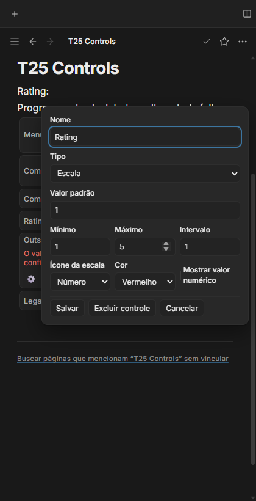
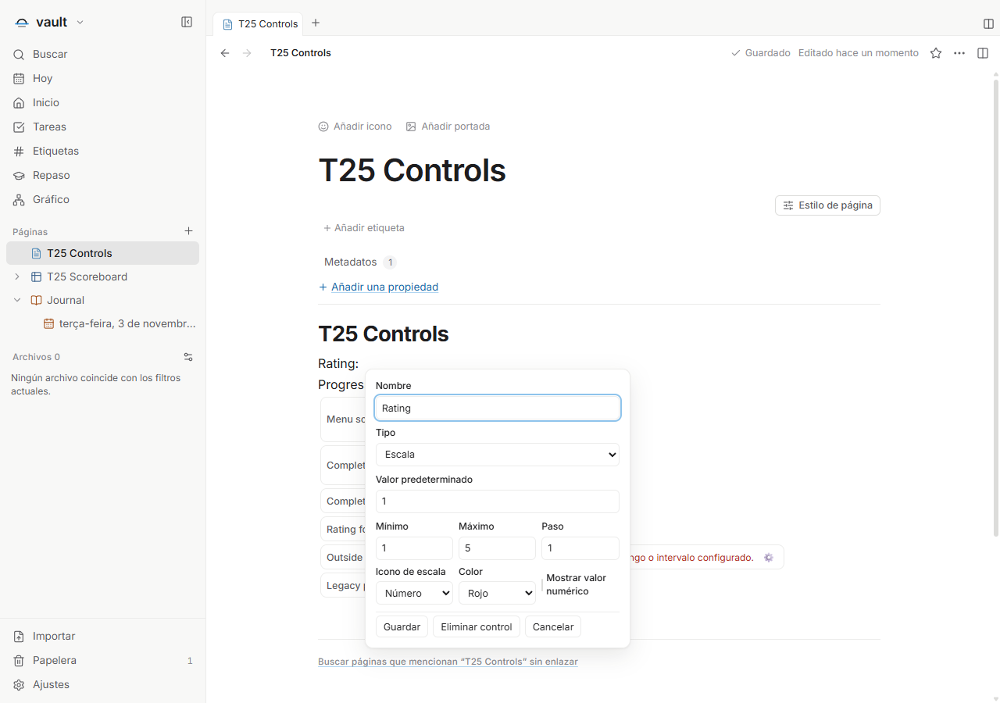
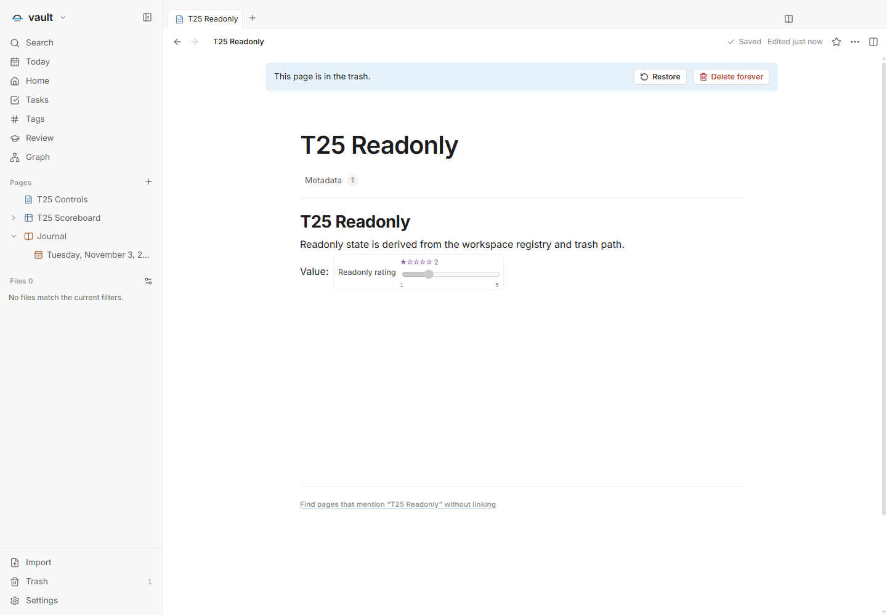

# T25 — Escala e progresso numéricos

Issue: [#76](https://github.com/hodeliun/Morrow/issues/76). Dependência: T23,
entregue no PR106. Os contratos numéricos persistidos pertencem ao formato 13
já publicado; esta entrega acrescenta sua interface.

Escala e progresso manuais usam limites e passo explícitos, com valor numérico
separado do padrão e da apresentação. Saídas calculadas permanecem readonly.
O progresso calculado legado com apenas `max: 100` mantém essa representação,
sem exigir a grade do controle manual nem quantizar a saída da fórmula.

## Verificação

`npm run check` passou com 1.073 testes em 136 arquivos, tipos, lint e build.
Foram conferidos os 3.597 artefatos do pacote contra o snapshot de 425 fontes.
O registro [T25-validation.json](T25-validation.json) contém hashes, os quinze
grupos de verificações da interface e seus limites.

A interface oculta verificou Home/End/setas, limites e passo decimal, ícone/cor,
legenda e valor acessível, criação pelo catálogo, padrão/reset e zero versus
vazio. Reconfigurações incompatíveis exigem resolução explícita e Cancel não
grava. Fórmulas acompanharam escala 4→3 e progresso 0,3→0,2 por IDs estáveis;
o filtro alternou Ada/Grace usando o mesmo número. A saída calculada de escala
permaneceu readonly e diagnosticou 6 fora do intervalo 1…5, sem clamping.
O progresso calculado 4,7 preservou o formato legado com apenas máximo 100.

Foram conferidos EN light, PT dark a 420 px e ES light a 1280 px, com preferência
preparada e reload. A reabertura preservou formatos, números, IDs, YAML
desconhecido e bytes/mtime. Uma nota realmente registrada em Trash manteve seu
controle desabilitado e seus arquivos intactos. Não houve erro de página nem
boundary genérico; os dois filhos saíram com código zero, sem processo próprio
ou lease ao final.

O diagnóstico vermelho ao fundo da captura ES pertence ao caso calculado
intencionalmente fora do intervalo, verificado separadamente.

O primeiro gate parou por uma declaração opcional de tipo; a precisão do retorno
foi corrigida sem alterar comportamento. O primeiro roteiro parou porque um
helper de navegação de notas exigia editor de texto na página de banco. A
precondição foi corrigida conforme o tipo de página, no mesmo prazo de 15 s e
no mesmo pacote; os asserts numéricos permaneceram intactos.

O editor de resultado continua sendo o editor simples já publicado; esta
entrega não incorpora os rascunhos/histórico de T27. Não foram usados clipboard
nativo, perfil/cofre pessoal, janela visível, instalação ou release.
