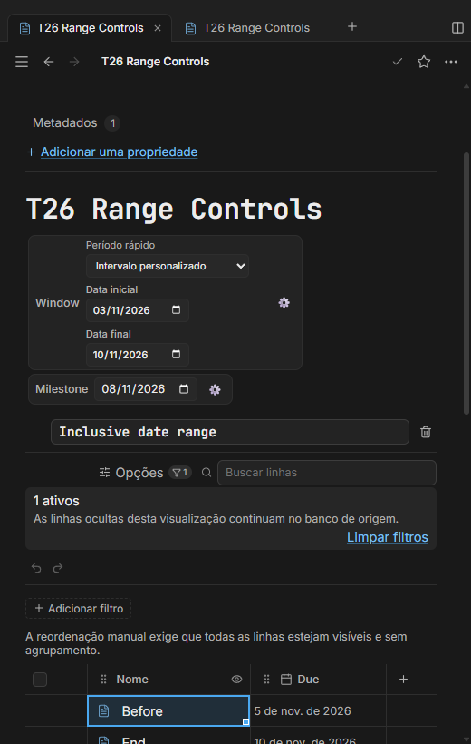
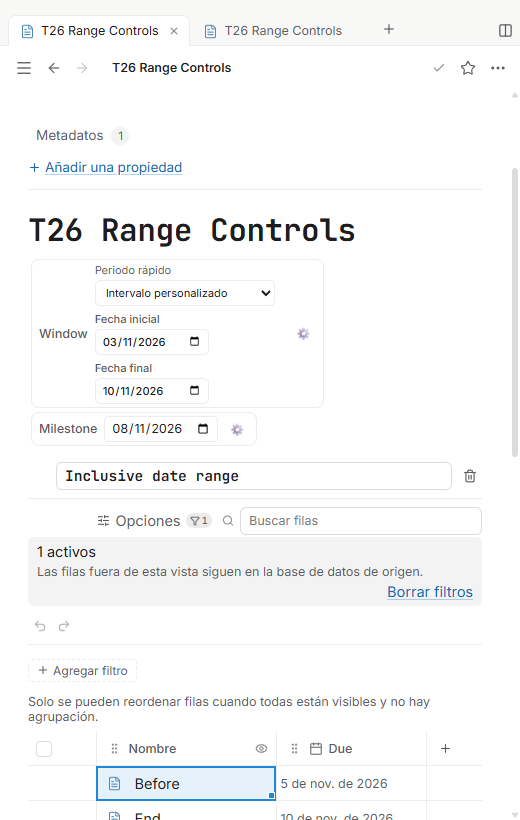
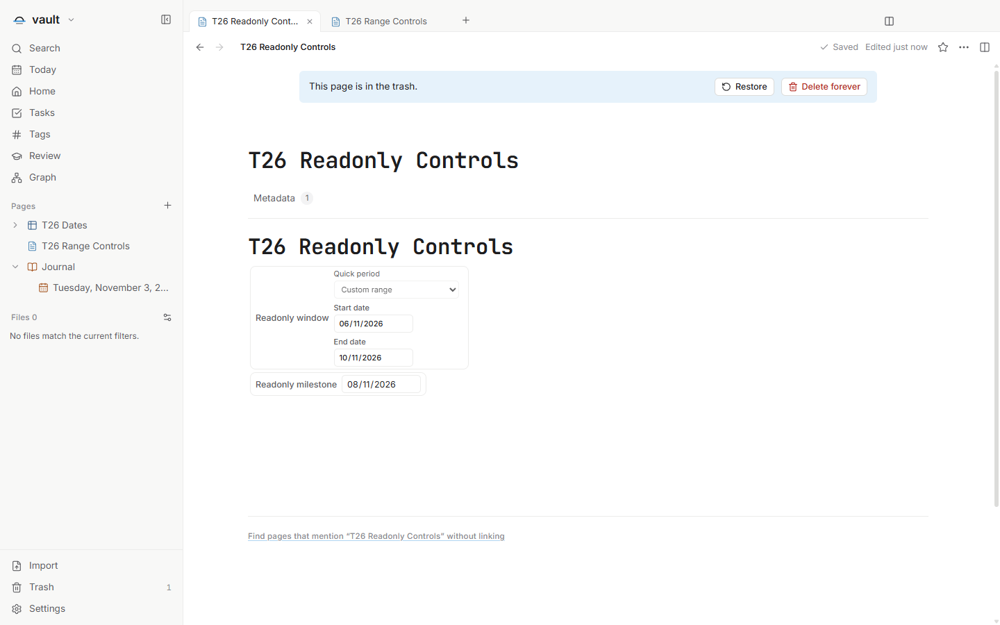

# T26 — Intervalo de datas e períodos rápidos

Issue: [#77](https://github.com/hodeliun/Morrow/issues/77). Dependência: T23,
entregue no PR106. O formato 13 já contém o contrato persistido do intervalo;
esta entrega acrescenta o controle, os presets e os endpoints na engine existente.

O valor é `null` ou um par ordenado de datas ISO sem hora. Não é uma lista com
todos os dias, nem uma lista de IDs de relation. Personalizado, hoje, últimos
sete dias, mês atual e próximos sete dias usam calendário local. Os dois períodos
de sete dias incluem hoje e materializam exatamente sete datas inclusivas entre
seus limites; essa é uma decisão de implementação, não uma resposta atribuída ao
mantenedor. Selecionar um preset grava os limites; abrir ou reabrir não os recalcula.

`First(Window)` e `Last(Window)`, assim como `Window.First()` e `Window.Last()`,
consomem o mesmo par tipado por bindings estáveis. Por exemplo, o par
`["2024-02-29", "2024-03-01"]` retorna os dois endpoints, sem conversão de fuso.
O filtro inclusivo pode usar
`thisRow.Due >= First(Window) and thisRow.Due <= Last(Window)`.

## Verificação

`npm run check` passou com 1.095 testes em 140 arquivos, tipos, lint e build.
Os 3.597 artefatos do pacote correspondem ao snapshot de 432 fontes. O registro
[T26-validation.json](T26-validation.json) contém hashes, critérios, matriz e limites.

O roteiro principal passou na primeira execução: vazio/reset, drafts parciais e
invertidos sem gravação, configuração atômica, quatro formas de First/Last,
presets amostrados pelo relógio real do renderer e filtro inclusivo. Dois ArrowUp
consecutivos mantiveram o mesmo input e seu foco. Uma segunda instância real
alterou o par sem desmontar os inputs da primeira nem perder seu próprio foco.
A reabertura manteve limites já materializados, fórmulas e bytes/mtime.

A matriz EN/PT/ES × claro/escuro passou a 520 px, com preferência preparada e
reload. A nota registrada em Trash manteve inputs/preset desabilitados, incluindo
a data simples compatível, sem mudar seus arquivos. As capturas abaixo mostram
os controles; a tabela continua abaixo do recorte nas imagens estreitas.

A regressão dirigida de foco também passou: após uma célula Due realmente
focada desaparecer por um rename reversível do arquivo sintético, o fallback
ficou em uma célula Due visível da mesma tabela/pane. O arquivo foi restaurado
com hash e mtime idênticos, sem mudar outro Markdown. Esse cenário não representa
um gesto público de Trash. O relatório observou também mudança em recent.json;
não afirma ausência de gravações auxiliares de metadata.

Os dois cenários usaram o mesmo pacote e passaram sem repetição, sem erros de
página/boundary genérico; três filhos saíram com código zero e ficaram ausentes,
sem processo próprio ou lease. O RED de Last e o alias ausente foram corrigidos
antes do gate, mantendo os asserts.

Os testes core usam relógio injetável e cobrem ano bissexto, mudança de mês/ano,
DST e relógio inválido. A interface não simula relógio nem prova troca de idioma
ao vivo. Não foram usados clipboard nativo, app/perfil/cofre pessoal, janela
visível, instalação ou release.
