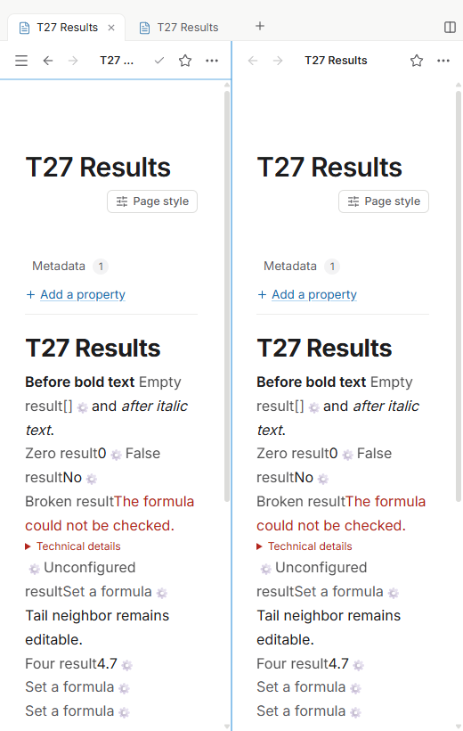
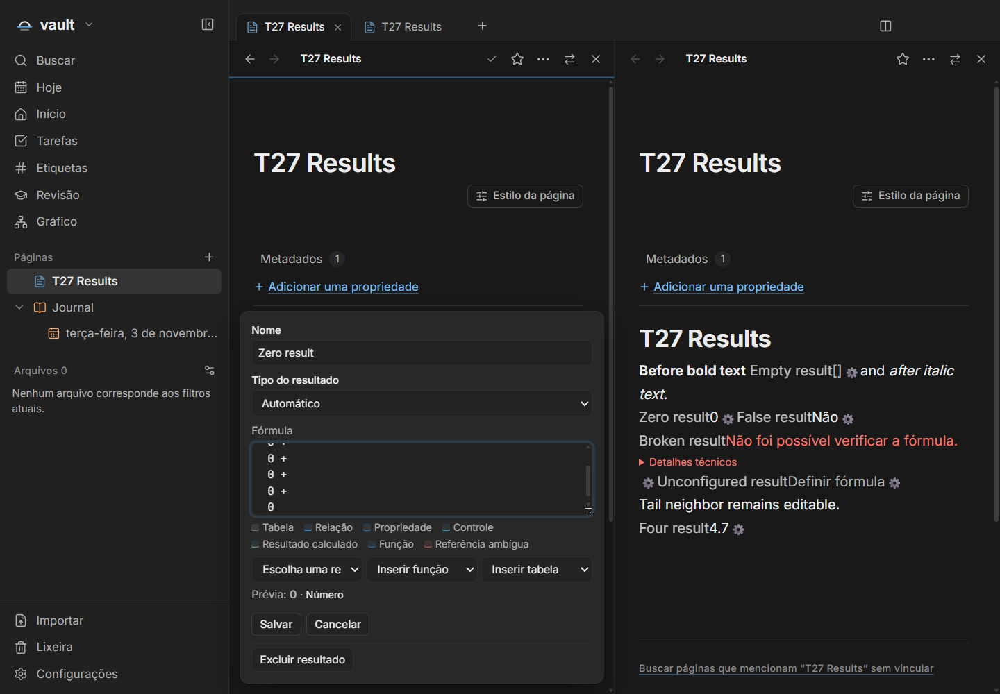
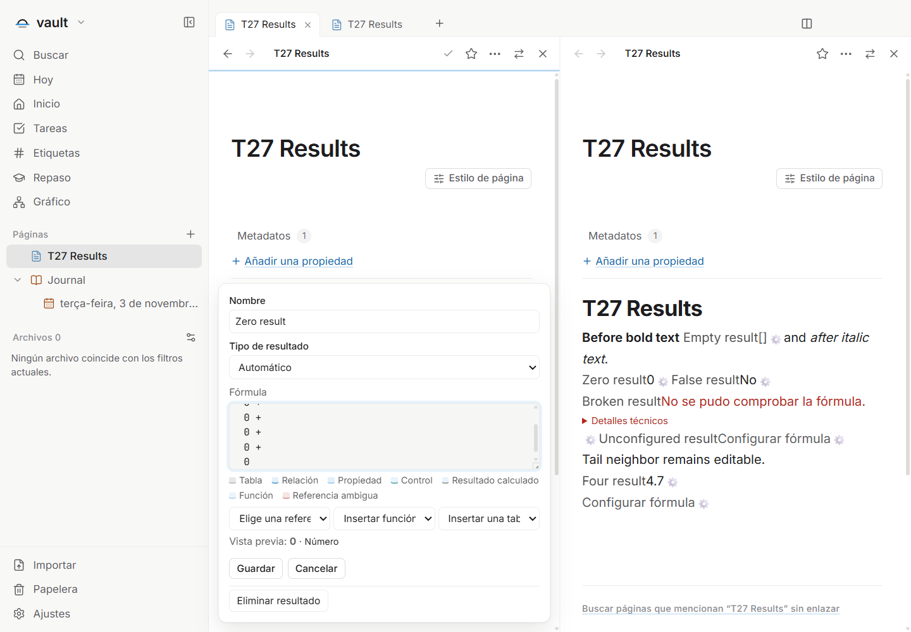

# T27 — Resultados de fórmula no texto

Issue: [#78](https://github.com/hodeliun/Morrow/issues/78). Os pré-requisitos
T08 e T14 já estavam publicados; sua aceitação histórica foi reconciliada antes
desta entrega, sem contar novamente nas 24 entregas retomadas.

O CalculatedResult existente permanece um objeto inline com identidade e
bindings estáveis. Nome opcional e resultado acompanham o parágrafo, entre texto
anterior e posterior. `/formula` e o menu contextual abrem o FormulaEditor
compartilhado; `=` continua sendo texto normal. Não há outro interpretador.

Fórmula ainda não configurada, vazio `[]`, zero, falso e erro têm apresentações
distintas. O popup fica limitado à pane/viewport; Save e Cancel preservam o
objeto, o texto e suas marcas. A configuração e a digitação vizinha têm etapas
separadas de Undo/Redo.

Rascunhos não salvos são efêmeros e isolados por Editor, página e resultado.
Sobrevivem à recriação de NodeView causada por edição estrutural em outra
instância, mantendo o snapshot original para rejeitar Save/Delete obsoletos.
Save, Cancel, remoção real e destruição do Editor limpam o rascunho; restaurar
uma pane inativa não rouba o foco da outra. PageEditor, sync e política geral
de history não são alterados.

## Verificação

`npm run check` passou com 1.135 testes em 146 arquivos, tipos, lint e build.
Os 3.597 artefatos empacotados correspondem ao snapshot de 443 fontes. O registro
[T27-validation.json](T27-validation.json) contém hashes, critérios e limites.

O roteiro principal final passou no pacote01: estados inline, nome opcional,
marcas originais, slash/menu contextual, Save/Cancel, texto vizinho, Undo/Redo
separados, duas panes reais e reabertura. EN/PT/ES × claro/escuro passaram a
520 px sem gravação ao abrir/cancelar configuração. A fonte editável de seis
linhas ficou alinhada ao overlay, incluindo scroll e caret, em PT dark e ES light
com zoom real de renderer125% preparado no ambiente sintético.

O cenário complementar verificou draft42 restaurado entre instâncias, SaveA
preservando o texto novo de B, rejeição de Save/Delete obsoletos, remoção sem
ressurreição e transição real a readonly com Cancel sem gravação. O handler real
consumiu copy/paste por eventos DOM em memória, preservou atributos e criou ID
novo; a composição Chromium sincronizou fonte e overlay sem persistir o draft.

O relatório complementar original permanece marcado como falho: seu trecho
final de navegação confundia ID do resultado com ID da página. Corrigidos os
dois callsites, somente esse trecho foi repetido. Uma continuação no perfil e
cofre sintéticos originais comprovou conteúdo incompatível protegido, bytes/mtime
inalterados após reopen e ausência do resultado já excluído. A passagem do trecho
em fixture nova foi registrada separadamente; não substitui essa continuidade.

Os negativos de prontidão também foram preservados: comparação inglesa “Saved”
com “Guardado” e leitura imediata de seleção PM antes de acompanhar o caret DOM.
O roteiro usa o rótulo exato do idioma e aguarda a seleção real no mesmo prazo,
sem seleção programática, aumento de timeout ou novo build. Nenhum erro de
página/boundary genérico foi observado; filhos saíram0 e os18 PIDs rastreados
ficaram ausentes, sem processo próprio ou lease. Fonte e pacote permaneceram
estáveis. Uma captura estreita com obstrução transitória do sidebar foi rejeitada
para publicação; as três imagens acima foram inspecionadas e estão legíveis.

Na curadoria, um teste dirigido detectou que o recorte antigo perderia o
diagnóstico T25 de domínio inválido de progresso. A chamada ao helper publicado
foi preservada e o mesmo teste passou, incluindo o formato legado máximo100 com
resultado4,7. Não houve alteração do formato13 ou da engine.

Composição Chromium e copy/paste por ClipboardEvent/DataTransfer em memória
são verificações do renderer; não representam IME ou clipboard do Windows.
Nenhum app, perfil ou cofre pessoal, janela visível, instalação ou release é
parte desta entrega.
