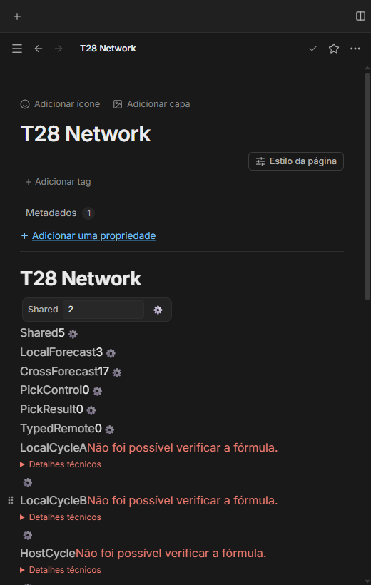
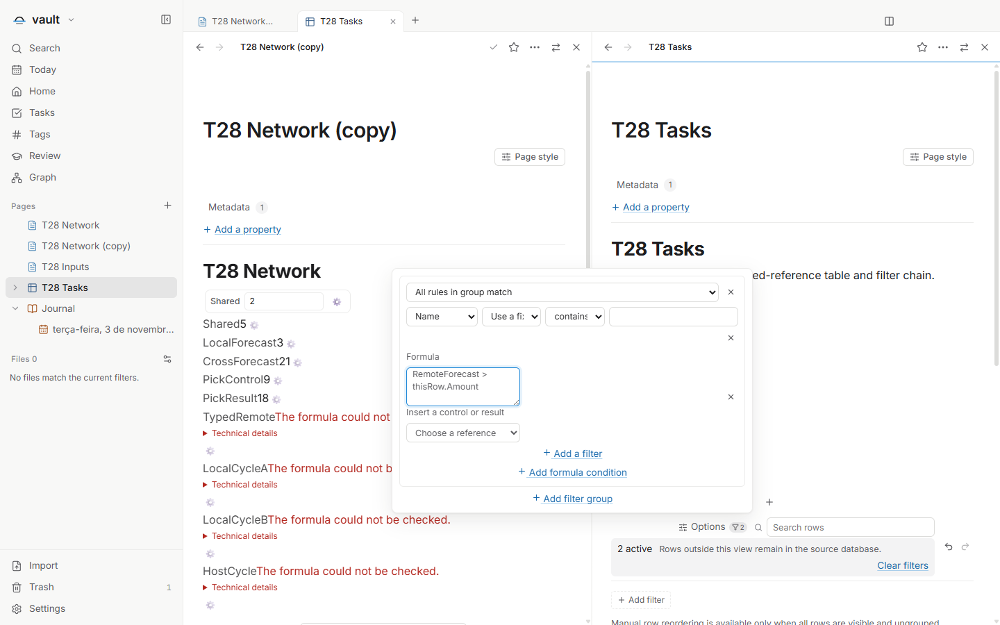
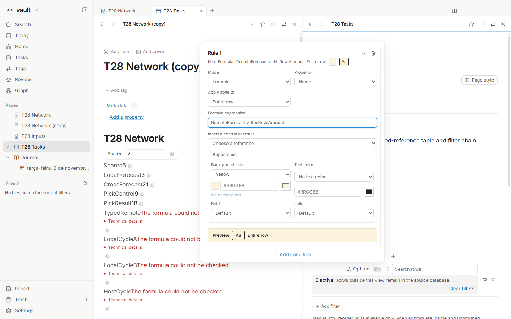

# T28 — Referências nomeadas entre páginas

Issue: [#79](https://github.com/hodeliun/Morrow/issues/79). T23 e T27 já estão
publicados e seus critérios foram verificados antes desta entrega.

Os pickers oferecem controles e resultados da página e de outras páginas com
nome, tipo e origem. A escolha persiste pageId e controlId/resultId no binding,
sem resolução global implícita por nome. Nomes duplicados exigem uma escolha
identificável; renomear mantém o vínculo e excluir produz diagnóstico, sem
substituir por outro objeto com nome parecido.

Controles podem alimentar resultados, outros resultados, fórmulas de tabela,
filtros e formatação condicional. A avaliação continua pura, com os limites e
guardas de ciclos existentes. Duplicar a página remapeia referências internas da
cópia e mantém referências externas. Não há engine, eval, rede ou ação adicional.

## Verificação

`npm run check` final passou com 1.152 testes em 147 arquivos, tipos, lint e
build. Os 3.597 artefatos empacotados correspondem ao snapshot de 444 fontes.
O [registro de validação](T28-validation.json) separa os dois trechos da interface
e os negativos, sem atribuir o aceite antigo do pacote41 à fonte atual.

O roteiro principal percorreu os pickers em seis combinações EN/PT/ES ×
claro/escuro a 520 px, sem gravação ao abrir/cancelar. A origem e o tipo distinguiram
três objetos chamados Shared; digitar um nome remoto sem binding não escolheu um
objeto implicitamente. Renomear manteve os IDs e excluir deixou diagnóstico,
incluindo nas referências de resultados e filtros existentes.

A rede inicial calculou 3, 14, 17 e 14 no resultado local, remoto, encadeado e na
projeção da tabela. Alterar o controle remoto atualizou resultados, cópia, tabela,
filtro explícito e formatação condicional. O filtro RemoteForecast > thisRow.Amount
mostrou Alpha/Beta e excluiu Gamma, preservando os bindings após rename. A célula
de ciclo foi alcançada por wheel real, com pintura/hit próprio e diagnóstico Error.
Testes core cobrem ciclos e a interrupção da cadeia 66 acima do limite 64 existente.

O comando público Duplicate remapeou controles/resultados internos da cópia e
preservou referências externas. Duas panes tinham IDs e Editors reais distintos.
A página registrada em Trash manteve o controle desabilitado, sem configurar ou
alterar seus bytes/mtime. YAML desconhecido sobreviveu às gravações legítimas.

A primeira imagem é posterior ao Cancel. Labels, opções e geometria do picker
são prova DOM do roteiro, não uma promessa de dropdown aberto nessa captura.
As duas imagens largas mostram a configuração; os IDs das linhas e bindings são
asserções separadas. As três capturas sintéticas foram inspecionadas visualmente.

O relatório principal original permanece failed: no trecho final de preparação
da reabertura, seu helper exigia YAML na nota diária vazia válida desta versão.
Os asserts anteriores já tinham sido executados. Somente esse trecho continuou
no perfil/cofre sintéticos originais, sem repetir o prefixo aprovado. Aceitar
vazio é restrito à nota diária conhecida; os sete arquivos semeados mantêm parser
estrito. A ação pública Hoje, seguida de Saved, acrescentou apenas o título inglês
atual: neste ensaio de 03/11, 0→41 bytes, corpo vazio e todos os outros Markdown/mtimes
intactos. A nova baseline durável foi tomada antes de fechar. Após reopen, todos
os Markdown ficaram idênticos e os bindings/diagnósticos excluídos permaneceram.
Não há whitelist aplicada depois de reabrir.

O check01 parou nos tipos por um import useMemo ausente na extração; uma linha
foi corrigida antes do check02, sem snapshot/pacote01. Não houve rebuild por
ajuste do roteiro, aumento de prazo ou seleção programática. Fonte/pacote ficaram
estáveis, sem erro de página/boundary genérico; três filhos saíram 0, seis PIDs
rastreados ficaram ausentes e a lease foi encerrada.

Preferência mais reload é setup de aparência, sem claim de troca pelo Settings
ao vivo. A cópia é o comando Duplicate, não clipboard nativo. Não houve IME/clipboard
do Windows, app/perfil/cofre pessoal, janela nativa visível, mudança de engine ou
formato, instalação ou release.
