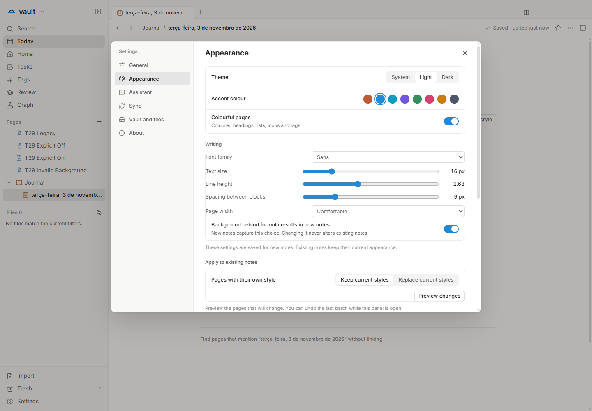
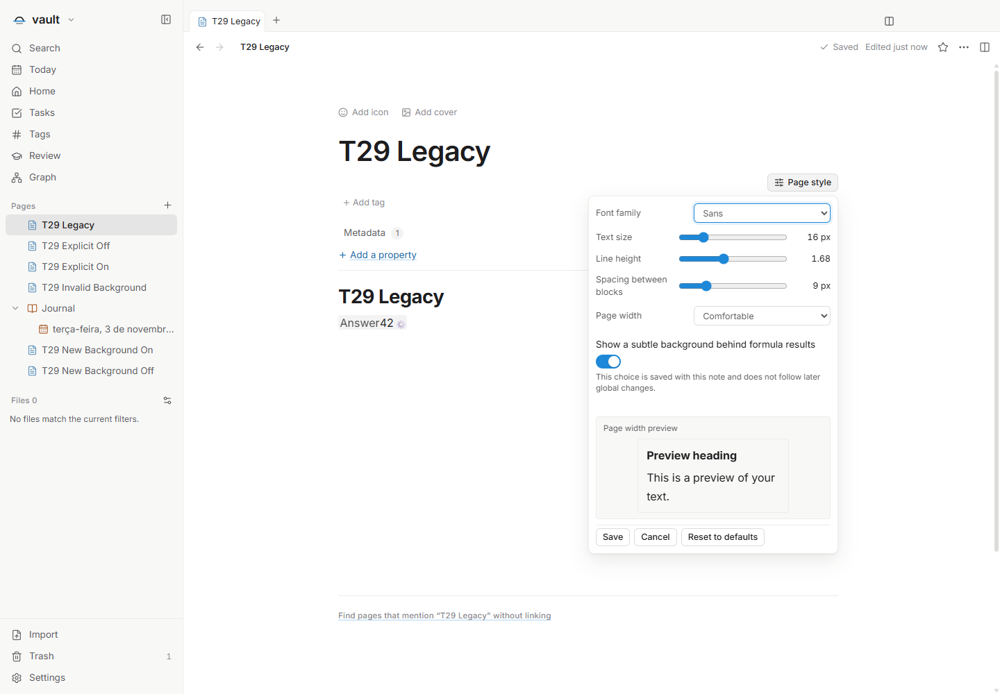
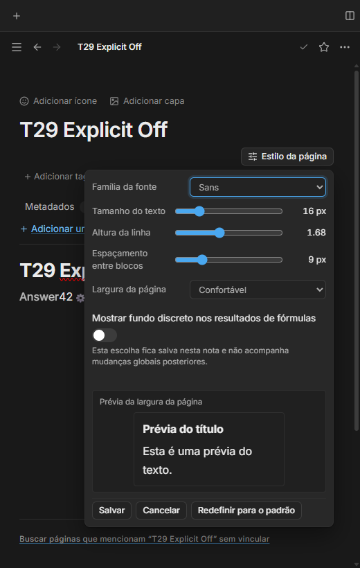

# T29 — fundo dos resultados por nota

O padrão do perfil começa ativado e é registrado nas novas notas. Cada nota pode
escolher o próprio fundo discreto em Estilo da página. Mudar o padrão não regrava
notas existentes; a ausência do campo legado continua significando fundo ativado.

A escolha acompanha criações genuínas, inclusive linhas e ações de tabela, antes
da geração dos comandos e do journal. Duplicação, importação e cópia preservam a
origem; o core/MCP sem perfil mantém o contrato legado. Formato13 permanece.

A entrega também impede que um evento antigo de gravação recrie uma linha já
removida pelo próprio aplicativo. A verificação de existência distingue ausência
de erro de acesso, retém a ordem e permite nova tentativa pelo salvamento existente.

Validação final: tipos, lint, build e **1.167 testes em 148 arquivos**. Snapshot
com 445 fontes e 3.597 artefatos, todos conferidos no pacote isolado03. Roteiro
principal04 aprovado nesse pacote, incluindo EN/PT/ES claro/escuro a520px e
rótulo local visível. Extras02 de inserção/ações/Undo/Redo/reopen são atribuídos
ao pacote02: 444 fontes idênticas, única mudança posterior é o texto visível
em NoteStylePopover, não visitado pelos extras. Não foram chamados extras03.

A inspeção visual encontrou o rótulo ausente antes da publicação; a correção é
um span traduzido, sem mudança dos comandos. Um hook de captura também tentou
fechar a notificação da fixture inválida atrás de modal: negativo preservado,
gesto movido para antes da abertura, sem force ou ampliação de prazo. O teste
antigo do assistente passou a exigir metadata true + corpo integral e reopen.

Core dirigido: 80 testes storage/native,36 defaults/planners/recovery e8 de
contrato do assistente; lint pertinente aprovado. Erros EIO/EACCES/EPERM são
injetados e recuperáveis; não representam ensaio em drive pessoal. As criações
por tabela comprovam comandos/records/journal, ambos padrões e IDs após Undo/Redo.

Fonte final e pacote estáveis, sem erros de página ou boundary genérico; 21 PIDs
rastreados ausentes e lease encerrada. Fixtures privadas preservadas para
auditoria, sem alegar remoção delas. [Registro verificável](T29-validation.json).

A matriz prepara o perfil sintético e recarrega; não prova troca de idioma ao
vivo. Import usa input sintético, readonly usa Trash/metadata inválida. Sem
clipboard/IME ou diálogos do Windows, dados pessoais, instalação ou release.

