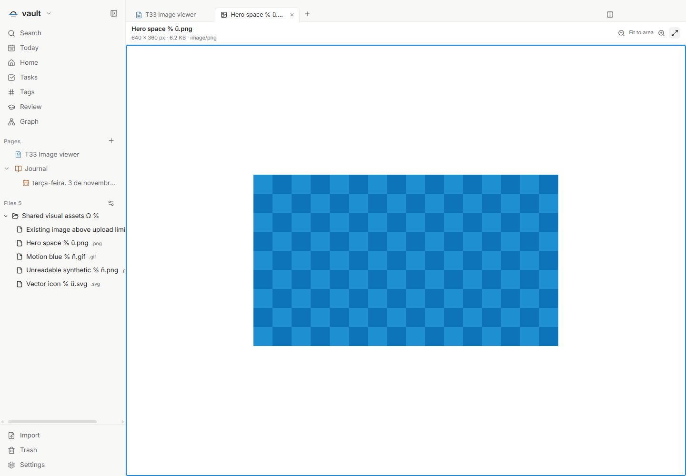
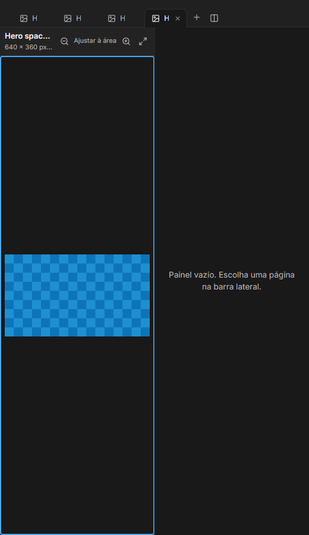

# Imagens em abas próprias — T33

Issue: [#85](https://github.com/hodeliun/Morrow/issues/85).
Base oficial: Morrow 1.3.0.

## Comportamento

Imagens que já estão no vault podem ser abertas em uma aba própria, usando o
visualizador interno escolhido nas preferências de abertura. O visualizador
oferece zoom, ajuste à área e informações do arquivo. A imagem continua no lugar:
abrir não cria uma nota, não copia para attachments e não altera seus pixels.

Para usar, escolha o destino interno para a extensão nas preferências de abertura
e clique no arquivo no catálogo. Na aba da imagem, use os botões de zoom e ajuste
à área. Com foco na prévia, `+` e `-` ajustam o zoom, e `0` restaura o ajuste.
O nome, as dimensões, o tamanho e o tipo do arquivo aparecem na barra do viewer.

Os alvos das abas distinguem páginas, arquivos locais, endereços e espaços vazios.
As páginas e rotas anteriores continuam compatíveis. Nesta entrega, um endereço
tem uma mensagem de indisponibilidade; a navegação web pertence ao T36.

SVG é apresentado como imagem, sem executar scripts como documento. O processo
principal valida o caminho e o tipo do recurso. Fechar a aba ou trocar de vault
libera o acesso correspondente. Arquivos ausentes ou inválidos recebem uma
mensagem de erro, preservando o original.

## Verificação

O recorte isolado T33 passou `npm run check`: 862 testes em 105 arquivos, tipos,
lint e compilação. Os 3.597 artefatos do pacote conferem com o snapshot testado.
Os cenários principal e complementar passaram na aplicação isolada no Windows.

Foram verificados PNG, GIF com dois quadros, SVG sem execução de script, zoom
por botão e teclado, ajuste à área, duas instâncias com acessos independentes,
reabertura, histórico, arquivo removido, erro de decode e troca de cofre. Uma
imagem PNG sintética de 101 MiB abriu no lugar, sem importar para attachments.
As matrizes de português, inglês e espanhol, temas claro/escuro e viewport de
520 px preservaram os controles e os originais. Nove alvos inválidos foram
rejeitados; nove etapas de histórico e armazenamento não conservaram o marcador
sintético de segredo. Nenhuma requisição remota ou janela adicional foi aberta.

A abertura protege a sessão do cofre em cada resposta assíncrona. Se a pessoa
trocar de cofre enquanto o destino ou a identidade do arquivo estiver pendente,
a resposta antiga não abre uma aba nem apresenta um erro no cofre novo. Quatro
testes direcionados cobrem essas respostas atrasadas e a abertura normal.

O primeiro cenário principal excedeu o prazo de encerramento do controlador e
permanece registrado como falha. O controlador privado passou a pedir `app.quit`
explicitamente à própria aplicação; o cenário repetido e o complementar passaram,
com quatro processos encerrados normalmente e sem aumentar o prazo. Nenhuma
mudança no produto ou recompilação foi feita para esse ajuste do controlador.

Resultados, hashes e limites: [registro verificável](T33-validation.json).
Os exemplos comprovam as amostras verificadas; não são um teste geral de consumo
de memória ou promessa de suporte a todo formato. Esta entrega publica código,
sem instalador, release ou alteração da instalação pessoal.

## Demonstrações sintéticas

A nota anterior permanece em sua aba e a imagem exibe nome, dimensões e controles.

O visualizador se ajusta ao painel estreito; o espaço vizinho continua vazio.
