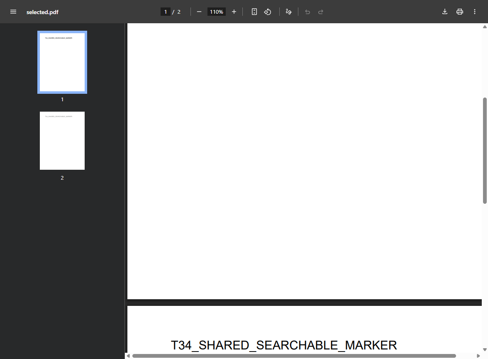
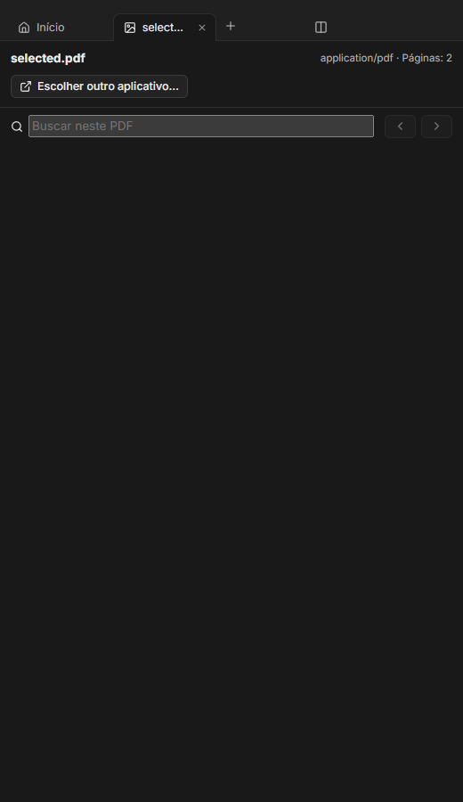
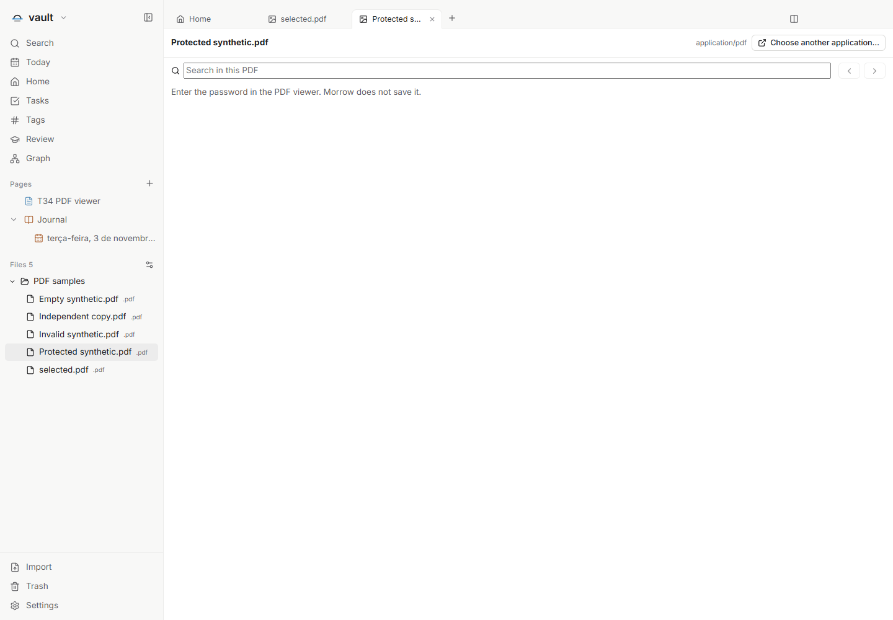

# T34 — PDFs locais em abas internas

Nas configurações de **Arquivos**, escolha **Interno** para `.pdf`. O arquivo
abre diretamente do vault, usando o leitor de PDF já incluído no Electron:
páginas, zoom e rolagem nativos, mais busca no aplicativo. O método de abertura
continua configurável; a entrega não substitui uma escolha anterior do usuário.

Cada instância usa uma sessão em memória, sem preload/bridge do aplicativo nem
Node. Uma capacidade opaca permite ler somente o PDF selecionado, após verificar
o caminho real e a identidade do arquivo aberto. A extensão permitida é `.pdf` e
a resposta usa `application/pdf`; isso não equivale a identificar o conteúdo por
assinatura. O leitor informa PDFs inválidos, protegidos ou indisponíveis.

Permissões, rede remota e downloads são negados nessa sessão. Os recursos locais
do próprio Chromium são permitidos pelo host exato `chrome://resources`. Links
HTTP(S) exigem confirmação no aplicativo antes do roteamento validado existente.
A opção **Escolher outro aplicativo** é explícita. A senha pertence ao diálogo
do Chromium: o aplicativo não lê nem persiste seu valor.

O viewer acompanha o painel e fica oculto quando outra superfície o obstrui.
Fechar a instância ou trocar de vault revoga sua capacidade. Arquivos originais
e metadados do vault permanecem preservados. O formato 13 não muda e não há nova
dependência de runtime, instalador ou release nesta entrega.

## Validação

Tipos, lint, build e **1.183 testes em 150 arquivos** passaram no build03;
451 fontes e 3.597 artefatos foram congelados e os artefatos do pacote conferidos.
O Windows empacotado comprovou zoom de 100% para 110%, rolagem real no renderer,
página 2 por teclado, busca nas duas páginas, isolamento e seis apresentações
EN/PT/ES, claro/escuro, em 520 px. PDFs inválido e vazio têm estados próprios.

O prefixo funcional do build02 foi preservado como parte de um resultado geral
**failed**, que encontrou um defeito real na identificação da senha. O build03
corrige a leitura do diálogo nativo aberto, com teste red→green e regressão
afetada aprovada. A comparação estrita deixou 448 fontes iguais; os três deltas
são o detector, seu teste e o limite do campo de busca alinhado a 512 caracteres.
Não se atribui a matriz anterior ao pacote novo nem se renomeia o resultado falho.

A regressão final também abriu outra instância, preservou hashes/mtimes dos nove
PDFs e o inventário completo dos dois vaults sintéticos. Não houve erros de
página, ErrorBoundary visível ou chamada externa pelo processo instrumentado.
As janelas ficaram ocultas e os processos próprios encerraram cooperativamente.

As ações nativas usam entrada CDP no renderer do PDF; não são prova de gesto ou
diálogo do Windows. O fallback externo foi apresentado, sem abrir um aplicativo
externo. A prontidão de pintura oculta usa a configuração de teste pós-load já
verificada. Os controles nativos seguem o idioma do Electron; busca, mensagens
e fallback do aplicativo foram verificados em EN/PT/ES.

[Evidência sanitizada](T34-validation.json) · [Issue #86](https://github.com/hodeliun/Morrow/issues/86)

## Capturas sintéticas reais

Superfície nativa do PDF, capturada diretamente do seu WebContents interno:

Controles do aplicativo em 520 px. A captura do aplicativo não inclui a
superfície nativa acima; as imagens são separadas e não foram compostas:

Condição de senha informada pelo aplicativo, sem entrada ou leitura da senha:

