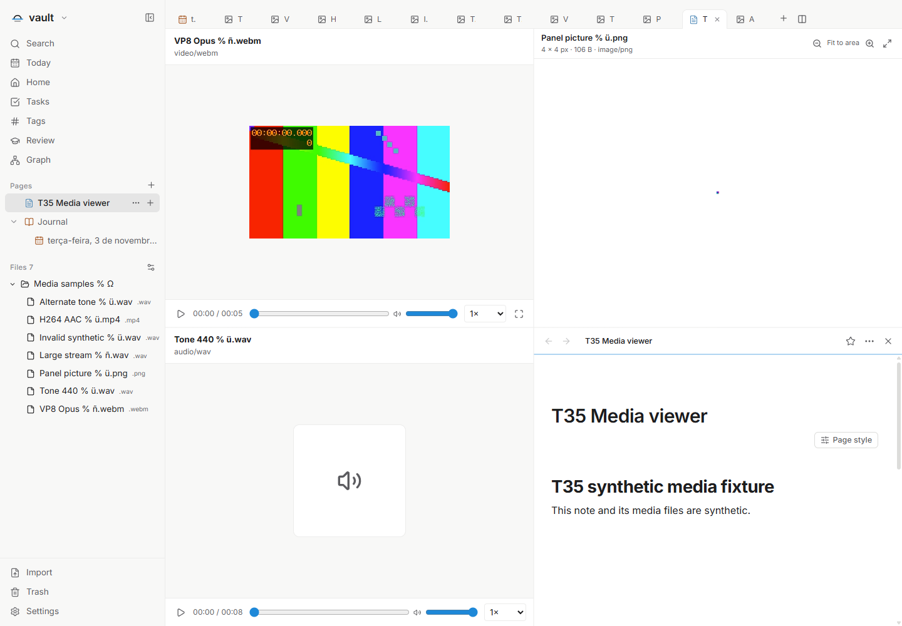
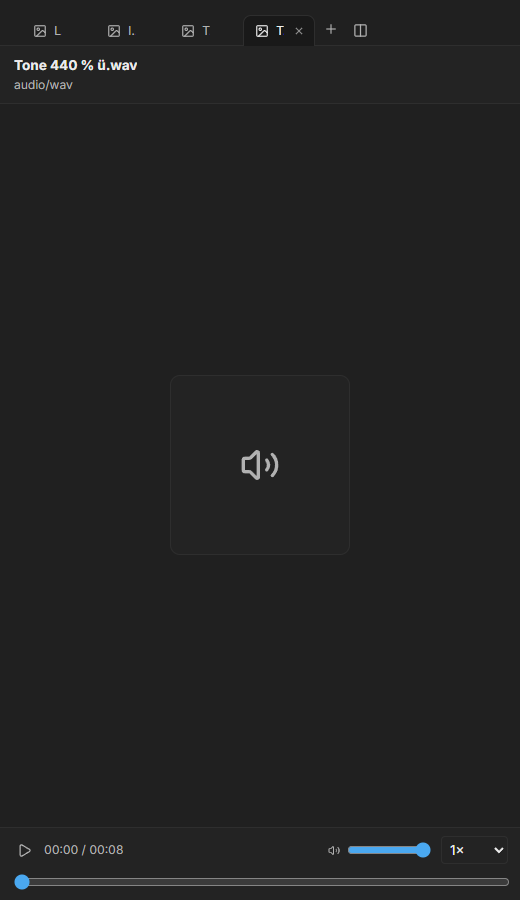
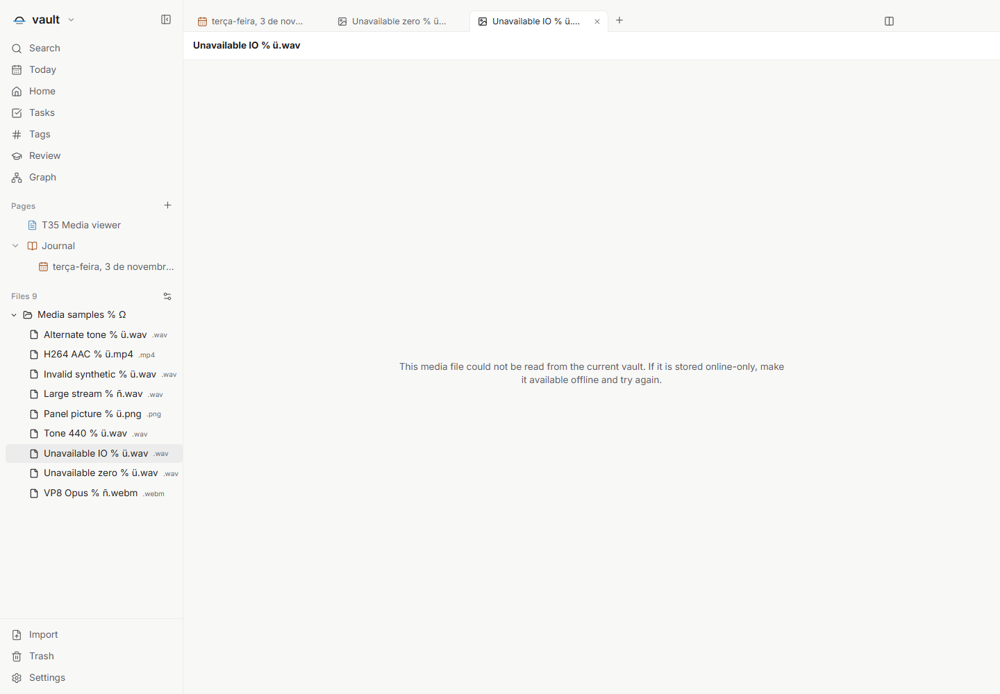

# Áudio e vídeo locais em abas — T35

Issue: [#87](https://github.com/hodeliun/Morrow/issues/87).
Base oficial: Morrow 1.3.0; extensão do visualizador de arquivos entregue no T33.

## Comportamento

Arquivos de áudio e vídeo existentes no vault podem abrir em uma aba própria,
sem criar notas, copiar para attachments ou transcodificar. O player oferece
reproduzir/pausar, posição e duração, busca de posição, volume e velocidade.
Vídeos também oferecem tela cheia do elemento e alternativa por teclado.

O visualizador lê os bytes sob demanda por um recurso validado no processo
principal. Fechar ou ocultar uma aba, ou trocar de cofre, pausa a mídia e libera
seus recursos. Restaurar uma aba não inicia reprodução automática.

Arquivo indisponível e formato que não pôde ser decodificado têm mensagens
distintas. A opção externa respeita a configuração local de abertura. A extensão
do arquivo, sozinha, não garante que o codec seja reproduzido nesta plataforma.
O aplicativo não baixa codecs nem inicia rede para obter um placeholder.

Para usar, escolha o destino interno para a extensão nas preferências de abertura
e clique no arquivo no catálogo. Os controles do player permitem reproduzir,
pausar, escolher posição, volume e velocidade. No vídeo, o botão de tela cheia
e o atalho `F` alternam a tela cheia do elemento; Escape sai desse modo.

## Verificação

O recorte isolado T35 passou `npm run check`: 910 testes em 112 arquivos, tipos,
lint e compilação. Os 3.597 artefatos do pacote conferem com o snapshot testado.
Os cenários principal e complementar passaram na aplicação isolada no Windows.

As amostras WAV/PCM de oito segundos, WebM/VP8+Opus de cinco segundos e
MP4/H.264/AAC de cinco segundos reproduziram e buscaram posições no pacote.
Esse resultado descreve as amostras verificadas nesta plataforma, sem inferir
suporte apenas pela extensão. Volume do elemento, velocidade, botões e teclado
foram verificados, com o áudio do WebContents de teste silenciado.

Um WAV sintético de 107.200.078 bytes começou a reprodução e buscou até a posição
de 6.700 segundos. Um pedido explícito de intervalo na mesma sessão do Electron
retornou 206 e exatamente 1.024 bytes. O núcleo e o protocolo também cobrem HEAD,
MIME, 416 e cancelamento, com buffers limitados a 64 KiB e fila por bytes de
128 KiB. Não houve cópia, transcodificação ou alteração dos originais.

Ocultar e fechar abas, restaurar o layout e trocar de cofre pausaram ou revogaram
os recursos sem reprodução automática. Vídeo, áudio, imagem e documento ficaram
visíveis em quatro painéis; português, inglês e espanhol, temas claro/escuro e
viewport de 520 px foram verificados sem erro de página ou tela genérica de falha.

Arquivos sintéticos sem bytes e uma falha de leitura controlada receberam a
mensagem de indisponibilidade. A varredura não abriu nem leu o binário; o viewer
tentou abri-lo uma vez. Bytes inválidos legíveis receberam o diagnóstico de codec
e a opção externa, sem abrir outro aplicativo. Hashes e horários de modificação
dos originais foram preservados.

Resultados, hashes e limites: [registro verificável](T35-validation.json).
Esta é uma entrega de código, sem instalador, release ou alteração da instalação
pessoal.

## Limites

A tela cheia do elemento, testada em uma janela isolada oculta, é diferente de
testar a transição nativa de tela cheia do Windows. Um ensaio de subintervalo
explícito comprova o protocolo; não comprova que cada busca do player faça essa
mesma requisição nem mede o consumo total de memória. Exemplos de disponibilidade
com dados sintéticos não equivalem a testar um provedor real de arquivos online.

## Demonstrações sintéticas

Cada superfície mantém sua função, sem transformar os binários em notas.

Os controles de áudio se reorganizam no viewport de 520 px.

A orientação de disponibilidade é diferente de uma falha de decodificação.
