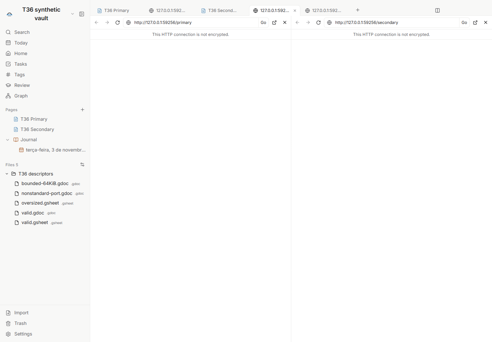
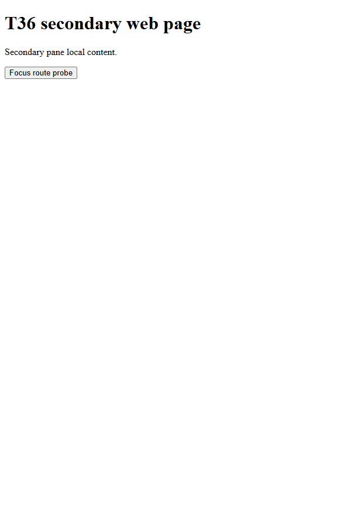
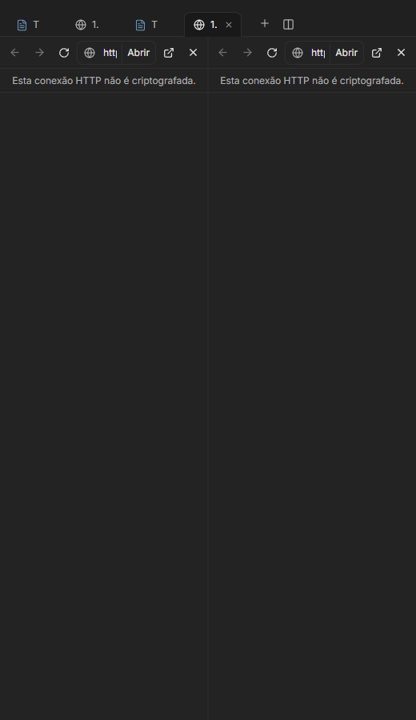

# T36 — navegação web em abas isoladas

Implementação e aceite local de [T36 / #88](https://github.com/hodeliun/Morrow/issues/88).
Publicação e encerramento dependem do CI Windows/Linux da main.

O conteúdo remoto usa uma WebContentsView sem preload do Morrow ou Node, em uma
sessão própria persistida no perfil local do aplicativo. Limpar dados é uma ação
explícita. Fechar abas ou o vault libera as views e sua rede; restaurar um endereço
não inicia navegação sem ativação explícita.

Endereços HTTP(S) são validados tanto no aplicativo quanto no processo principal.
Domínios sem esquema recebem HTTPS; HTTP explícito recebe aviso. O destino salvo
pelo aplicativo não conserva consultas ou fragmentos, com exceção do endereço
exato de vídeo do YouTube permitido pela política; o endereço em execução recebe
aviso de não restauração. Dados mantidos pelo próprio site pertencem à sessão web
e podem ser removidos pela ação de limpar. URLs rejeitadas ou não restauráveis não são substituídas
silenciosamente por outro destino. Descritores gdoc/gsheet são lidos de forma
limitada e validada; XLSX permanece no fluxo de arquivos locais.

Limites da verificação: somente perfis/cofres sintéticos e janelas ocultas.
Entrada CDP no renderer e seleção/cancelamento interceptados não são apresentados
como interação com diálogos ou ponteiro nativo do Windows. Compatibilidade com
sites públicos é datada e não promete login, DRM ou autenticação externa herdada.

## Verificação

`npm run check`: 1.222 testes em 156 arquivos, tipos, lint e build aprovados.
O pacote final 06 confere os 3.593 artefatos do snapshot de 464 fontes.

Os oito critérios combinam o prefixo funcional registrado no pacote 04, o fluxo
original de encerramento aprovado no 05 e as continuações afetadas no 06. Os
relatórios que terminaram em falha continuam identificados como falhas; somente
as asserções concluídas antes delas são reutilizadas. As únicas alterações
04→05 são a captura antecipada do ID do WebContents destruído e seu teste;
05→06 altera o label acessível para a classe de ocultação existente.

- Endereço, navegação, preferência e opções de link; um único encaminhamento
  externo por ação, interceptado no teste sem abrir aplicativo pessoal.
- Sessão própria persistida, isolamento e negação de protocolos/permissões;
  upload selecionado/cancelado por interceptação CDP antes da página, download
  cancelado antes de gravar e três APIs de picker local ausentes nas frames.
- Descritores HTTP(S) limitados a 64 KiB, caminhos e identidade revalidados;
  originais e XLSX preservados, sem avaliar conteúdo.
- Duas panes reais, overlay ocultando views e pausa de mídia em iframe.
  Bounds nativos conferem com os retângulos do renderer; zoom e escala do
  processo são registrados separadamente. Não é ensaio de troca do DPI do Windows.
- Português escuro e espanhol claro em 520 px, inglês amplo; controles dentro
  dos painéis. A figura do renderer não inclui o conteúdo da view nativa, que
  foi capturado separadamente.
- Cookie e localStorage sintéticos sobrevivem a processo novo; nenhum request
  ou WebContents antes de ativar o endereço restaurado. Limpar dados remove
  ambos. Fechar, recarregar e trocar vault liberam as views; processos encerram
  cooperativamente com código zero, sem lease ou processo próprio restante.

Em 04/11/2026 às 01:57 UTC, as navegações anônimas foram observadas por eventos
próprios de início/fim: YouTube apresentou fallback de erro do aplicativo;
Drive redirecionou para sua página pública em workspace.google.com; Sheets
redirecionou para login em accounts.google.com. Não houve login, inspeção de
cookies desses serviços, alteração de user-agent ou abertura externa.

O foco do site para sua pane foi verificado pelo evento do WebContents próprio
e pelo callback de produto. Entrada CDP oculta não produziu foco nativo do
Windows, portanto esse gesto do sistema não é alegado como testado.

Resumo verificável: [T36 validation](T36-isolated-web-tabs.json).
