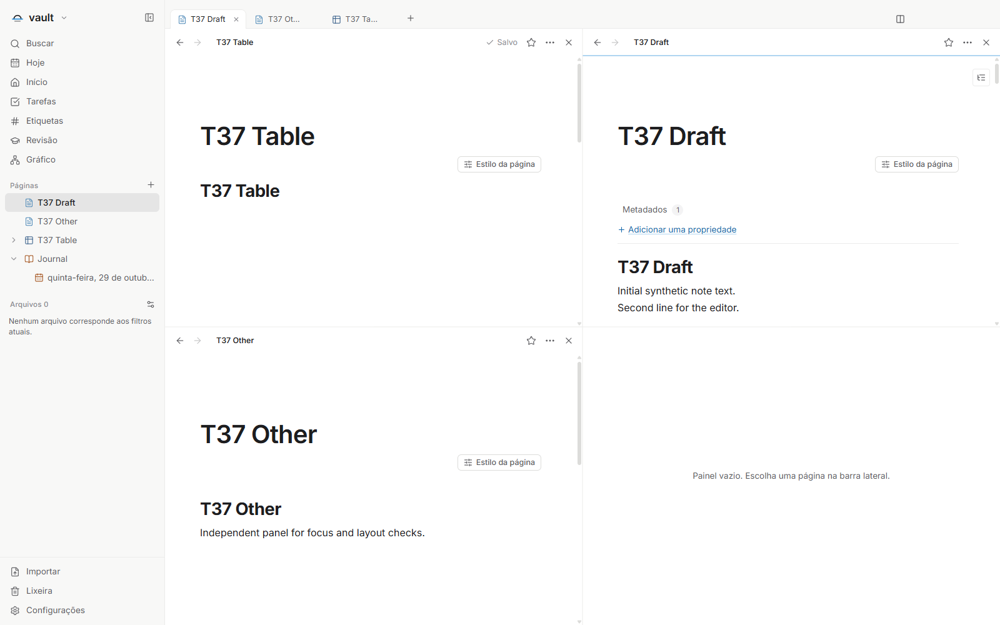
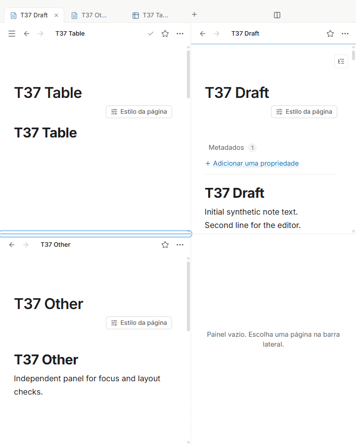
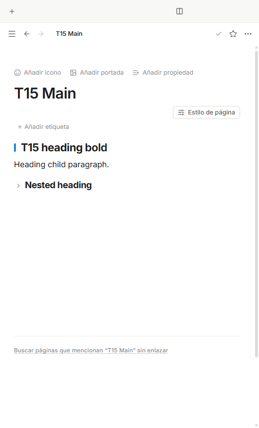
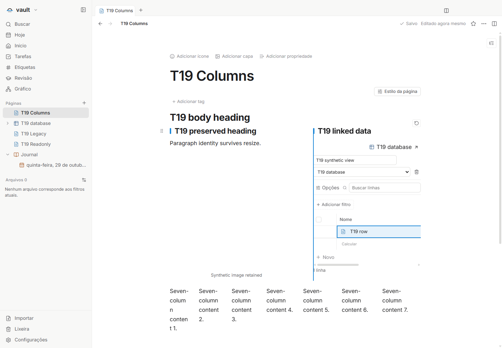

# Integração Morrow 1.3.0 e fork 1.2.0

Estado: fontes e validação integrada concluídas no build 23. Esta atualização preserva os quinze tickets aceitos e mantém os outros 24 pausados. Não publica tag, instalador ou release.

A base oficial é `13ce1908ac7777a16161b5ef0c013de5eadcb3a1` (v1.3.0). Os 39 commits oficiais desde v1.2.1 são preservados por merge. A versão própria do fork é 1.2.0; o pacote combina as versões em `1.3.0-fork.1.2.0`.

## Limite e entregas funcionais

Os quinze tickets previamente aceitos são T01/T02/T06/T08/T09/T10/T11/T14/T15/T16/T17/T19/T31/T32/T37. O avanço oficial não conclui automaticamente nenhum dos outros 24 tickets.

1. Bancos de dados e interoperabilidade nativa: edição tipada, clipboard, fórmulas, regras condicionais e controles de views; inclui interfaces compartilhadas de persistência e despacho local.
2. Editor, leitura e painéis: estrutura reversível, estilos, colunas, rascunhos montados e navegação contextual.
3. Catálogo e configuração de abertura: visibilidade local e escolha de aplicativos por dispositivo.

Os limites seguem dependências reais. Cada árvore intermediária passou na checagem de tipos de renderer, Electron e entradas de teste. Correções encontradas na reconciliação com a base oficial integram o merge final, sem microcommits de reparo públicos.

## Reconciliação e revisão

As 26 colisões de merge foram conciliadas pela intenção dos dois lados. A restauração oficial de cursor e posição usa uma autoridade única, isolada por cofre/aba/painel; a segunda aba da mesma página permanece independente. Navegação explícita e interação confiável cancelam restauração pendente. Abas fixadas preservam ordem, persistência e proteção contra fechamento.

A abertura distingue o endereço recebido ao iniciar do endereço restaurado pelas abas. Links explícitos prevalecem no painel em foco, com histórico persistido; Home/Hoje respeitam a preferência e “Onde parei” mantém o alvo salvo sem retroceder no histórico. Os demais painéis permanecem preservados. Quando as notas diárias estão ocultas, a abertura Hoje usa Home.

Regressões da integração corrigidas: o campo oficial archivedAt passa pelo protocolo tipado de linhas com validação e compatibilidade legada; resumos de toggles distinguem formato Markdown explícito, títulos oficiais e texto legado; links Markdown internos preservam query e fragmento ao carregar/mover/reabrir; imagens coladas interrompem a leitura ao exceder o limite mesmo quando Content-Length é omitido ou falso.

Revisões independentes de leitura/painéis e de segurança/compatibilidade não encontraram P1/P2 remanescente no escopo inspecionado. A revisão estática não substitui as provas visuais e de persistência do build final. O histórico privado de recuperação permanece separado da ancestralidade publicada. O checkout original é reconciliado somente após comparar o seu estado com o backup verificado.

## Validação e limites

O build integral aprovado é `scope-2-build-23`: `npm run check` passou com
771 testes em 98 arquivos, tipos, lint e compilação; os dez testes de preflight
passaram. As duas cópias isoladas contêm os mesmos 3.977 arquivos manifestados e o ícone build/icon.png verificado separadamente, totalizando 3.978 arquivos.
O [registro de validação](validation-1.3.0-fork.1.2.0.json) reúne resultados, limites e hashes das provas de runtime sem caminhos privados. O [manifesto de fontes](runtime-sources-1.3.0-fork.1.2.0.json) identifica os
331 arquivos de produto e configuração usados, com SHA-256 e blob Git após os
filtros do repositório. Ferramentas privadas de execução estão excluídas.

Entre os builds 20 e 23, somente duas das 380 fontes mudaram. O seletor de
FormulaEditor.css passou a exigir `.formula-editor .formula-input.text-input`:
a regra geral carregada depois do componente impunha padding lateral de 8 px,
enquanto a camada colorida usava 10 px. O ajuste preserva valores e gutter,
aumentando somente a especificidade.

Popover.tsx passou a ajustar também o eixo de colocação. A 150%, o painel tinha
584 px de altura numa janela de 600 px, mas começava em y=32,229 e terminava em
616,229. O excesso persistiu após carregar fontes, dois frames e 300 ms. Com
`shift({ padding: 8, crossAxis: true })`, a prova original passou: topo 8 e base
592. Os módulos de posicionamento afetados receberam novas rodadas T08/T09/T10/T11
no build 23. As demais provas do build 20 são mantidas com essa fronteira explícita.

O build 21 excedeu o prazo de cinco segundos de um teste de scanner. O mesmo
caso passou isoladamente em 1,04 s; as suítes completas dos builds 22 e 23 passaram
sem alterar o teste ou seu prazo. As tentativas interrompidas foram preservadas.

A prova oficial do build 20 reabriu a mesma aba fixada com a posição exata
3432 → 3432 e o cursor 2837, no mesmo texto e offset 59. Também passaram a
paleta de nova aba, proteção de fechamento de abas fixadas, arquivamento e
restauração na barra lateral e preferência de ortografia após reabrir. Markdown,
fontes e artefatos permaneceram íntegros; não houve erro de renderer nem acesso
externo. Três processos de teste encerraram com código zero e nenhum permaneceu
ativo. As sete capturas sintéticas foram inspecionadas.

T15 e T19 usam provas visuais e de persistência do build integrado 16, com
revisão da fronteira até o build final. Todos os demais 35 arquivos do editor,
as sete folhas de estilo globais e os módulos de colunas/painéis permaneceram idênticos.
A única mudança em PageEditor exporta e renomeia uma comparação existente, sem
alterar seu corpo. A restauração modificada em PageView tem prova nova no build
20 e na rodada específica de painéis, sem apresentar esses resultados antigos
como se tivessem sido executados novamente.

T17 passou nos dezoito casos de títulos, temas e reabertura do build 17. O teste
completo continua registrado como falha por uma limitação auxiliar já presente
antes desta integração: o arquivo de registro do cofre recebe novo mtime com os
mesmos bytes ao abrir. O Markdown mantém bytes, tamanho e mtime; os únicos dados
novos são o registro intencional de abertura recente. O aceite específico de
cores e preservação do documento é mantido com essa ressalva, sem afirmar que o
teste completo ficou verde.

A ponte nativa de clipboard e as preferências de abertura por dispositivo
mantêm a evidência anterior aceita e revisão de compatibilidade. Não houve nova
leitura ou escrita do clipboard pessoal nesta integração. O protocolo de linhas
recebeu compatibilidade com `archivedAt`, coberta por 26 regressões; essa mudança
é declarada separadamente da equivalência dos adaptadores nativos. Relatórios
históricos de testes interrompidos permanecem preservados.

T16/T37 passaram no build 20 em 25 grupos: presets de um a quatro painéis,
redimensionamento por teclado e ponteiro, cancelamento e confirmação, impressão
restrita ao alvo, rascunhos pendentes, valor inválido sem gravação e sem foco em
painel oculto, reabertura e isolamento entre cofres. A posição 700 e o título ativo
foram preservados ao mover e retornar o painel. Passaram os controles estreitos
em português, inglês e espanhol nos dois temas. Três processos encerraram com
código zero, nenhum permaneceu ativo e o cofre sintético foi removido. Fontes e
artefatos ficaram intactos. As nove capturas foram inspecionadas. A primeira
tentativa parou antes dos cenários por um recipiente de proveniência ausente no
driver privado; falha e fixture foram preservados. A repetição alterou somente
esse registro, mantendo template, verificações e fontes do produto.
T14 passou no build 20: arquivos futuros e a página de teste mantiveram os bytes
e hashes em duas reaberturas; campos desconhecidos, corpo e metadados foram
preservados. O editor de fonte manteve identidade e destino após renomear, links
com fragmento e o texto salvo ao reabrir. A rodada produziu relatório JSON, sem
capturas; o verificador encerrou com código zero, confirmou limpeza e nenhum
processo de teste ativo. O driver original não registra códigos individuais de
saída de cada filho; esse limite não é apresentado como prova adicional.

T02 mantém a prova de edição tipada do build 20. T09/T10/T11 passaram novamente
no build 23, cobrindo regras e validação numérica, estilos de linha/célula,
diagnósticos localizados, cartões de regras, filtros rápidos, definições salvas
e limites de bancos embutidos. Cada etapa usou no máximo uma instância por vez,
encerrou com código zero e deixou zero processos de teste. As nove capturas
estreitas em português, inglês e espanhol foram inspecionadas; os cenários largos
no tema claro também passaram nas verificações do driver.

T31 passou no build 20: criação e remoção externas foram observadas pelo watcher;
filtros, navegação por teclado, lote de 405 arquivos e preferências separadas por
cofre foram preservados após reabrir. As referências e o canvas mantiveram os
bytes e campos desconhecidos; somente o registro esperado de abertura recente
mudou. O baseline continha 426 arquivos. Três filhos encerraram com código zero,
nenhum processo de teste permaneceu ativo e a fixture foi limpa; não houve abertura
de arquivo externo nem uso de clipboard. O driver produz logs, sem capturas.
Duas tentativas anteriores usavam referências antigas à marcação de interface
antes de T32; foram preservadas. A rodada aprovada ajustou somente seletores
semânticos de botão e grupo de visibilidade, mantendo todas as verificações.
T08 passou completo no build 23 com o driver original e todas as verificações
preservadas: alinhamento de cursor e seleção a 100%, 125% e 150%, rolagem,
composição Chromium, autocomplete, aplicação e persistência após reabrir.
Os dois processos encerraram com código zero. As três capturas incluem duas
imagens únicas, ambas inspecionadas. Não se afirma validação física de IME.

T06 passou nas 27 verificações originais do build 23: seleção em ambos os sentidos,
Shift, menus, digitação, arraste, rolagem, estado de leitura e reabertura. O observador
privado reconhece a serialização oficial `
` e o marcador Markdown
do resumo, exigindo estado de abertura compatível, título, fechamento e identidades
exatos. Coordenadas são amostradas após estabilização e confirmadas por hit-test;
o controle de wheel mantém o prazo original inferior a 120 ms desde rows-ready.
As 27 asserções permanecem idênticas ao template. Quatro processos encerraram com
código zero, os snapshots permaneceram íntegros e a fixture foi removida. O driver
não produz capturas. Falhas anteriores de gravação de relatório e de observação
literal do formato legado estão preservadas, sem alteração do produto.

O pacote do build 23 passou no preflight com leitor ASAR 3.4.1 e comparação dos
3.597 artefatos com o build congelado. O smoke abriu, editou, salvou e reabriu uma
nota sintética em duas execuções ocultas; ambos os processos encerraram com
código zero, sem erros de runtime, e a limpeza foi confirmada. Nenhum instalador
ou release foi produzido.

Uma rejeição anterior da ferramenta e a falha posterior de inicialização no
contexto do executor permanecem como histórico. As execuções finais autorizadas
usaram ferramentas normais no contexto do coordenador, sem alterar políticas,
credenciais ou permissões. Não houve uso de clipboard pessoal nem aplicativos externos.

## Demonstrações sintéticas

Quatro painéis no build integrado 20, incluindo um painel vazio pronto para receber
uma página, em janela larga e estreita:

Títulos reversíveis e colunas de conteúdo, registrados no build integrado 16 e
preservados pela revisão de equivalência descrita acima:

## Matriz dos 39 tickets

A coluna de relação oficial descreve cobertura de código, não aceite da especificação do fork. Nenhum ticket foi considerado integralmente coberto apenas pela atualização oficial.

| Ticket | Relação com o upstream 1.3 | Estado nesta rodada |
| --- | --- | --- |
| [T01 — Clipboard de células e linhas funcionando no aplicativo desktop](https://github.com/hodeliun/Morrow/issues/52) | Parcial | Aceite nativo anterior preservado; compatibilidade revisada |
| [T02 — Digitação imediata e confirmação confiável de células](https://github.com/hodeliun/Morrow/issues/53) | Parcial | Revalidado no build20; fronteira de fontes final documentada |
| [T03 — Editar Nome e restaurar a coluna de exibição](https://github.com/hodeliun/Morrow/issues/54) | Independente | Sem início; pausado |
| [T04 — Reordenar colunas por arraste apenas na visualização ativa](https://github.com/hodeliun/Morrow/issues/55) | Independente | Sem início; pausado |
| [T05 — Seleção aditiva e controles de linha discretos](https://github.com/hodeliun/Morrow/issues/56) | Independente | Sem início; pausado |
| [T06 — Selecionar células sem arrastar a visualização inteira](https://github.com/hodeliun/Morrow/issues/57) | Independente funcionalmente | Revalidado no build23: 27 verificações originais |
| [T07 — Painéis de propriedades e seletores legíveis, sem cortes](https://github.com/hodeliun/Morrow/issues/58) | Independente | Sem início; pausado |
| [T08 — Editor de fórmulas com cursor alinhado, cores e autocomplete](https://github.com/hodeliun/Morrow/issues/59) | Independente funcionalmente | Revalidado no build23: cursor e painel a 100/125/150% |
| [T09 — Regras condicionais corretas com estilos de célula e linha](https://github.com/hodeliun/Morrow/issues/60) | Independente funcionalmente | Revalidado no build23 após ajuste do Popover |
| [T10 — Configuração condicional em cartões recolhíveis e legíveis](https://github.com/hodeliun/Morrow/issues/61) | Independente funcionalmente | Revalidado no build23 após ajuste do Popover |
| [T11 — Barra compacta, filtros discretos e área útil de bancos](https://github.com/hodeliun/Morrow/issues/62) | Independente | Revalidado no build23 após ajuste do Popover |
| [T12 — Rodapé discreto e Novo antes dos cálculos](https://github.com/hodeliun/Morrow/issues/63) | Independente | Sem início; pausado |
| [T13 — Views com título próprio e a mesma experiência da tabela inline](https://github.com/hodeliun/Morrow/issues/64) | Independente | Sem início; pausado |
| [T14 — Preservar tabelas ao editar e converter blocos](https://github.com/hodeliun/Morrow/issues/65) | Parcial | Revalidado: integridade e persistência no build20 |
| [T15 — Alternadores e recolhimento reversíveis e opcionais](https://github.com/hodeliun/Morrow/issues/66) | Parcial com conflito direto de representação/conversão | Aceite preservado: UI16 e revisão de equivalência final |
| [T16 — Navegação por títulos e restauração de rolagem entre abas](https://github.com/hodeliun/Morrow/issues/67) | Parcial e conflito de chaveamento de posição | Revalidado: leitura, rascunhos e painéis no build20 |
| [T17 — Títulos com cor padrão do tema](https://github.com/hodeliun/Morrow/issues/68) | Independente | Critérios específicos preservados; ressalva auxiliar de mtime |
| [T18 — Redimensionar imagens dentro e fora de colunas](https://github.com/hodeliun/Morrow/issues/69) | Independente | Sem início; pausado |
| [T19 — Larguras livres e persistentes nas colunas da página](https://github.com/hodeliun/Morrow/issues/70) | Independente funcionalmente | Aceite preservado: UI16 e revisão de equivalência final |
| [T20 — Remover colunas, inserir texto entre blocos e indicar o drop correto](https://github.com/hodeliun/Morrow/issues/71) | Parcial em comandos de bloco | Sem início; pausado |
| [T21 — Desfazer e refazer alterações de dados com histórico limitado](https://github.com/hodeliun/Morrow/issues/72) | Parcial | Sem início; pausado |
| [T22 — Histórico contextual das configurações de cada visualização](https://github.com/hodeliun/Morrow/issues/73) | Parcial | Sem início; pausado |
| [T23 — Descoberta, edição e validação dos controles existentes](https://github.com/hodeliun/Morrow/issues/74) | Independente | Sem início; pausado |
| [T24 — Controle de seleção múltipla integrado às fórmulas](https://github.com/hodeliun/Morrow/issues/75) | Independente | Sem início; pausado |
| [T25 — Controles de escala e progresso com valores numéricos](https://github.com/hodeliun/Morrow/issues/76) | Independente | Sem início; pausado |
| [T26 — Controle de intervalo de datas e períodos rápidos](https://github.com/hodeliun/Morrow/issues/77) | Independente | Sem início; pausado |
| [T27 — Resultados de fórmula realmente integrados ao texto](https://github.com/hodeliun/Morrow/issues/78) | Independente | Sem início; pausado |
| [T28 — Referências nomeadas entre controles, resultados e tabelas](https://github.com/hodeliun/Morrow/issues/79) | Independente | Sem início; pausado |
| [T29 — Preferência de fundo dos resultados por nota](https://github.com/hodeliun/Morrow/issues/80) | Independente | Sem início; pausado |
| [T30 — Validação integrada do Aumento de Escopo 2](https://github.com/hodeliun/Morrow/issues/81) | Independente como aceitação integrada | Sem início; pausado |
| [T31 — Mostrar arquivos e pastas com filtros por extensão](https://github.com/hodeliun/Morrow/issues/83) | Independente funcionalmente | Revalidado: catálogo, watcher e persistência no build20 |
| [T32 — Associar extensões ao viewer interno, sistema ou aplicativo escolhido](https://github.com/hodeliun/Morrow/issues/84) | Independente funcionalmente | Aceite anterior preservado; configuração e catálogo revisados |
| [T33 — Abrir imagens existentes em abas sem importar para notas](https://github.com/hodeliun/Morrow/issues/85) | Independente | Sem início; pausado |
| [T34 — Visualizar PDF local em uma aba interna](https://github.com/hodeliun/Morrow/issues/86) | Independente | Sem início; pausado |
| [T35 — Reproduzir áudio e vídeo locais em abas](https://github.com/hodeliun/Morrow/issues/87) | Independente | Sem início; pausado |
| [T36 — Navegar sites em abas internas isoladas](https://github.com/hodeliun/Morrow/issues/88) | Parcial apenas no substrato de abas | Sem início; pausado |
| [T37 — Organizar notas em até quatro painéis redimensionáveis](https://github.com/hodeliun/Morrow/issues/89) | Parcial | Revalidado: leitura, rascunhos e painéis no build20 |
| [T38 — Escolher abas e arrastar arquivos para cada painel](https://github.com/hodeliun/Morrow/issues/90) | Independente | Sem início; pausado |
| [T39 — Validar arquivos, navegação e painéis com o escopo anterior](https://github.com/hodeliun/Morrow/issues/91) | Independente como aceitação estendida | Sem início; pausado |

