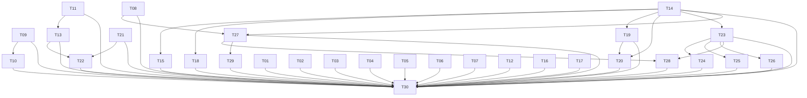

# Tickets — Aumento de Escopo 2

**Estado: planejados, sem autorização de implementação.**

Parent: https://github.com/hodeliun/Morrow/issues/51. Consulte dependências nativas e status atual no GitHub; esta tabela é snapshot de publicação.

| Ticket | Issue | Entrega | Bloqueado por |
| --- | --- | --- | --- |
| [T01](01-desktop-clipboard.md) | [#52](https://github.com/hodeliun/Morrow/issues/52) | Clipboard de células e linhas funcionando no aplicativo desktop | Nenhum |
| [T02](02-cell-editing.md) | [#53](https://github.com/hodeliun/Morrow/issues/53) | Digitação imediata e confirmação confiável de células | Nenhum |
| [T03](03-title-display-property.md) | [#54](https://github.com/hodeliun/Morrow/issues/54) | Editar Nome e restaurar a coluna de exibição | Nenhum |
| [T04](04-view-column-order.md) | [#55](https://github.com/hodeliun/Morrow/issues/55) | Reordenar colunas por arraste apenas na visualização ativa | Nenhum |
| [T05](05-row-selection.md) | [#56](https://github.com/hodeliun/Morrow/issues/56) | Seleção aditiva e controles de linha discretos | Nenhum |
| [T06](06-linked-grid-gestures.md) | [#57](https://github.com/hodeliun/Morrow/issues/57) | Selecionar células sem arrastar a visualização inteira | Nenhum |
| [T07](07-configuration-panels.md) | [#58](https://github.com/hodeliun/Morrow/issues/58) | Painéis de propriedades e seletores legíveis, sem cortes | Nenhum |
| [T08](08-formula-editor.md) | [#59](https://github.com/hodeliun/Morrow/issues/59) | Editor de fórmulas com cursor alinhado, cores e autocomplete | Nenhum |
| [T09](09-conditional-semantics.md) | [#60](https://github.com/hodeliun/Morrow/issues/60) | Regras condicionais corretas com estilos de célula e linha | Nenhum |
| [T10](10-conditional-cards.md) | [#61](https://github.com/hodeliun/Morrow/issues/61) | Configuração condicional em cartões recolhíveis e legíveis | [#60](https://github.com/hodeliun/Morrow/issues/60) |
| [T11](11-table-toolbar.md) | [#62](https://github.com/hodeliun/Morrow/issues/62) | Barra compacta, filtros discretos e área útil de bancos | Nenhum |
| [T12](12-table-footer.md) | [#63](https://github.com/hodeliun/Morrow/issues/63) | Rodapé discreto e Novo antes dos cálculos | Nenhum |
| [T13](13-linked-view-parity.md) | [#64](https://github.com/hodeliun/Morrow/issues/64) | Views com título próprio e a mesma experiência da tabela inline | [#62](https://github.com/hodeliun/Morrow/issues/62) |
| [T14](14-document-integrity.md) | [#65](https://github.com/hodeliun/Morrow/issues/65) | Preservar tabelas ao editar e converter blocos | Nenhum |
| [T15](15-reversible-toggles.md) | [#66](https://github.com/hodeliun/Morrow/issues/66) | Alternadores e recolhimento reversíveis e opcionais | [#65](https://github.com/hodeliun/Morrow/issues/65) |
| [T16](16-outline-tab-navigation.md) | [#67](https://github.com/hodeliun/Morrow/issues/67) | Navegação por títulos e restauração de rolagem entre abas | Nenhum |
| [T17](17-heading-default-colors.md) | [#68](https://github.com/hodeliun/Morrow/issues/68) | Títulos com cor padrão do tema | Nenhum |
| [T18](18-image-sizing.md) | [#69](https://github.com/hodeliun/Morrow/issues/69) | Redimensionar imagens dentro e fora de colunas | [#65](https://github.com/hodeliun/Morrow/issues/65) |
| [T19](19-layout-column-widths.md) | [#70](https://github.com/hodeliun/Morrow/issues/70) | Larguras livres e persistentes nas colunas da página | [#65](https://github.com/hodeliun/Morrow/issues/65) |
| [T20](20-layout-column-actions.md) | [#71](https://github.com/hodeliun/Morrow/issues/71) | Remover colunas, inserir texto entre blocos e indicar o drop correto | [#65](https://github.com/hodeliun/Morrow/issues/65), [#70](https://github.com/hodeliun/Morrow/issues/70) |
| [T21](21-data-history.md) | [#72](https://github.com/hodeliun/Morrow/issues/72) | Desfazer e refazer alterações de dados com histórico limitado | Nenhum |
| [T22](22-view-history.md) | [#73](https://github.com/hodeliun/Morrow/issues/73) | Histórico contextual das configurações de cada visualização | [#72](https://github.com/hodeliun/Morrow/issues/72), [#64](https://github.com/hodeliun/Morrow/issues/64) |
| [T23](23-canvas-controls-ux.md) | [#74](https://github.com/hodeliun/Morrow/issues/74) | Descoberta, edição e validação dos controles existentes | [#65](https://github.com/hodeliun/Morrow/issues/65) |
| [T24](24-multi-select-control.md) | [#75](https://github.com/hodeliun/Morrow/issues/75) | Controle de seleção múltipla integrado às fórmulas | [#74](https://github.com/hodeliun/Morrow/issues/74) |
| [T25](25-scale-progress-controls.md) | [#76](https://github.com/hodeliun/Morrow/issues/76) | Controles de escala e progresso com valores numéricos | [#74](https://github.com/hodeliun/Morrow/issues/74) |
| [T26](26-date-range-control.md) | [#77](https://github.com/hodeliun/Morrow/issues/77) | Controle de intervalo de datas e períodos rápidos | [#74](https://github.com/hodeliun/Morrow/issues/74) |
| [T27](27-inline-formula-ux.md) | [#78](https://github.com/hodeliun/Morrow/issues/78) | Resultados de fórmula realmente integrados ao texto | [#59](https://github.com/hodeliun/Morrow/issues/59), [#65](https://github.com/hodeliun/Morrow/issues/65) |
| [T28](28-named-reference-network.md) | [#79](https://github.com/hodeliun/Morrow/issues/79) | Referências nomeadas entre controles, resultados e tabelas | [#74](https://github.com/hodeliun/Morrow/issues/74), [#78](https://github.com/hodeliun/Morrow/issues/78) |
| [T29](29-formula-background-preference.md) | [#80](https://github.com/hodeliun/Morrow/issues/80) | Preferência de fundo dos resultados por nota | [#78](https://github.com/hodeliun/Morrow/issues/78) |
| [T30](30-integrated-acceptance.md) | [#81](https://github.com/hodeliun/Morrow/issues/81) | Validação integrada do Aumento de Escopo 2 | [#52](https://github.com/hodeliun/Morrow/issues/52), [#53](https://github.com/hodeliun/Morrow/issues/53), [#54](https://github.com/hodeliun/Morrow/issues/54), [#55](https://github.com/hodeliun/Morrow/issues/55), [#56](https://github.com/hodeliun/Morrow/issues/56), [#57](https://github.com/hodeliun/Morrow/issues/57), [#58](https://github.com/hodeliun/Morrow/issues/58), [#59](https://github.com/hodeliun/Morrow/issues/59), [#60](https://github.com/hodeliun/Morrow/issues/60), [#61](https://github.com/hodeliun/Morrow/issues/61), [#62](https://github.com/hodeliun/Morrow/issues/62), [#63](https://github.com/hodeliun/Morrow/issues/63), [#64](https://github.com/hodeliun/Morrow/issues/64), [#65](https://github.com/hodeliun/Morrow/issues/65), [#66](https://github.com/hodeliun/Morrow/issues/66), [#67](https://github.com/hodeliun/Morrow/issues/67), [#68](https://github.com/hodeliun/Morrow/issues/68), [#69](https://github.com/hodeliun/Morrow/issues/69), [#70](https://github.com/hodeliun/Morrow/issues/70), [#71](https://github.com/hodeliun/Morrow/issues/71), [#72](https://github.com/hodeliun/Morrow/issues/72), [#73](https://github.com/hodeliun/Morrow/issues/73), [#74](https://github.com/hodeliun/Morrow/issues/74), [#75](https://github.com/hodeliun/Morrow/issues/75), [#76](https://github.com/hodeliun/Morrow/issues/76), [#77](https://github.com/hodeliun/Morrow/issues/77), [#78](https://github.com/hodeliun/Morrow/issues/78), [#79](https://github.com/hodeliun/Morrow/issues/79), [#80](https://github.com/hodeliun/Morrow/issues/80) |

## Dependências

Seta aponta do bloqueador para o dependente. Compartilhamento de módulo exige coordenação; não foi inventado bloqueio funcional apenas por arquivo compartilhado.
