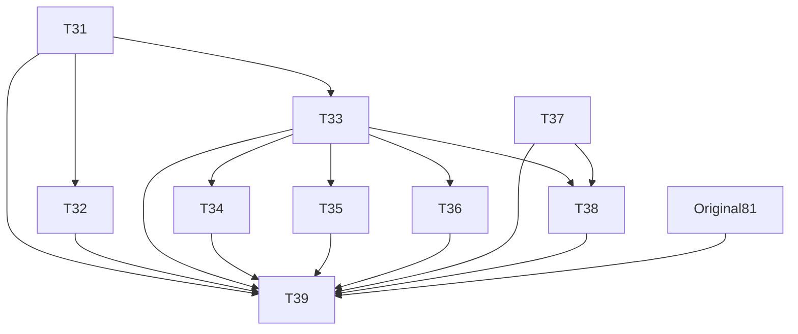

# Tickets adicionais — arquivos, web e painéis

**Planejamento somente.** Parent: https://github.com/hodeliun/Morrow/issues/82. Os trinta tickets anteriores continuam válidos. Nove novos tickets: T31–T39; source IDs S2-31–37 não equivalem à numeração das entregas.

| Ticket | Issue | Entrega | Bloqueado por |
| --- | --- | --- | --- |
| [T31](31-file-catalog.md) | [#83](https://github.com/hodeliun/Morrow/issues/83) | Mostrar arquivos e pastas com filtros por extensão | Nenhum |
| [T32](32-file-handlers.md) | [#84](https://github.com/hodeliun/Morrow/issues/84) | Associar extensões ao viewer interno, sistema ou aplicativo escolhido | [#83](https://github.com/hodeliun/Morrow/issues/83) |
| [T33](33-image-file-tabs.md) | [#85](https://github.com/hodeliun/Morrow/issues/85) | Abrir imagens existentes em abas sem importar para notas | [#83](https://github.com/hodeliun/Morrow/issues/83) |
| [T34](34-pdf-file-tabs.md) | [#86](https://github.com/hodeliun/Morrow/issues/86) | Visualizar PDF local em uma aba interna | [#85](https://github.com/hodeliun/Morrow/issues/85) |
| [T35](35-media-file-tabs.md) | [#87](https://github.com/hodeliun/Morrow/issues/87) | Reproduzir áudio e vídeo locais em abas | [#85](https://github.com/hodeliun/Morrow/issues/85) |
| [T36](36-web-tabs.md) | [#88](https://github.com/hodeliun/Morrow/issues/88) | Navegar sites em abas internas isoladas | [#85](https://github.com/hodeliun/Morrow/issues/85) |
| [T37](37-four-pane-layouts.md) | [#89](https://github.com/hodeliun/Morrow/issues/89) | Organizar notas em até quatro painéis redimensionáveis | Nenhum |
| [T38](38-pane-content-placement.md) | [#90](https://github.com/hodeliun/Morrow/issues/90) | Escolher abas e arrastar arquivos para cada painel | [#85](https://github.com/hodeliun/Morrow/issues/85), [#89](https://github.com/hodeliun/Morrow/issues/89) |
| [T39](39-extended-acceptance.md) | [#91](https://github.com/hodeliun/Morrow/issues/91) | Validar arquivos, navegação e painéis com o escopo anterior | [#83](https://github.com/hodeliun/Morrow/issues/83), [#84](https://github.com/hodeliun/Morrow/issues/84), [#85](https://github.com/hodeliun/Morrow/issues/85), [#86](https://github.com/hodeliun/Morrow/issues/86), [#87](https://github.com/hodeliun/Morrow/issues/87), [#88](https://github.com/hodeliun/Morrow/issues/88), [#89](https://github.com/hodeliun/Morrow/issues/89), [#90](https://github.com/hodeliun/Morrow/issues/90), [#81](https://github.com/hodeliun/Morrow/issues/81) |

## Dependências

Original81 é a aceitação dos trinta itens iniciais. Não criar bloqueio reverso. O GitHub contém as relações nativas e é autoridade de status.
