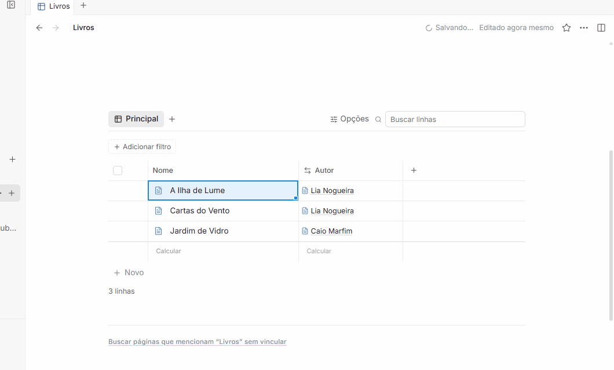
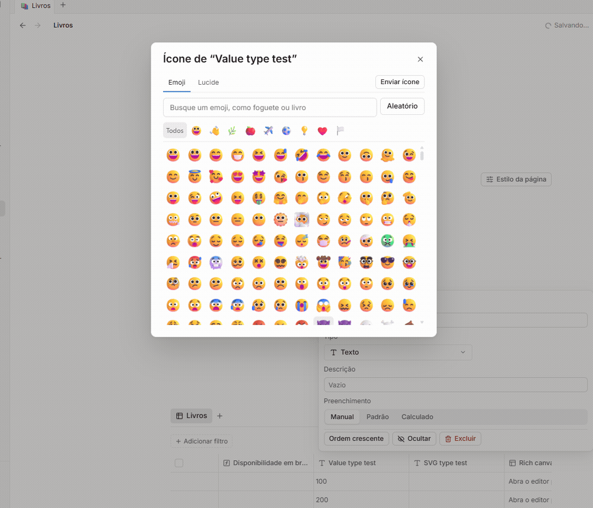

# Morrow fork 1.1.1 — notas de versão

> Base oficial **1.2.1** · modificações do fork **1.1.1** · pacote **1.2.1-fork.1.1.1**.

## Base oficial

Esta versão usa Morrow 1.2.1, commit oficial
[`5e6392b`](https://github.com/Aarav2709/Morrow/commit/5e6392bb6425924abd30eec8a99b42aa8c953577),
a mesma base do último download, `v1.2.1-fork.1.0.1` (commit `796496a`). A base
oficial permanece inalterada; não há sincronização upstream nova a atribuir a
este lançamento. Consulte as [notas oficiais do Morrow 1.2.1](https://github.com/Aarav2709/Morrow/releases/tag/v1.2.1).

## O que mudou desde o último download

O fork 1.1.0 foi preparado como `1.2.1-fork.1.1.0`, mas não foi distribuído
como release baixável. As melhorias abaixo entraram nessa versão interna e
integram o download do fork depois da 1.0.1.
Elas são alterações do fork, não mudanças da base oficial.

### Edição de páginas

- **Fundos personalizados em blocos:** abra o menu do bloco e escolha uma cor,
  incluindo um valor HEX quando disponível.
- **Imagens:** clique com o botão direito na imagem para ajustar recorte,
  legenda e alinhamento ou substituí-la. O recorte pode ser revisto antes de
  confirmar a troca.
- **Seções recolhíveis:** recolha um título para ocultar o conteúdo relacionado
  e expanda-o para restaurá-lo; o conteúdo continua no documento.
- **Até sete colunas de conteúdo:** mova blocos para formar colunas e mantenha
  o conteúdo organizado lado a lado.
- **Menus junto à borda da janela:** os menus e painéis de edição se ajustam à
  área visível para que seus controles continuem acessíveis.

### Tabelas e bancos de dados

- **Busca e filtros por visualização:** use **Opções** na barra da tabela para
  encontrar filtros, ordenação, layout e configurações. A busca **Buscar** e
  os filtros são salvos na configuração da visualização; cada view pode manter
  critérios próprios.
- **Visualizações vinculadas independentes:** insira uma visualização de um
  banco em outra página; dê a ela um nome e filtros próprios sem mudar as outras
  visualizações do mesmo banco.
- **Formatação condicional e cálculos:** configure regras de cor nas opções da
  coluna e escolha **Calcular** no rodapé para definir uma operação por coluna
  e por visualização.
- **Tipos e ícones pesquisáveis:** abra **Editar coluna** para selecionar o
  tipo, buscar por nome ou alias e escolher um ícone para a propriedade.
- **Fórmulas com sugestões e formato de resultado:** digite no editor de fórmula
  para receber sugestões de propriedades e inserir referências; configure a
  apresentação do resultado nas opções da propriedade.
- **Seleção e edição de células:** use teclado para navegar e editar, selecione
  intervalos com teclado ou mouse, copie e cole valores mantendo texto e tipos,
  e arraste a alça de preenchimento para estender sequências com prévia e
  desfazer.
- **Operações com linhas:** selecione linhas, abra suas ações pelo menu
  contextual, duplique ou transfira linhas entre bancos com um mapeamento dos
  campos e desfaça operações recentes.

### Correções já incluídas no fork 1.1.0

O fork 1.1.0 também corrigiu controles de imagem, seleção de ícones e edição de
fórmulas. Resultados `false` e zero permanecem distintos de um resultado vazio.
Essas correções não devem ser atribuídas ao Morrow oficial.

## Estabilização para 1.1.1 — UI verificada no candidato

Os critérios de interface associados aos itens abaixo passaram na auditoria
original de 20 itens do candidato, com dados sintéticos, janelas ocultas e build
compilado estável. Os testes locais também passaram. A matriz detalha cada
resultado e aponta qualquer limite da evidência; ela não substitui a validação
do executável empacotado nem os demais gates de release.

- Criar relações inversas diretamente e preservar valores e pares existentes;
  validar configurações inválidas de forma atômica.
- Corrigir a sequência de inserir antes, desfazer e inserir depois; confirmar
  cópia, movimentação, exclusão, recuperação e persistência depois de reabrir.
- Colocar o seletor de ícones acima do painel que o abriu, restaurar foco ao
  fechar com Escape e limitar imagens enviadas ao tamanho do ícone da coluna.
- Evitar erros de seleção ao recolher visualizações vinculadas e impedir que o
  título oculto revele o nome da origem.
- Tornar a alça de seis pontos útil para selecionar uma linha e abrir suas
  ações; manter os demais modos de seleção, arraste e teclado.
- Agrupar controles da tabela em uma barra compacta, preservando o acesso a
  opções, filtros e ordenação ativos.
- Alinhar a apresentação de tabelas inline e vinculadas e manter o cálculo do
  rodapé alinhado às colunas após redimensionar, rolar ou congelar colunas.

**Matriz dos vinte critérios:** [auditoria UI, 20/20 passaram](../../evidence/stabilization-1.1.1/e9a8d29-20261028-gate49-aa4b900b/audit/original-scope-matrix.md) · [JSON](../../evidence/stabilization-1.1.1/e9a8d29-20261028-gate49-aa4b900b/audit/original-scope-matrix.json) · [execução de testes do candidato](../../evidence/stabilization-1.1.1/check-candidate.json).

## Demonstrações visuais

Os GIFs mostram sequências de estados reais capturados da interface com dados
sintéticos; são demonstrações em passos capturados, não gravações contínuas.
Os arquivos de proveniência identificam candidato, fixture e contexto das
capturas.

**Relação inversa:** criar a relação e conferir a reciprocidade persistida. [PNG](assets/data-01-relacao-inversa.png) · [Proveniência](PROVENANCE-DATA.md)

**Seleção e desfazer:** selecionar uma linha pela alça, abrir as ações, inserir antes e desfazer; a captura PNG mostra o estado restaurado. [Captura do estado após desfazer](assets/data-02-linha-apos-desfazer.png) · [Proveniência](PROVENANCE-DATA.md)

**Seletor de ícones:** a janela fica sobre o painel de origem, e os ícones enviados mantêm a dimensão prevista. [Captura da camada](assets/editor-icon-picker-layering.png) · [Resultado do ícone na coluna](assets/editor-icon-column-result.png) · [Proveniência](PROVENANCE-EDITOR.md)

## Downloads e validação de release

A [release no GitHub](https://github.com/hodeliun/Morrow/releases/tag/v1.2.1-fork.1.1.1)
concentra os downloads Windows x64, checksums SHA-256, situação da assinatura,
CI do commit publicado e resultado do teste do executável empacotado.

- Instalador: `Morrow-Setup-1.2.1-fork.1.1.1-x64.exe`.
- Portátil: `Morrow-1.2.1-fork.1.1.1-portable-x64.exe`.
- `npm run check` passou no candidato: **473 testes em 61 arquivos**, além de
  typecheck, lint e builds ([relatório](../../evidence/stabilization-1.1.1/check-candidate.json)).
- A auditoria cobriu os **20 critérios originais**, incluindo modo somente
  leitura; a [matriz](../../evidence/stabilization-1.1.1/e9a8d29-20261028-gate49-aa4b900b/audit/original-scope-matrix.md)
  vincula as asserções e a proveniência de cada execução.
- A [regressão integrada](../../evidence/stabilization-1.1.1/e9a8d29-20261028-gate49-aa4b900b/audit/interaction-final-integrated.json)
  verificou três idiomas, reabertura, PDF e edição de 1.000 células, com rejeição
  de 1.001 sem alteração parcial.
- Prévia do PDF: [página 1](../../evidence/stabilization-1.1.1/e9a8d29-20261028-gate49-aa4b900b/screenshots/interaction-final-page1.png),
  [página 2](../../evidence/stabilization-1.1.1/e9a8d29-20261028-gate49-aa4b900b/screenshots/interaction-expansion-final-page2.png) e
  [página 3](../../evidence/stabilization-1.1.1/e9a8d29-20261028-gate49-aa4b900b/screenshots/interaction-expansion-final-page3.png).

Os relatórios acima descrevem a auditoria da interface; os resultados dos artefatos
finais constam separadamente na release, com seu escopo exato. O instalador não
é executado como parte da verificação e a instalação pessoal permanece preservada.

## Limitações conhecidas

- Na exportação PDF complementar, a segunda view vinculada continua da página
  2 para a 3; o conteúdo verificado está presente. A colagem das 1.000 células
  levou 444 ms e sua persistência, cerca de 18,96 s. Undo levou 595 ms e sua
  persistência, 17,92 s; redo levou 655 ms e sua persistência, 21,21 s. São
  tempos observados, não promessa de gravação instantânea nem limite de desempenho.
- A evidência do item 11 usa a comparação canônica entre embed inline e view
  vinculada. Um comparativo agregado diferente, entre banco de página inteira
  e view vinculada, ficou explicitamente “not verified” e não foi usado para
  inferir o resultado do critério.
- O relatório delivery5 registra `maxPropertyGuardIncludedInTestedBuild: false`
  por padrão do campo opt-in do harness; isso não é uma asserção do app nem
  determina o resultado do item 19. A nota de proveniência e os testes de
  fonte estão descritos na [matriz](../../evidence/stabilization-1.1.1/e9a8d29-20261028-gate49-aa4b900b/audit/original-scope-matrix.md).