# Morrow fork 1.2.0 — notas de versão e guia cumulativo

> Base oficial **1.3.0** (`13ce190`) · modificações do fork **1.2.0** · pacote **`1.3.0-fork.1.2.0`**.

Esta release conclui integralmente os **39 tickets** do **Aumento de Escopo 2** ([`#51`](https://github.com/hodeliun/Morrow/issues/51), [`#82`](https://github.com/hodeliun/Morrow/issues/82), `T01`–`T39` / [`#52`](https://github.com/hodeliun/Morrow/issues/52)–[`#91`](https://github.com/hodeliun/Morrow/issues/91)) sobre a base oficial **Morrow 1.3.0**.

Conforme a [política de releases](../../RELEASE-POLICY.md), este documento está dividido em quatro partes claramente identificadas:

1. **[Base oficial Morrow 1.3.0](#1-base-oficial-morrow-130)** — o que veio do projeto original de Aarav Gupta e colaboradores.
2. **[Novidades e melhorias do fork 1.2.0 (desde `v1.2.1-fork.1.1.1`)](#2-novidades-e-melhorias-do-fork-120-desde-v121-fork111)** — descrições funcionais, como usar, exemplos sintéticos, opções, limites e capturas das entregas do Aumento de Escopo 2.
3. **[Correções de comportamento no fork 1.2.0](#3-correções-de-comportamento-no-fork-120)** — gatilhos visíveis, sintomas anteriores e resultados corrigidos.
4. **[Guia cumulativo dos recursos do fork (1.0.0 → 1.2.0)](#4-guia-cumulativo-dos-recursos-do-fork-100--120)** — inventário consolidado de todas as capacidades do fork até a conclusão do Aumento de Escopo 2, organizado por fluxo de trabalho, com origem, versão inicial e referências de evidência.
5. **[Downloads, validação e limitações conhecidas](#5-downloads-validação-e-limitações-conhecidas)** — artefatos para Windows e Linux, checksums SHA-256, escopo de testes e ressalvas documentadas.

---

## 1. Base oficial Morrow 1.3.0

Esta versão atualiza a base oficial do [Morrow 1.2.1](https://github.com/Aarav2709/Morrow/releases/tag/v1.2.1) ([`5e6392b`](https://github.com/Aarav2709/Morrow/commit/5e6392bb6425924abd30eec8a99b42aa8c953577)) para o **Morrow 1.3.0**, commit oficial [`13ce1908ac7777a16161b5ef0c013de5eadcb3a1`](https://github.com/Aarav2709/Morrow/commit/13ce1908ac7777a16161b5ef0c013de5eadcb3a1) ([comparação upstream `5e6392b...13ce190`](https://github.com/Aarav2709/Morrow/compare/5e6392bb6425924abd30eec8a99b42aa8c953577...13ce1908ac7777a16161b5ef0c013de5eadcb3a1), preservando os 39 commits oficiais por merge).

Recursos herdados dessa atualização oficial e reconciliados com o fork:

- **Arquivamento de páginas (`archivedAt`):** páginas podem ser arquivadas e restauradas pela barra lateral sem exclusão, com suporte integrado ao protocolo tipado de linhas do fork.
- **Abas fixadas e paleta de nova aba:** abas podem ser fixadas com proteção contra fechamento acidental e persistência entre sessões; a abertura de nova aba apresenta paleta rápida.
- **Restauração de posição de leitura e cursor:** o aplicativo lembra o ponto de leitura e a posição do cursor ao reabrir notas, reconciliado no fork para operar com isolamento por cofre, aba e painel.
- **Preferências de barra lateral e verificação ortográfica:** controle de módulos visíveis na barra lateral e preferência persistida de corretor ortográfico por cofre.
- **Editor e blocos oficiais:** seleção de blocos pela margem, melhorias na conversão de itens de lista, títulos de alternadores (`
`) e inserção de emojis e mídia.

Detalhes técnicos da reconciliação de merge estão no [relatório de integração `1.3.0-fork.1.2.0`](../../integration/1.3.0-fork-1.2.0.md).

---

## 2. Novidades e melhorias do fork 1.2.0 (desde `v1.2.1-fork.1.1.1`)

As funcionalidades abaixo foram desenvolvidas no fork desde o último download publicado ([`v1.2.1-fork.1.1.1`](https://github.com/hodeliun/Morrow/releases/tag/v1.2.1-fork.1.1.1); [comparação completa no GitHub](https://github.com/hodeliun/Morrow/compare/v1.2.1-fork.1.1.1...v1.3.0-fork.1.2.0)).

### 2.1. Bancos de dados, visualizações e operações de tabela (`T01`–`T07`, `T09`–`T13`)

#### Rótulo de `Nome` (`titleAlias`) e propriedade de exibição (`displayPropertyId`) — [`T03` / `#54`](../../deliveries/T03-name-display-property.md)
- **Problema e comportamento:** permite personalizar o rótulo visível da coluna `Nome` em um banco de dados sem duplicar o título da página no frontmatter, além de escolher qualquer propriedade como rótulo de exibição em relações e chips.
- **Onde encontrar e como usar:** clique no cabeçalho da coluna `Nome` para definir um rótulo alternativo (`titleAlias`) ou abra o menu de uma coluna / configurações do banco para marcar **Usar como propriedade de exibição** (indicada pelo ícone de olho no cabeçalho) ou restaurar `Nome`.
- **Exemplo sintético:** renomear o cabeçalho `Nome` para `Código do Ticket` mantém o título da nota como identidade da linha, enquanto definir `Resumo` como `displayPropertyId` faz com que células de relação exibam o valor de `Resumo`.
- **Opções e limites:** introduz o [esquema persistido formato 13](../../SCHEMA-13.md) com migração automática `12 → 13`. A coluna `Nome` não pode ser excluída porque representa a identidade do documento Markdown.

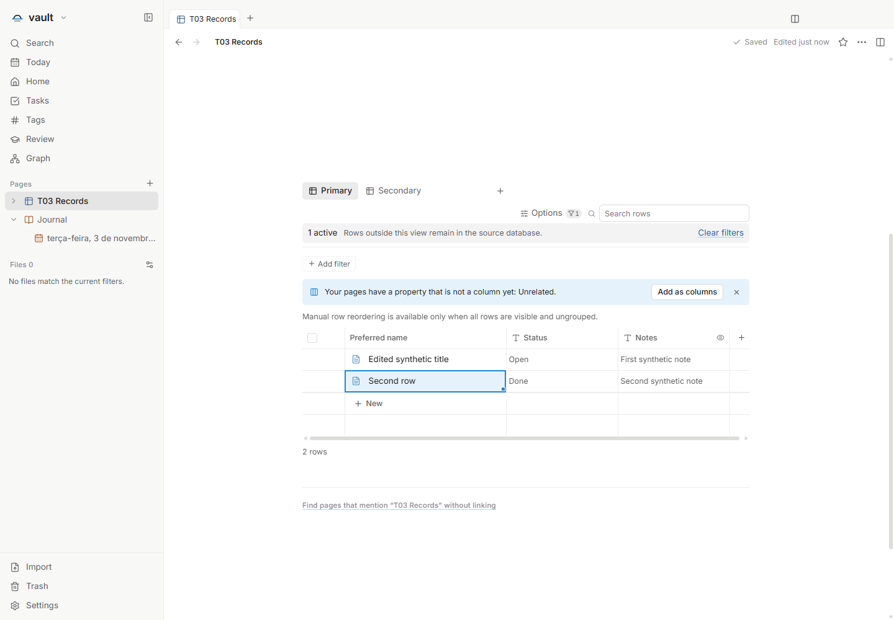

#### Reordenação de colunas independente por visualização — [`T04` / `#55`](../../deliveries/T04-view-column-order.md)
- **Problema e comportamento:** permite organizar a sequência de colunas (incluindo `Nome`) especificamente para a visualização ativa, sem embaralhar o esquema do banco nem outras visualizações vinculadas.
- **Onde encontrar e como usar:** arraste o cabeçalho da coluna horizontalmente até o indicador vertical de destino (ou use **Mover para a esquerda / direita** no menu da coluna); pressione `Escape` para cancelar o arraste antes de soltar.
- **Exemplo sintético:** na view `Financeiro`, colocar `Valor` antes de `Nome`; na view `Auditoria` do mesmo banco, manter `Nome` como primeira coluna. Ambas preservam cabeçalho, células, linha `Novo` e cálculos do rodapé alinhados.

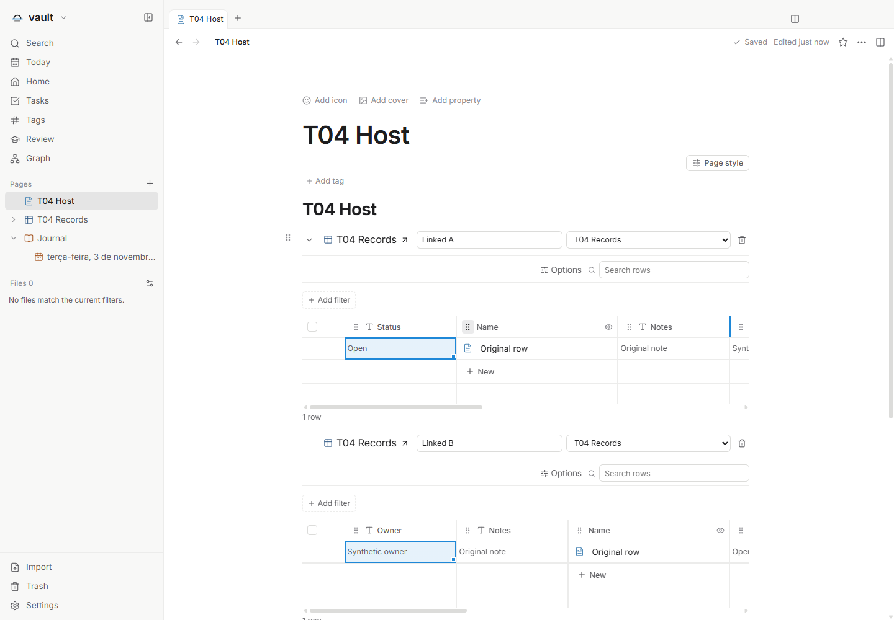

#### Seleção aditiva de linhas e menu compacto na margem — [`T05` / `#56`](../../deliveries/T05-additive-row-selection.md)
- **Problema e comportamento:** clicar na caixa de seleção de uma linha adiciona ou remove aquela linha da seleção atual sem exigir `Ctrl` ou `Shift`, e agrupa ações de linha em um menu discreto de três pontos (`⋯`).
- **Onde encontrar e como usar:** passe o cursor ou navegue por teclado até a margem esquerda da linha para exibir a caixa de seleção e o botão `⋯` de ações em lote (inserir acima/abaixo, duplicar, transferir ou excluir).
- **Opções e limites:** controles de mutação ficam ocultos em bancos somente leitura; a largura das colunas não sofre deslocamento ao revelar a margem.

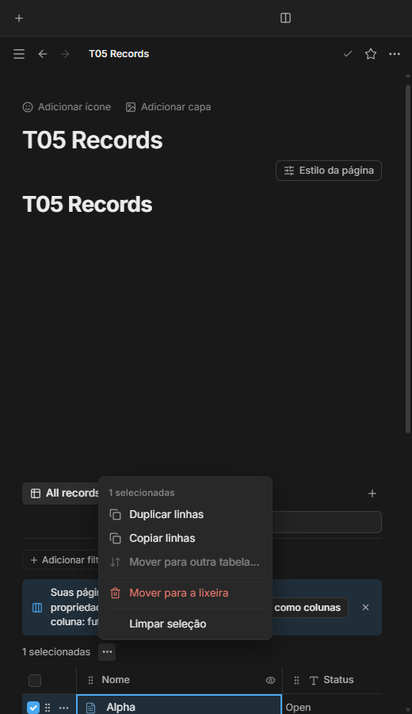

#### Digitação imediata, seleção de células e clipboard desktop — [`T01` / `#52`](../../integration/1.3.0-fork-1.2.0.md), [`T02` / `#53`](../../integration/1.3.0-fork-1.2.0.md), [`T06` / `#57`](../../integration/1.3.0-fork-1.2.0.md)
- **Problema e comportamento:** digitar com uma célula selecionada inicia a edição imediatamente sem perder o primeiro caractere; arrastar sobre células seleciona o intervalo da grade sem arrastar o bloco da visualização inteira; copiar e colar intervalos usa a ponte nativa do Electron preservando tipos compatíveis.
- **Onde encontrar e como usar:** selecione qualquer célula editável e comece a digitar, ou arraste entre células / use `Shift + Setas` para selecionar um bloco e usar `Ctrl/Cmd + C` e `Ctrl/Cmd + V`.

#### Painéis de propriedades legíveis, busca de moeda/fuso e prévia de preenchimento — [`T07` / `#58`](../../deliveries/T07-readable-property-panels.md)
- **Problema e comportamento:** separa a escolha do tipo da confirmação **Adicionar** ao criar propriedades manualmente, adiciona busca por código ou nome para moedas e fusos horários, e mantém o card de prévia de preenchimento sempre dentro da janela visível.
- **Onde encontrar e como usar:** clique em `+` para criar uma coluna, escolha o tipo e confirme em **Adicionar**; em colunas numéricas/moeda ou data/fuso, pesquise no catálogo (ex.: `BRL`, `Real`, `America/Sao_Paulo`).

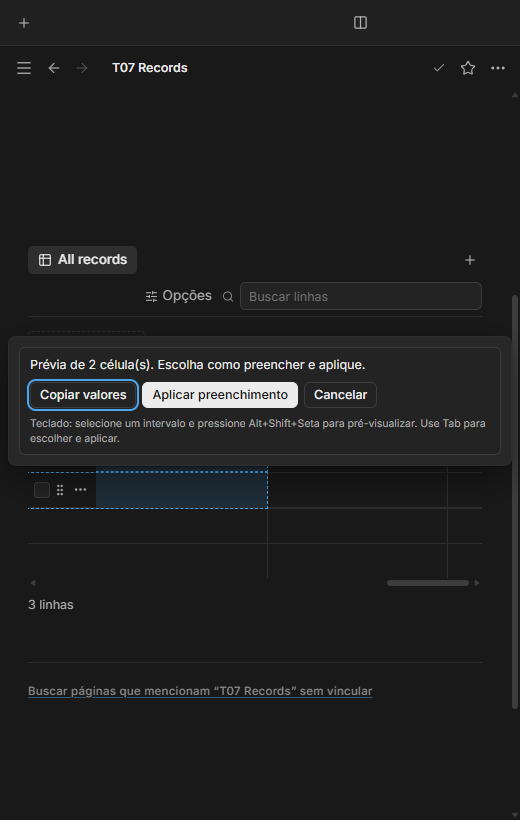

#### Regras condicionais por célula e linha em cartões recolhíveis — [`T09` / `#60`](../../integration/1.3.0-fork-1.2.0.md), [`T10` / `#61`](../../integration/1.3.0-fork-1.2.0.md)
- **Problema e comportamento:** regras de formatação condicional suportam escopo de **célula** ou **linha inteira**, combinação de atributos (`cor de fundo`, `cor do texto`, `negrito`, `itálico`) com contraste legível nos temas claro e escuro, e edição organizada em cartões recolhíveis com resumo claro.
- **Exemplo sintético:** regra 1 (`Score > 800` → fundo verde na linha) combinada com regra 2 (`Status = "Urgente"` → texto em negrito na célula) preserva ambos os estilos sem que a segunda apague o fundo da primeira.

#### Barra compacta, rodapé discreto (`Novo` antes dos cálculos) e paridade de linked views — [`T11` / `#62`](../../integration/1.3.0-fork-1.2.0.md), [`T12` / `#63`](../../deliveries/T12-compact-table-footer.md), [`T13` / `#64`](../../deliveries/T13-view-titles.md)
- **Problema e comportamento:**
  - A barra da tabela mantém busca, chips de filtros ativos e **Opções** compactos para priorizar as linhas (`T11`).
  - Na parte inferior da tabela, a linha discreta **`+ Novo`** aparece logo após os registros e **antes** da faixa de cálculos (`Calcular`), sem poluir exportações ou agregações (`T12`).
  - Visualizações vinculadas (`linked views`) possuem título próprio independente do banco de origem, opção de ocultar título sem expor o nome do banco original, aviso claro ao trocar a fonte de dados e a mesma experiência visual e operacional da tabela inline (`T13`).

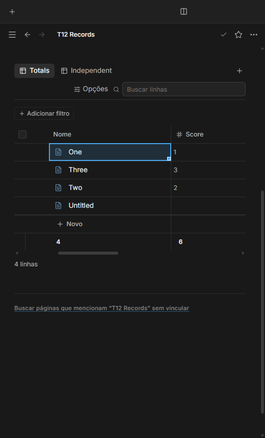

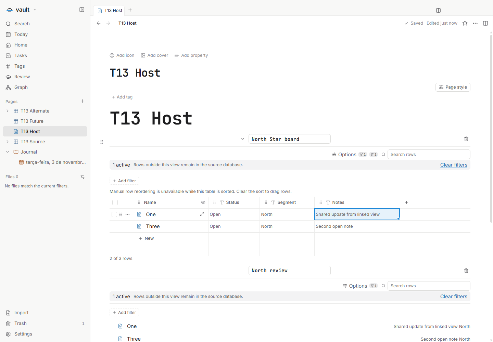

---

### 2.2. Controles nomeados no documento, fórmulas no texto e referências entre páginas (`T08`, `T23`–`T29`)

#### Editor de fórmulas alinhado sob zoom — [`T08` / `#59`](../../integration/1.3.0-fork-1.2.0.md)
- **Problema e comportamento:** o editor de fórmulas mantém o cursor perfeitamente alinhado ao texto colorido em escalas de `100%`, `125%` e `150%`, com realce sintático, sugestões por teclado/ponteiro e posicionamento contido na janela.

#### Catálogo de controles existentes e novos controles tipados (`multiSelect`, `scale`, `progress`, `dateRange`) — [`T23` / `#74`](../../deliveries/T23-existing-controls.md), [`T24` / `#75`](../../deliveries/T24-multiple-selection-control.md), [`T25` / `#76`](../../deliveries/T25-scale-progress-controls.md), [`T26` / `#77`](../../deliveries/T26-date-range-controls.md)
- **Problema e comportamento:** amplia os controles interativos de página para **11 tipos nomeados** com identidade persistente (`id` estável):
  1. Controles revisados (`T23`): `text`, `number`, `slider`, `select`, `checkbox`, `date` e `relation`, com separação entre valor atual e valor padrão, botão de resetar para o padrão, limpar valor e validação antes de salvar.
  2. **Seleção múltipla (`multiSelect`, `T24`):** busca de opções, chips removíveis, preservação ao renomear opção e resolução explícita antes de excluir opção em uso.
  3. **Escala (`scale`) e Progresso (`progress`, `T25`):** controles numéricos com mínimo, máximo e passo configuráveis, suporte a teclado e distinção entre `0`, vazio e padrão.
  4. **Intervalo de datas (`dateRange`, `T26`):** armazena dois limites ISO ordenados (`start` e `end`), com atalhos de calendário local (**Hoje**, **Últimos 7 dias**, **Mês atual**, **Próximos 7 dias**) e funções `First()` e `Last()` para uso em fórmulas e filtros.
- **Onde encontrar e como usar:** digite `/control` (ou escolha um tipo específico como `/multiselect`, `/scale`, `/progress`, `/daterange`) no editor da página; clique na engrenagem do controle para configurar nome, opções, limites e valor padrão.
- **Exemplo sintético de fórmula com `dateRange`:** para um controle `Período Fiscal` com intervalo `2026-11-01` a `2026-11-30`, `First([Período Fiscal])` retorna `2026-11-01` e `Last([Período Fiscal])` retorna `2026-11-30`.

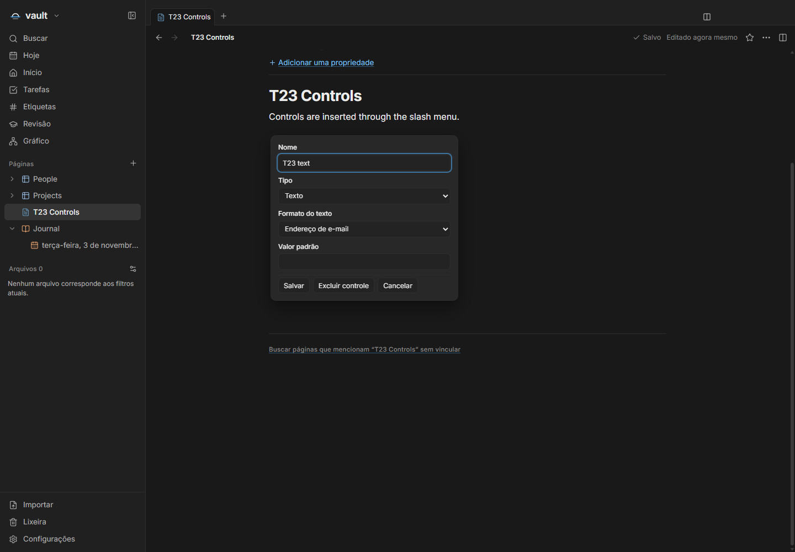

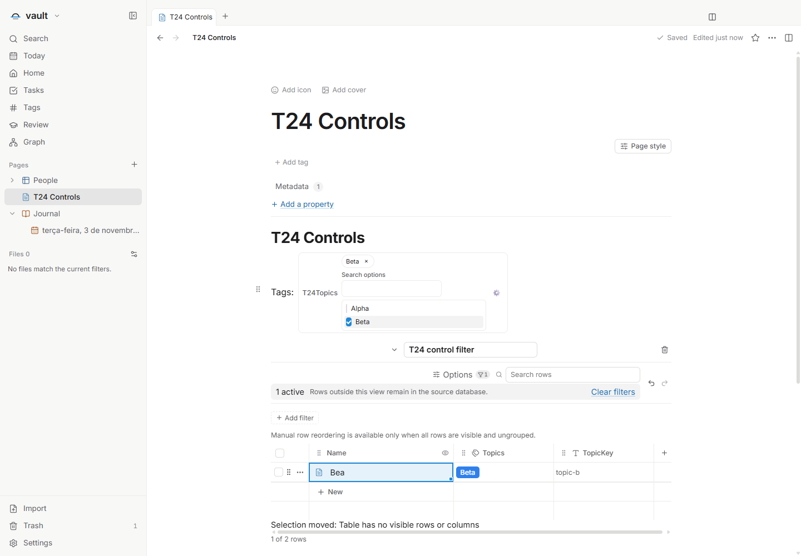

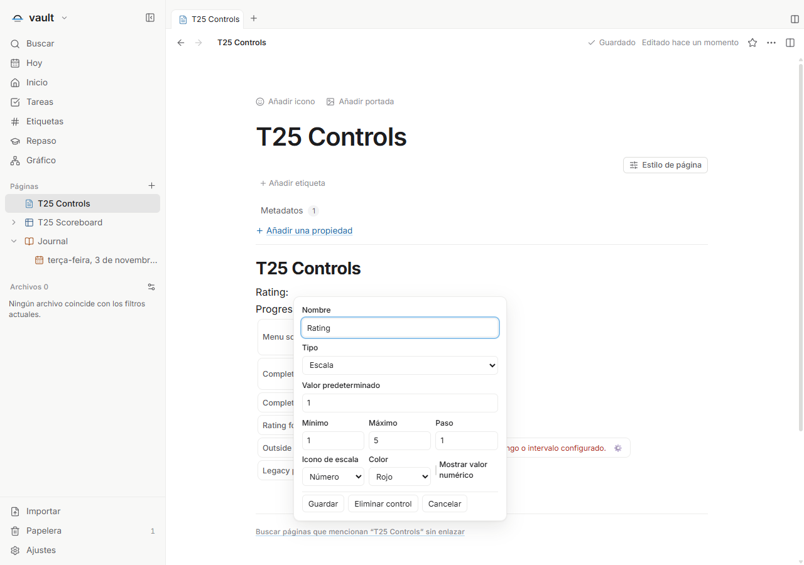

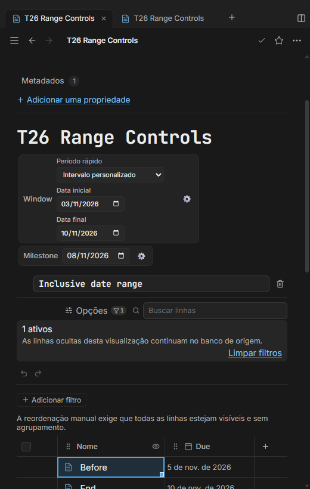

#### Resultados de fórmula integrados ao texto (`/formula`), rede de referências nomeadas e fundo por nota — [`T27` / `#78`](../../deliveries/T27-inline-formula-results.md), [`T28` / `#79`](../../deliveries/T28-named-reference-network.md), [`T29` / `#80`](../../deliveries/T29-formula-background.md)
- **Problema e comportamento:**
  - **Resultados inline (`T27`):** insira cálculos diretamente dentro de um parágrafo com `/formula`. O resultado acompanha a linha de texto, permite nome opcional e distingue claramente fórmula não configurada, lista vazia `[]`, `0`, `false` e erro com diagnóstico.
  - **Rede de referências nomeadas entre páginas (`T28`):** controles, resultados inline e tabelas podem referenciar controles e resultados de qualquer página pelo seletor tipado (persistindo o `ID` para resistir a renomeações), com detecção automática de ciclos locais ou entre páginas.
  - **Preferência de fundo de resultados por perfil e por nota (`T29`):** defina no perfil se novos documentos destacam o fundo dos resultados calculados e sobrescreva essa escolha individualmente no painel de estilo de cada nota (`morrowCalculatedResultBackground`), sem alterar notas legadas ao abrir.
- **Exemplo sintético:** um controle `Taxa Global` (`0.15`) na nota `Parâmetros` referenciado em outra nota por `=[Taxa Global] * 100` exibe `15`; se duas fórmulas criarem dependência circular (`A → B → A`), o resultado exibe diagnóstico explícito de ciclo em vez de travar ou ocultar o erro.

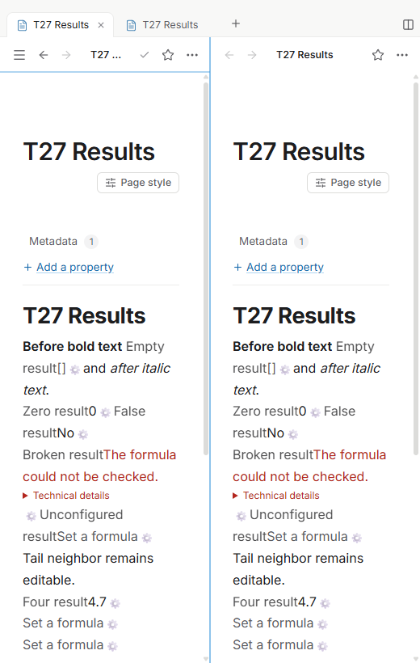

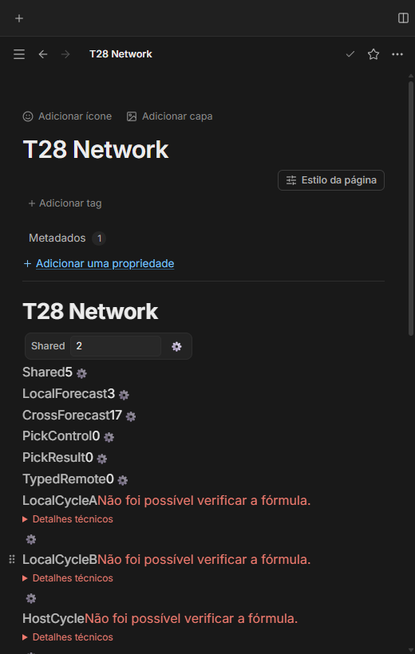

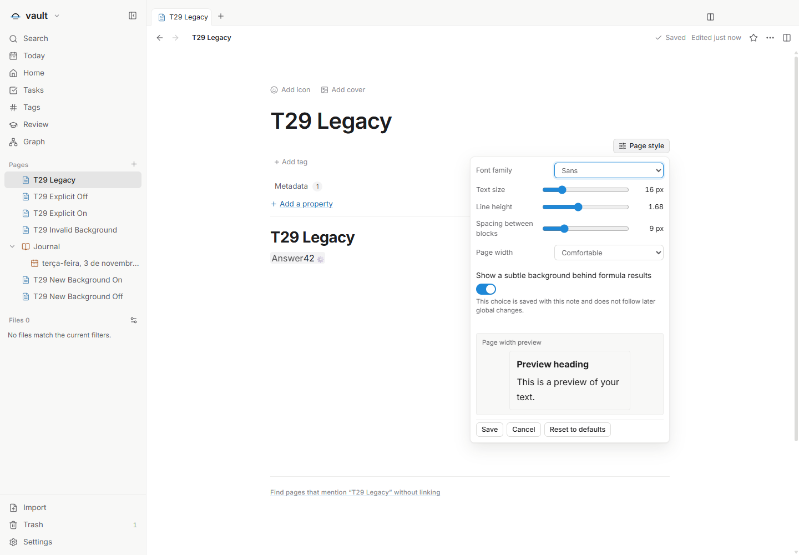

---

### 2.3. Histórico limitado de dados e histórico contextual de visualizações (`T21`, `T22`)

#### Desfazer e refazer de dados por banco (10 passos / 32 MiB) — [`T21` / `#72`](../../deliveries/T21-data-history.md)
- **Problema e comportamento:** cada banco de dados mantém uma pilha de sessão com até **10 ações recentes de dados** (edição de células, criação/exclusão/movimentação de linhas, alterações de esquema), compartilhada entre as visualizações da mesma origem e limitada a um teto global de **32 MiB** para entradas concluídas.
- **Onde encontrar e como usar:** use os botões de desfazer/refazer da barra do banco (que informam no tooltip/rótulo a ação exata a ser desfeita) ou os atalhos de teclado quando o foco estiver na grade.

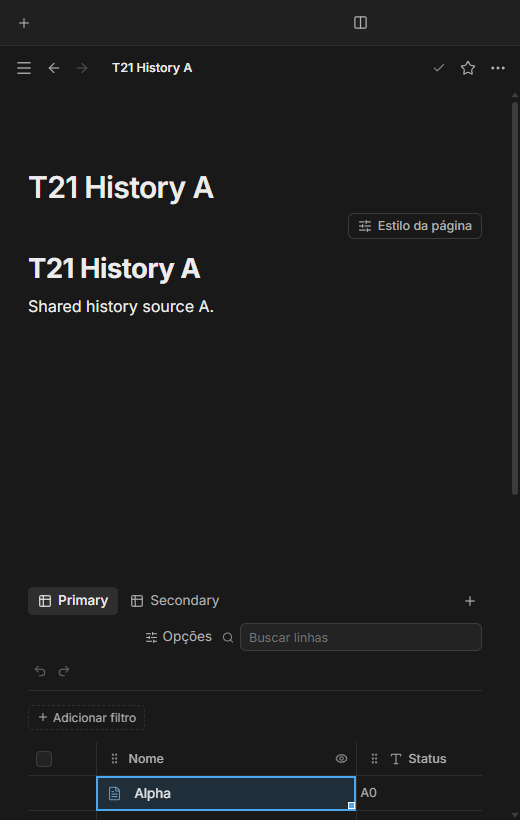

#### Histórico contextual das configurações de cada visualização (10 passos) — [`T22` / `#73`](../../deliveries/T22-view-history.md)
- **Problema e comportamento:** alterações de configuração da view ativa (filtros, ordenação, ordem/largura de colunas, título, cálculos do rodapé) têm histórico próprio de até **10 passos por visualização**, separado dos dados das linhas. Desfazer reverte a última mudança aplicável ao contexto atual sem desfazer edições em outros bancos ou views.

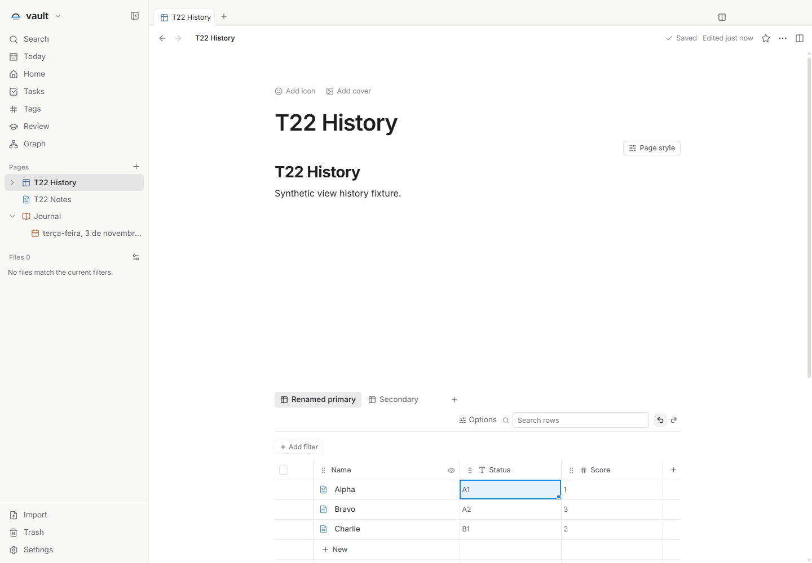

---

### 2.4. Edição de páginas, títulos, alternadores, imagens e colunas (`T14`–`T20`)

- **Integridade de tabelas ao converter blocos (`T14` / `#65`):** converter parágrafos, listas ou títulos próximos a tabelas preserva os bancos e tabelas intactos; a exclusão de um contêiner só ocorre por ação intencional e reversível ([detalhes](../../deliveries/T14-document-integrity.md)).
- **Alternadores e recolhimento reversíveis (`T15` / `#66`) e cor padrão de títulos (`T17` / `#68`):** títulos e blocos podem ser convertidos em seções recolhíveis (`
`) e revertidos ao formato normal sem perder conteúdo; novos títulos seguem a cor padrão do tema claro/escuro até que o usuário escolha uma cor personalizada.
- **Navegação por sumário e restauração isolada de rolagem (`T16` / `#67`):** clicar em um título no sumário posiciona a leitura com precisão e cada par `(cofre, aba, painel)` restaura sua própria posição de rolagem sem interferir em outra aba aberta na mesma nota.
- **Tamanho individual de imagens de `1%` a `100%` (`T18` / `#69`):** redimensione cada imagem pela alça lateral com prévia contínua ou defina o percentual exato por teclado no painel de largura, tanto no corpo da nota quanto dentro de colunas, sem modificar o arquivo original ([detalhes](../../deliveries/T18-image-sizing.md)).
- **Colunas com larguras livres, remoção segura e inserção entre blocos (`T19` / `#70`, `T20` / `#71`):** ajuste livremente a proporção entre colunas de página com persistência em Markdown; ao remover uma coluna com conteúdo, escolha entre mover seus blocos para depois do grupo ou descartá-los; insira parágrafos facilmente antes ou depois de imagens e grupos de colunas ([detalhes](../../deliveries/T20-layout-columns.md)).

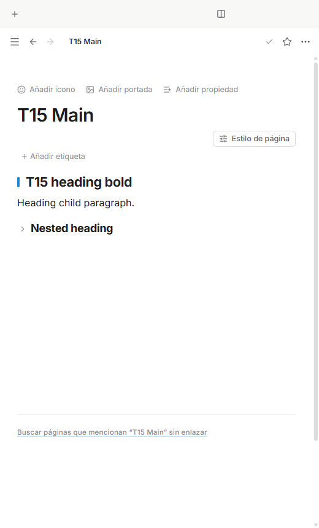

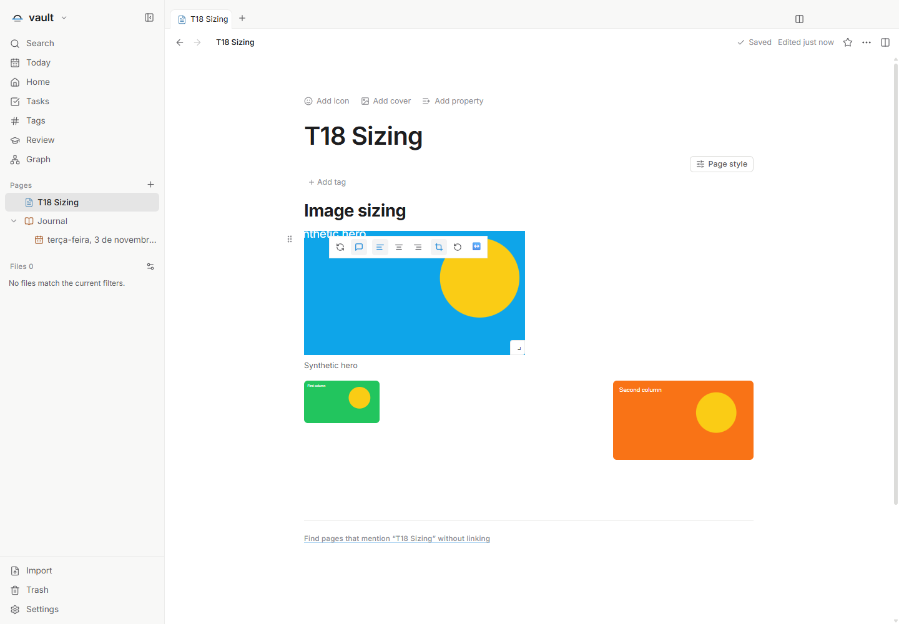

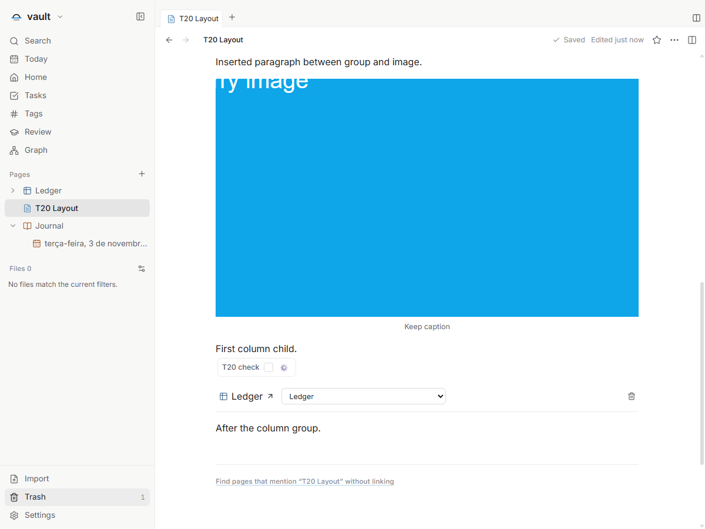

---

### 2.5. Catálogo de arquivos, abas de imagem/PDF/mídia e navegação web isolada (`T31`–`T36`)

#### Catálogo de arquivos com filtros por extensão e associações de abertura — [`T31` / `#83`](../../integration/1.3.0-fork-1.2.0.md), [`T32` / `#84`](../../integration/1.3.0-fork-1.2.0.md)
- **Problema e comportamento:** lista pastas e arquivos não-Markdown do cofre (imagens, PDFs, áudios, vídeos, documentos Office, `.gdoc`/`.gsheet` e arquivos sem extensão opcionalmente), com filtro rápido por extensão e configuração por dispositivo para abrir cada formato no **Visualizador interno**, no **Aplicativo padrão do sistema** ou em um **Programa escolhido** (executado sem shell).

#### Imagens locais em abas próprias sem importar para notas — [`T33` / `#85`](../../deliveries/T33-image-file-tabs.md)
- **Problema e comportamento:** abrir um arquivo `.png`, `.jpg`, `.gif`, `.webp` ou `.svg` pelo catálogo abre uma aba dedicada de visualização com controles de zoom, ajuste à tela e metadados (dimensões e tamanho), sem criar nota Markdown nem copiar o arquivo para `attachments/`.

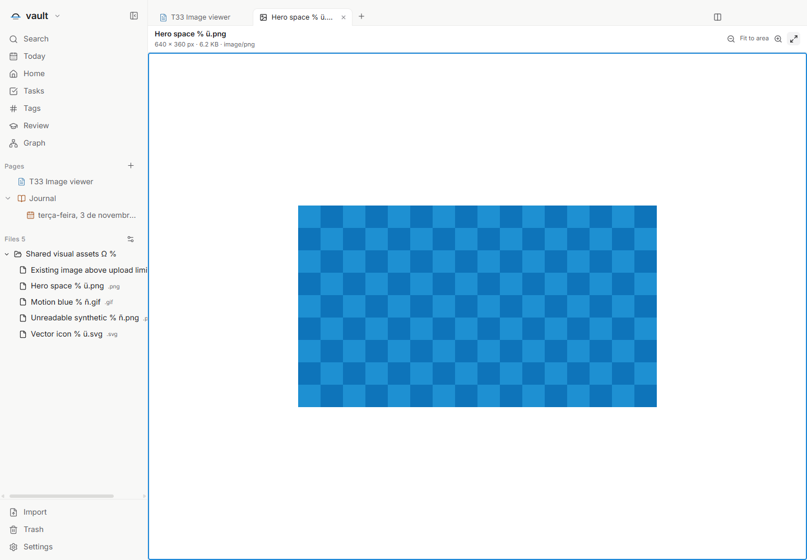

#### Visualizador interno de PDF local em aba isolada — [`T34` / `#86`](../../deliveries/T34-pdf-file-tabs.md)
- **Problema e comportamento:** quando configurado como **Interno**, arquivos `.pdf` do cofre abrem em aba própria usando o leitor nativo isolado do Chromium/Electron com navegação por páginas, zoom, rolagem e busca, além de diagnóstico claro para PDFs protegidos por senha e botão para abrir em aplicativo externo.

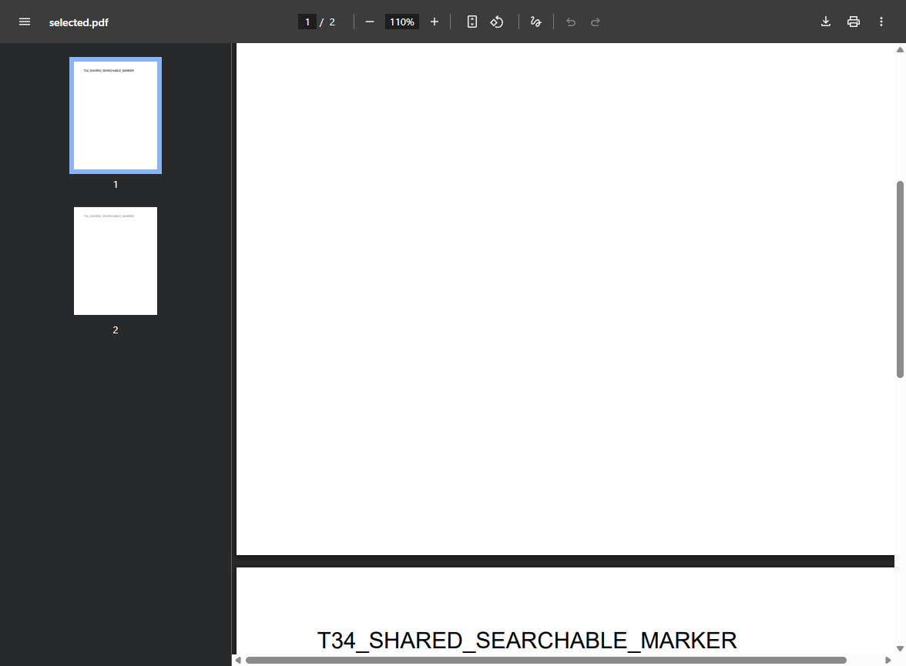

#### Reprodução de áudio e vídeo locais em abas com streaming Range — [`T35` / `#87`](../../deliveries/T35-media-file-tabs.md)
- **Problema e comportamento:** arquivos de áudio e vídeo (`.mp3`, `.wav`, `.ogg`, `.m4a`, `.flac`, `.mp4`, `.webm`, etc.) abrem em abas de mídia com controles de reprodução, busca na linha do tempo (`seek`), volume e velocidade (`0.5x` a `2x`). O protocolo local serve fatias sob demanda (`HTTP 206 Partial Content`), sem carregar arquivos grandes inteiros na memória RAM, e pausa/libera a mídia automaticamente ao fechar a aba ou trocar de cofre.

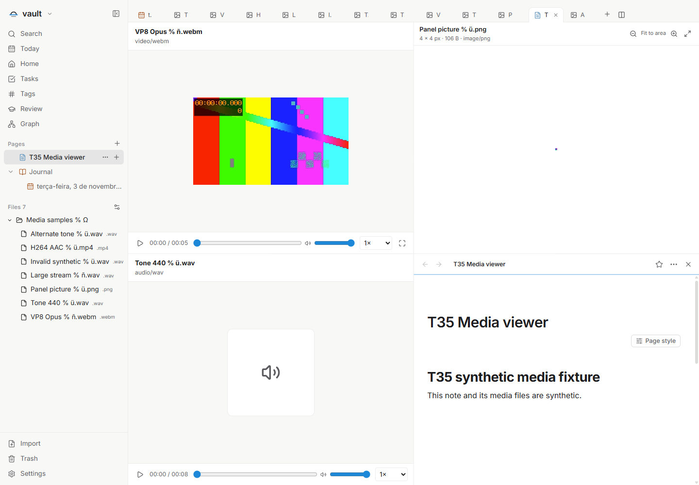

#### Navegação de sites e `.gdoc`/`.gsheet` em abas internas isoladas — [`T36` / `#88`](../../deliveries/T36-isolated-web-tabs.md)
- **Problema e comportamento:** links externos `https://` / `http://` e descritores `.gdoc` / `.gsheet` validados (`docs.google.com`) podem abrir em abas web internas isoladas (`WebContentsView` com sessão particionada, sandbox ativo, sem Node/preload e sem acesso a protocolos locais `file:`, `morrow-asset:` ou `morrow-media:`). Abas web restauradas da sessão anterior permanecem estacionadas sem fazer requisições de rede até que o usuário ative a aba.

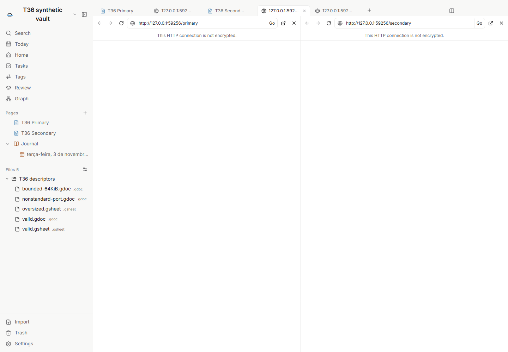

---

### 2.6. Workspace de até quatro painéis redimensionáveis e posicionamento de conteúdo (`T37`, `T38`)

#### Layouts de até quatro painéis redimensionáveis — [`T37` / `#89`](../../integration/1.3.0-fork-1.2.0.md)
- **Problema e comportamento:** organize o workspace em 1, 2, 3 ou 4 painéis simultâneos (`1 painel`, `2 colunas`, `1 à esquerda + 2 à direita`, `grade 2×2`), misturando notas, bancos de dados, imagens, PDFs, áudios/vídeos e abas web. As divisórias suportam arraste proporcional (`20%` a `80%`), ajuste por teclado (`Setas`), cancelamento por `Escape` e restauração central por `Home`.

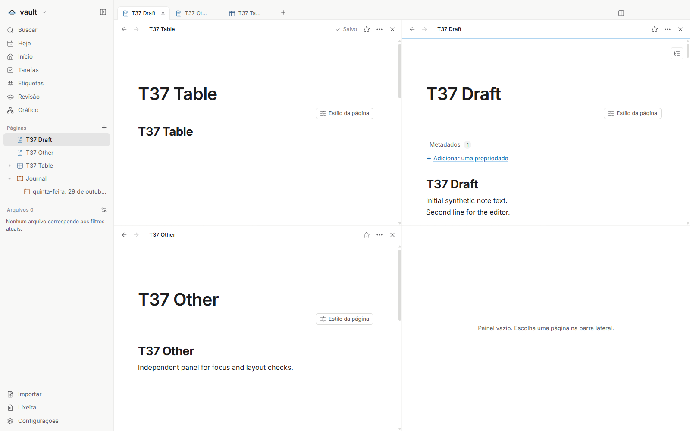

#### Seletor de abas em painel vazio, arraste para bordas e mesma nota em múltiplos painéis — [`T38` / `#90`](../../deliveries/T38-pane-content-placement.md)
- **Problema e comportamento:**
  - **Painel vazio interativo (`PaneEmptyChooser`):** qualquer slot de painel vazio exibe a lista pesquisável das abas abertas (com ícone de tipo, caminho/URL e indicação se já está visível em outro painel ou disponível em segundo plano), sem pré-seleção forçada, além de atalhos rápidos.
  - **Arraste para o centro ou bordas:** arraste abas, notas da árvore lateral ou arquivos do catálogo para o centro de um painel (para abrir nele) ou para suas bordas superior/inferior/esquerda/direita (para dividir o painel em até 4 painéis). Quando já existem 4 painéis visíveis, tentar criar um 5º painel exibe aviso visual e sonoro/acessível de limite atingido, sem descartar nada.
  - **Zero perda de abas:** substituir a aba exibida em um painel ou fechar um painel dividido preserva a aba anterior na lista global de abas disponíveis.
  - **Mesma nota em múltiplos painéis:** abra ou duplique a mesma nota em dois ou mais painéis simultâneos com rolagem e histórico de navegação independentes, compartilhando a mesma sessão de documento em memória para evitar conflitos de gravação.

---

## 3. Correções de comportamento no fork 1.2.0

Além das novas capacidades acima, o ciclo `1.2.0` corrigiu os seguintes comportamentos:

- **Abertura de cofre sem escritas indevidas (`0 writes on open`):** abrir um cofre existente com notas, bancos no formato 13, controles nomeados e arquivos binários não reescreve arquivos Markdown nem altera metadados YAML desconhecidos; a gravação ocorre exclusivamente após edição explícita do usuário ([`T12`](../../deliveries/T12-compact-table-footer.md), [`T14`](../../deliveries/T14-document-integrity.md), [`T30`](../../deliveries/T30-integrated-acceptance.md), [`T39`](../../deliveries/T39-extended-acceptance.md)).
- **Alinhamento do cursor no editor de fórmulas sob zoom (`T08`):** corrigida a diferença de `padding` lateral (`8 px` vs `10 px`) que deslocava o cursor em relação ao texto destacado a `125%` e `150%`.
- **Posicionamento de popovers e prévia de preenchimento próximos às bordas (`T07`–`T11`):** `Popover.tsx` passou a ajustar também o eixo cruzado (`crossAxis: true`), evitando corte de painéis altos em janelas de `600 px` de altura e mantendo o card de prévia de preenchimento dentro da tela mesmo na última coluna à direita.
- **Precedência por atributo em formatação condicional (`T09`):** regras condicionais sobrepostas agora combinam atributos independentes (ex.: fundo de uma regra e cor de texto/negrito de outra) em vez de descartar atributos não especificados pela regra seguinte.
- **Preservação de query e fragmento em links Markdown internos (`Integração 1.3.0`):** mover, renomear ou reabrir páginas preserva sufixos `?query` e `#secao` nos links internos.
- **Proteção de gestos internos contra arraste acidental de painel (`T38`):** selecionar texto no editor ProseMirror, arrastar células na grade, interagir com zoom de imagem, buscar na barra de vídeo/áudio ou rolar PDFs nunca dispara acidentalmente o arraste de aba/painel (`shouldIgnorePaneContentDragStart`).
- **Isolamento de segurança para recursos locais e web (`T33`–`T36`, `T39`):** bloqueio de `directory traversal` (`../`), validação de remetente (`sender`) nos protocolos `morrow-asset://` e `morrow-media://`, expurgo de credenciais em URLs e bloqueio de esquemas locais em abas web.

---

## 4. Guia cumulativo dos recursos do fork (1.0.0 → 1.2.0)

Esta seção cumpre a exigência da [política de releases](../../RELEASE-POLICY.md) de apresentar, após a conclusão de todos os grupos do Aumento de Escopo 2, o **inventário consolidado das capacidades do fork desde o início do projeto**, separado das novidades específicas desta versão listadas na Seção 2.

### 4.1. Edição e aparência de páginas

| Capacidade | Origem | Desde a versão | Disponibilidade atual | Demonstração e referência |
| :--- | :--- | :--- | :--- | :--- |
| Armazenamento local em arquivos Markdown, wiki links, callouts, matemática KaTeX, diagramas Mermaid, Canvas e grafo | Base oficial (`Aarav2709/Morrow`) | Base `1.2.0` / `1.2.1` | Disponível e verificado | [README](../../../README.md) |
| Arquivamento de páginas (`archivedAt`), abas fixadas, paleta de nova aba e preferência de ortografia | Base oficial (`1.3.0`) + reconciliação do fork | Base `1.3.0` / Fork `1.2.0` | Disponível e verificado | [Integração 1.3.0](../../integration/1.3.0-fork-1.2.0.md) |
| Estilo por página (largura da página, espaçamento e tipografia por nota) | Adição do fork | Fork `1.0.0` | Disponível e verificado | [Notas 1.1.1](../1.1.1/NOTES.md) |
| Fundos personalizados de bloco com paleta e código HEX | Adição do fork | Fork `1.1.0` / `1.1.1` | Disponível e verificado | [Notas 1.1.1](../1.1.1/NOTES.md) |
| Títulos com cor padrão do tema e personalização opcional por título | Evolução do fork | Fork `1.2.0` (`T17`) | Disponível e verificado | [Integração 1.3.0](../../integration/1.3.0-fork-1.2.0.md) |
| Seções e títulos recolhíveis reversíveis (`
`) sem perda de conteúdo | Adição e evolução do fork | Fork `1.1.0` → `1.2.0` (`T15`) | Disponível e verificado | [Captura `reversible-headings-narrow.png`](../../integration/assets/1.3.0-fork-1.2.0/reversible-headings-narrow.png) |
| Composição em até 7 colunas de página com larguras livres persistentes, remoção segura e inserção entre blocos | Adição e evolução do fork | Fork `1.0.0` → `1.1.0` → `1.2.0` (`T19`, `T20`) | Disponível e verificado | [T20](../../deliveries/T20-layout-columns.md) · [Captura](../../deliveries/assets/T20/paragraph-between-blocks.png) |
| Controles de imagem: recorte, substituição, alinhamento, legenda e largura individual (`1%`–`100%`) por alça ou teclado | Adição e evolução do fork | Fork `1.1.0` → `1.2.0` (`T18`) | Disponível e verificado | [T18](../../deliveries/T18-image-sizing.md) · [Captura](../../deliveries/assets/T18/independent-widths.png) |
| Preservação de tabelas e bancos em conversões de blocos adjacentes | Evolução do fork | Fork `1.2.0` (`T14`) | Disponível e verificado | [T14](../../deliveries/T14-document-integrity.md) · [Captura](../../assets/T14/conversion.png) |
| Exportação em PDF sem controles flutuantes de interface (`Estilo da página` oculto na folha impressa) | Evolução do fork | Fork `1.0.1` / `1.1.1` | Disponível e verificado | [Notas 1.1.1](../1.1.1/NOTES.md) |

### 4.2. Tabelas, visualizações e operações de linha

| Capacidade | Origem | Desde a versão | Disponibilidade atual | Demonstração e referência |
| :--- | :--- | :--- | :--- | :--- |
| Visualizações em tabela, quadro, calendário, lista e galeria com propriedades em frontmatter | Base oficial + evolução do fork | Base `1.2.0` / Fork `1.0.0` | Disponível e verificado | [README](../../../README.md) |
| Visualizações vinculadas (`linked views`) com filtros, ordenação, título independente e ocultação limpa da origem | Adição e evolução do fork | Fork `1.0.0` → `1.1.1` → `1.2.0` (`T13`) | Disponível e verificado | [T13](../../deliveries/T13-view-titles.md) · [Captura](../../deliveries/assets/T13/independent-views.png) |
| Barra compacta de visualizações com busca, chips de filtros rápidos e menu **Opções** | Adição e evolução do fork | Fork `1.1.0` → `1.2.0` (`T11`) | Disponível e verificado | [Integração 1.3.0](../../integration/1.3.0-fork-1.2.0.md) |
| Reordenação de colunas por arraste ou teclado isolada por visualização | Adição do fork | Fork `1.2.0` (`T04`) | Disponível e verificado | [T04](../../deliveries/T04-view-column-order.md) · [Captura](../../deliveries/assets/T04/column-drop-target.png) |
| Rodapé discreto com ação `+ Novo` antes dos cálculos por coluna/visualização | Adição e evolução do fork | Fork `1.1.0` → `1.2.0` (`T12`) | Disponível e verificado | [T12](../../deliveries/T12-compact-table-footer.md) · [Captura](../../deliveries/assets/T12/compact-footer-pt-dark.png) |
| Digitação imediata em células, navegação por teclado, seleção de intervalos sem arrastar a view e alça de preenchimento com prévia | Adição e evolução do fork | Fork `1.1.0` → `1.2.0` (`T02`, `T06`, `T07`) | Disponível e verificado | [T07](../../deliveries/T07-readable-property-panels.md) · [Captura](../../deliveries/assets/T07/fill-preview-pt-dark.png) |
| Copiar e colar intervalos de células pelo clipboard nativo do desktop preservando tipos | Adição e evolução do fork | Fork `1.1.0` → `1.2.0` (`T01`) | Disponível e verificado | [Integração 1.3.0](../../integration/1.3.0-fork-1.2.0.md) |
| Seleção aditiva de linhas por checkbox na margem, menu compacto `⋯` e transferência entre bancos com mapeamento de campos | Adição e evolução do fork | Fork `1.1.0` → `1.1.1` → `1.2.0` (`T05`) | Disponível e verificado | [T05](../../deliveries/T05-additive-row-selection.md) · [Captura](../../deliveries/assets/T05/selection-menu-pt-dark.png) |
| Histórico limitado de dados por banco (10 passos / 32 MiB) e histórico contextual por visualização (10 passos) | Adição do fork | Fork `1.2.0` (`T21`, `T22`) | Disponível e verificado | [T21](../../deliveries/T21-data-history.md) · [T22](../../deliveries/T22-view-history.md) |

### 4.3. Tipos de coluna, propriedades e formatação

| Capacidade | Origem | Desde a versão | Disponibilidade atual | Demonstração e referência |
| :--- | :--- | :--- | :--- | :--- |
| Tipos expandidos: moeda, percentual, slider, progresso, escala, e-mail, telefone, hora, data/hora, duração, criado/editado em, imagem, arquivo e Canvas rico | Adição do fork | Fork `1.0.0` / `1.1.0` | Disponível e verificado | [Notas 1.1.1](../1.1.1/NOTES.md) |
| Criação manual com confirmação explícita (**Adicionar**), busca de tipos/moedas/fusos por nome ou código e ícones Lucide ou enviados | Adição e evolução do fork | Fork `1.1.0` → `1.1.1` → `1.2.0` (`T07`) | Disponível e verificado | [T07](../../deliveries/T07-readable-property-panels.md) · [Captura](../../deliveries/assets/T07/manual-property-settings.png) |
| Rótulo personalizado para `Nome` (`titleAlias`) e escolha/restauração da propriedade de exibição (`displayPropertyId`) no formato 13 | Adição e evolução do fork | Fork `1.0.0` → `1.2.0` (`T03`) | Disponível e verificado | [T03](../../deliveries/T03-name-display-property.md) · [SCHEMA-13](../../SCHEMA-13.md) |
| Valores iniciais literais, por fórmula ou sequenciais, descrições de coluna e duplicação com ou sem valores | Adição do fork | Fork `1.0.0` | Disponível e verificado | [Notas 1.1.1](../1.1.1/NOTES.md) |
| Regras de formatação condicional por célula ou linha inteira em cartões recolhíveis com combinação de atributos e contraste automático | Adição e evolução do fork | Fork `1.1.0` → `1.2.0` (`T09`, `T10`) | Disponível e verificado | [Integração 1.3.0](../../integration/1.3.0-fork-1.2.0.md) |

### 4.4. Relações, controles de página e fórmulas

| Capacidade | Origem | Desde a versão | Disponibilidade atual | Demonstração e referência |
| :--- | :--- | :--- | :--- | :--- |
| Relações direcionadas e relações inversas atômicas entre bancos de dados | Adição e evolução do fork | Fork `1.0.0` → `1.1.1` | Disponível e verificado | [GIF Relação Inversa](../1.1.1/assets/data-01-relacao-inversa.gif) |
| Linguagem de fórmulas (`thisRow`, projeção de relações, `Filter`, `Sum`, `IfError`, datas, listas) com formato de saída | Adição do fork | Fork `1.0.0` → `1.1.0` | Disponível e verificado | [Notas 1.1.1](../1.1.1/NOTES.md) |
| Editor de fórmulas com realce de cores, autocomplete, diagnósticos e alinhamento de cursor em `100%`/`125%`/`150%` | Adição e evolução do fork | Fork `1.0.0` → `1.1.0` → `1.2.0` (`T08`) | Disponível e verificado | [Integração 1.3.0](../../integration/1.3.0-fork-1.2.0.md) |
| 11 controles nomeados na página (`text`, `number`, `slider`, `select`, `checkbox`, `date`, `relation`, `multiSelect`, `scale`, `progress`, `dateRange`) | Adição e evolução do fork | Fork `1.2.0` (`T23`–`T26`) | Disponível e verificado | [T23](../../deliveries/T23-existing-controls.md)–[T26](../../deliveries/T26-date-range-controls.md) |
| Resultados de fórmula inline no parágrafo (`/formula`), rede de referências nomeadas entre páginas e preferência de fundo por nota | Adição do fork | Fork `1.2.0` (`T27`–`T29`) | Disponível e verificado | [T27](../../deliveries/T27-inline-formula-results.md)–[T29](../../deliveries/T29-formula-background.md) |

### 4.5. Navegação, arquivos, mídia, web e painéis

| Capacidade | Origem | Desde a versão | Disponibilidade atual | Demonstração e referência |
| :--- | :--- | :--- | :--- | :--- |
| Navegação por títulos e restauração isolada de posição de leitura por cofre, aba e painel | Base oficial + evolução do fork | Base `1.3.0` / Fork `1.2.0` (`T16`) | Disponível e verificado | [Integração 1.3.0](../../integration/1.3.0-fork-1.2.0.md) |
| Catálogo de arquivos não-Markdown com filtros por extensão e escolha de método de abertura (Interno, Sistema ou Aplicativo) | Adição do fork | Fork `1.2.0` (`T31`, `T32`) | Disponível e verificado | [Integração 1.3.0](../../integration/1.3.0-fork-1.2.0.md) |
| Visualizadores internos em abas para imagens (`T33`), PDFs locais (`T34`) e áudio/vídeo com streaming Range (`T35`) | Adição do fork | Fork `1.2.0` (`T33`–`T35`) | Disponível e verificado | [T33](../../deliveries/T33-image-file-tabs.md), [T34](../../deliveries/T34-pdf-file-tabs.md), [T35](../../deliveries/T35-media-file-tabs.md) |
| Navegação de sites e `.gdoc`/`.gsheet` em abas web internas isoladas sem bridge local | Adição do fork | Fork `1.2.0` (`T36`) | Disponível e verificado | [T36](../../deliveries/T36-isolated-web-tabs.md) · [Captura](../../assets/T36/two-pane-toolbar.png) |
| Workspace de até 4 painéis redimensionáveis (`T37`), seletor em painel vazio, arraste com zonas de borda e mesma nota em múltiplos painéis (`T38`) | Adição do fork | Fork `1.2.0` (`T37`, `T38`) | Disponível e verificado | [T38](../../deliveries/T38-pane-content-placement.md) · [Captura 4 painéis](../../integration/assets/1.3.0-fork-1.2.0/four-panes-wide.png) |

---

## 5. Downloads, validação e limitações conhecidas

### 5.1. Pacotes disponíveis na release [`v1.3.0-fork.1.2.0`](https://github.com/hodeliun/Morrow/releases/tag/v1.3.0-fork.1.2.0)

- **Windows x64:**
  - Instalador NSIS: `Morrow-Setup-1.3.0-fork.1.2.0-x64.exe`
  - Executável portátil (arquivo único): `Morrow-1.3.0-fork.1.2.0-portable-x64.exe`
  - Pacote compactado: `Morrow-1.3.0-fork.1.2.0-win.zip`
- **Linux x64:**
  - Executável portátil AppImage: `Morrow-1.3.0-fork.1.2.0.AppImage`
  - Pacote Debian/Ubuntu: `Morrow-1.3.0-fork.1.2.0.deb`
- **Verificação e metadados:**
  - `SHA256SUMS.txt` — hashes SHA-256 de todos os pacotes publicados.
  - `VALIDATION.json` e `PACKAGED-SMOKE.json` — registros estruturados da validação integrada e do preflight do pacote empacotado.

Os pacotes não possuem assinatura digital de código (`code signing`); o Windows SmartScreen pode exibir aviso na primeira abertura.

### 5.2. Validação realizada

- **Gate completo (`npm run check`) e CI multiplataforma:** **1.262 testes aprovados em 159 arquivos de teste**, `typecheck` (`tsconfig.json` e `tsconfig.electron.json`), `eslint` com zero erros/avisos e builds completos de renderer, Electron e servidor MCP.
- **Aceitação integrada do escopo original ([`T30` / `#81`](../../deliveries/T30-integrated-acceptance.md) · [`T30-validation.json`](../../deliveries/T30-validation.json)):** cobriu os 30 itens `S2-01`..`S2-30`, abertura de cofre sintético com **0 escritas em disco**, round-trip de persistência preservando campos desconhecidos, medição real com banco sintético de **1.000 linhas** (avaliação de fórmula `0,60–2,73 ms`, regras condicionais em 1.000 células `43,82–56,46 ms`, filtro `1,51–5,76 ms`, ordenação `1,32–1,54 ms`, seleção aditiva `1,24–1,59 ms`, agregação de rodapé `1,77–2,23 ms`), histórico limitado de dados/views, modo `readonly`, temas claro/escuro e traduções PT/EN/ES.
- **Aceitação integrada estendida ([`T39` / `#91`](../../deliveries/T39-extended-acceptance.md) · [`T39-validation.json`](../../deliveries/T39-validation.json)):** cobriu os itens `S2-31`..`S2-37` integrados ao escopo anterior, 4 painéis simultâneos misturando nota, PDF, vídeo WebM e aba web, preservação exata de hashes SHA-256 de binários e Markdown com 0 escritas ao abrir, streaming `HTTP 206/416` por intervalos e bloqueios de segurança (`directory traversal`, remetentes não confiáveis e esquemas locais em abas web).
- **Preflight de pacote empacotado e aceite humano:** o pacote Windows (`win-unpacked/Morrow.exe`) passou no verificador `scripts/packaged-smoke-preflight.cjs` com leitor `@electron/asar` `3.4.1`, e o executável portátil foi testado e aprovado por Carlos antes da publicação desta release.

### 5.3. Limitações conhecidas

- **Registro de abertura recente (`recent.json`):** ao abrir intencionalmente um cofre, o arquivo auxiliar de cofres recentes atualiza seu timestamp (`mtime`); os arquivos Markdown e binários do cofre mantêm bytes, hashes e `mtime` inalterados.
- **AppImage em distribuições Linux com restrição de user namespaces:** em versões recentes do Ubuntu/kernel com restrição de AppArmor para namespaces não privilegiados, caso o sandbox do Chromium impeça a abertura direta do `.AppImage`, execute com `./Morrow-1.3.0-fork.1.2.0.AppImage --no-sandbox` ou instale o pacote `.deb`.
- **Desempenho em lote e escopo de histórico:** os tempos medidos com 1.000 linhas em memória não representam promessa de gravação instantânea em disco para colagens massivas. O histórico de 10 ações de dados e 10 ações por visualização vale durante a sessão ativa (até 32 MiB globais).
